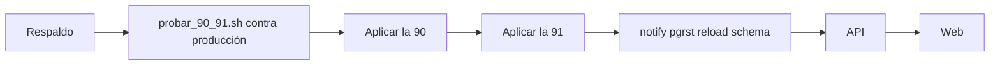

# Comentarios y me gusta en los perfiles: guía de implementación

## Estado

**Hecho y probado en local el 2026-11-09**, en `kyan/pruebas`. **Sin commit** y **sin aplicar en producción.** La web del perfil necesita la 90 y la 91 aplicadas y la API nueva: sin ellas, `GET /wall` da error. El encabezado sigue funcionando, pero sin votos, y la pestaña Comentarios dice que no se pudieron cargar.

## Archivos

| Archivo | Cambio |
|---|---|
| `supabase/replanteo/91_comentarios_y_votos_perfil.sql` y su inversa en `reversas/` | Tablas, funciones y avisos |
| `pruebas/probar_90_91.sh`, `pruebas/prueba_90_91.sql` | Pruebas de la 90 y la 91 juntas |
| `web/backend/src/routes/community.ts` | Las cinco rutas |
| `web/backend/test/unit/community.test.ts` | 6 pruebas nuevas |
| `web/frontend/src/api/schema.d.ts` | Regenerado. También trae rutas del anticheat que ya estaban en la API y faltaban acá |
| `web/frontend/src/features/player/components/ProfileWall.tsx` (nuevo) | El muro |
| `PlayerProfile.tsx`, `PlayerTabs.tsx`, `lib/search.ts` | Votos y pestaña |
| `PlayerProfile.test.tsx` | Votos, insignia y "Steam vinculado" |
| `features/shell/notifications/lib/model.ts` (+ prueba), `NotificationPrefsCard.tsx` | Avisos |
| `routes/demo.perfil-social.tsx` (nuevo) | La demo |
| `docs/frontend/contrato/notificaciones.md` | Los dos tipos |
| Manual: `jugador/comentarios-en-el-perfil.md` y `moderador/borrar-comentarios.md` (nuevas) | |
| Términos y privacidad (web y `terms/`) | |

## Despliegue (Daniel)

1. Respaldo de la base.
2. `docs/bitacora/2026-11-09-comentarios-perfil/pruebas/probar_90_91.sh "<conexión>"`. Corre en una transacción que se deshace. Todas las líneas tienen que dar `ok` y la última, `inversas iguales a antes: true`.
3. Aplicar la `90_jugadores_verificados.sql` y después la `91_comentarios_y_votos_perfil.sql`, desde el archivo commiteado, con `PGCLIENTENCODING=UTF8`. **La 90 tiene que estar antes que la API nueva:** la ficha del jugador lee `players.verified`, y sin la columna el perfil da error.
4. Desplegar la API y después la web.

No toca el matchmaking: no hace falta parar `cmleague-mm` ni que no haya salas.

## Pruebas

- **Base:** `probar_90_91.sh docker` en la base local, el 2026-11-09. 8 bloques en verde y las inversas dejan la estructura igual que antes:
  - un voto por cuenta y sacarlo;
  - comentar, borrar y el tope de 30 segundos y 30 por día;
  - cerrados;
  - sin sesión;
  - los avisos.
- **Detalles de la base local:**
  - No tiene `mm_player_photo` (replanteo 55) ni la categoría `friends` (replanteo 85).
  - El script los agrega solo dentro de la transacción si faltan; en producción ya están.
  - La base local está atrasada desde la 68: no se pudo aplicar la cadena entera.
- **API:** `community.test.ts`, 11 en verde, y las 569 de la API en verde.
- **Web:**
  - `PlayerProfile.test.tsx` y `model.test.ts`, en verde.
  - Las del perfil, el matchmaking, las notificaciones, Mi perfil y legales, también en verde.
- **En el navegador:** en `/demo/perfil-social` se probaron el voto, un comentario (aparece primero, con su papelera), la ficha de la insignia gris y dorada, y "Es mi perfil" y "Sin sesión".
- **No se probó:** la web real contra una base con la 91, porque la local no la tiene completa, ni el "Ver más" con más de 20 comentarios.

## En qué se apartó del plan

- Los mensajes de error de la base usan `P0001` y no `22023` o `54000`. La API convierte `22xxx` en un mensaje genérico y `54000` en `500`. Con `P0001` llega el mensaje de la base con un `400`.
- El chip "Verificado" del encabezado decía que la ficha tenía un SteamID. Ahora dice **Steam vinculado**, para no confundirse con la insignia nueva.
