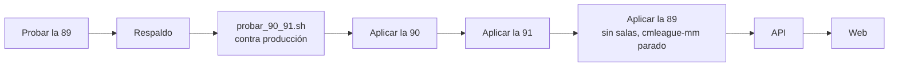

# Para Daniel: lo que se hizo el 2026-11-09 y lo que te toca

Hola Daniel. Este es el resumen de lo que trabajamos Kyan y Claude el 2026-11-09 en `kyan/pruebas`. Abajo están lo que falta para llevarlo a producción, ideas para sumarle y lo que sigue abierto de ayer.

Como también hacés lo de Esteban, van juntos el backend y el frontend.

## Qué se hizo

Todo está en el commit **`da8a65a`** de `kyan/pruebas`, ya subido. Son tres pedidos de Kyan:

| Pedido | Qué es | Replanteo | Bitácora |
|---|---|---|---|
| **Comentarios y me gusta en los perfiles** | 👍/👎 en el encabezado del perfil y una pestaña **Comentarios**. Avisos al dueño en la campana (categoría Amigos) | `91` | [`2026-11-09-comentarios-perfil`](.) |
| **Insignia de verificado** | Sello gris o dorado al lado del nick, con ficha al estilo FACEIT. La pone solo un admin, desde el perfil del jugador | `90` | [`2026-11-09-jugadores-verificados`](../2026-11-09-jugadores-verificados/) |
| **Autoaceptar partida (VIP)** | Interruptor en Jugar › Configuración. La base acepta por el VIP al armarse la sala | `89` | [`2026-11-09-autoaceptar-vip`](../2026-11-09-autoaceptar-vip/) |

Esta vez no es solo una demo: están la base, la API y la web reales. Para verlo sin la base nueva hay dos demos: `/demo/perfil-social` y `/demo/matchmaking` (Configuración).

**Estado de las pruebas:**

| Qué | Resultado |
|---|---|
| Replanteos 90 y 91 | `probar_90_91.sh docker`: 8 bloques en verde, y las inversas dejan la estructura igual que antes |
| Replanteo 89 | **Sin probar en una base** |
| API | 569 pruebas en verde |
| Web | 742 pruebas en verde |

La 89 quedó sin probar porque la base local está atrasada: no tiene la 59 y la cadena falla en la 68 (`team_rename`).

**No se tocó:**
- La base de producción.
- Los servidores y el plugin: no hay nada que subir a #1, #2 ni #3.

## Lo que te toca: llevarlo a producción

Ordenado por lo que hay que hacer primero.

1. **Probar la 89** en una base que tenga todo hasta la 88 (la tuya o una copia de producción), dentro de una transacción con `rollback`:
   - aplicar la 89;
   - con un VIP: `mm_set_auto_accept(true)`, armar una sala con él y ver que `accepted_at` sale lleno;
   - sin VIP: `mm_set_auto_accept(true)` tiene que fallar;
   - mirar `mm_my_state()->'auto_accept'`;
   - aplicar la inversa y comparar con `estructura.sql`.

   Cambia `mm_my_profile` con `pg_temp.reemplazar`, buscando la línea `'sounds', jsonb_build_object(`. Si la cambiaste después de la 85, revisá que siga igual.
2. **Respaldo** de la base.
3. **`probar_90_91.sh "<conexión>"` contra producción.** Es una transacción que se deshace. Todo tiene que dar `ok`, y la última línea, `inversas iguales a antes: true`.
4. **Aplicar la 90 y después la 91**, con `PGCLIENTENCODING=UTF8` y desde el archivo commiteado.
   > **Ojo:** la 90 tiene que estar antes que la API nueva. La ficha del jugador (`GET /players/{id}`) lee `players.verified`, y sin esa columna **todos los perfiles dan error**.
5. **Aplicar la 89** sin salas en curso ni nadie en la cola, y con `cmleague-mm` parado: el trigger corre dentro de `mm_tick`.
6. `notify pgrst, 'reload schema'`, después **la API** y después **la web**.
7. **Ramas:** la 89 y `mm.ts` son del matchmaking, así que van también en `feat/frontend-fase-1` y `feat/mm-claim-en-sala`. La web va solo en `feat/frontend-fase-1`. La 90, la 91 y el resto, decidís vos. Kyan no lo pasó a esas ramas.
8. **Avisar en el Discord** con los tres `CHANGELOG_DISCORD.txt` (versión 2.9.28): uno en esta carpeta y los otros dos en las de verificados y autoaceptar.

La web aguanta que falte la 89: sin `auto_accept` en el estado, no muestra el interruptor y la ventana de aceptar funciona como siempre. Lo que **no** aguanta es la API nueva sin la 90.

## Lo que falta o conviene sumar

### Backend

1. **Filtro de palabras en los comentarios.** Hoy un comentario solo se limita por largo y por tope. Habría que pasarlo por el mismo filtro del chat de la sala o por las palabras bloqueadas de Administración.
2. **Denunciar un comentario.** Hoy un moderador solo borra lo que ve. Se podría sumar `POST /profile-comments/{id}/report` y una lista en Administración, o meterlo en la denuncia fuera de la sala que quedó pendiente ayer (punto 10 de abajo).
3. **Baneados y bloqueados.** Hoy un baneado puede comentar y votar, y alguien que el dueño bloqueó en el matchmaking (`mm_blocks`) también. Sugerencia: que `profile_comment_add` y `profile_vote` rechacen al que tenga un baneo activo (`activeBan`), y quizás también al bloqueado por el dueño.
4. **La insignia en las listas.** Hoy el sello sale solo en el perfil y en los comentarios. Para el ranking, el buscador, amigos y la sala del matchmaking falta mandar `verified` en `PlayerSummary` y en la ficha del jugador del matchmaking (`mm_player_card`).
5. **Administración › Jugadores:** un filtro "Verificados" y el sello en la lista. Hoy la insignia solo se ve y se cambia desde el perfil público.
6. **`pnpm db:types`** con la 90 aplicada. En `src/db/types.ts` se agregaron a mano las cuatro columnas de `players`, igual a lo que genera el comando.

### Frontend (lo que era de Esteban)

1. **Probar contra la API real** con la 90 y la 91 aplicadas. No se pudo, porque la base local no las tiene completas:
   - votar, comentar, borrar y cerrar los comentarios;
   - **Ver más**, con más de 20 comentarios;
   - el diálogo **Verificar** del admin.
2. **El sello en las listas** (punto 4 del backend): `VerifiedSeal` de `components/brand/VerifiedBadge.tsx` ya está listo para usar.
3. **"Saber más"** de la insignia lleva a `/help/jugador/cuentas-verificadas`, que solo existe con sesión. Si alguien sin sesión lo toca, cae en el aviso de "iniciá sesión". Decidir si se deja así o si el link se oculta sin sesión.
4. **El autoaceptar en una sala real:** con un VIP, ver que la ventana dice "Aceptada sola" y que pasa al veto cuando aceptan los demás.

## Lo que sigue abierto de ayer (2026-11-08)

Detalle en [`2026-11-08-pcw-demo/PARA_DANIEL.md`](../2026-11-08-pcw-demo/PARA_DANIEL.md) y en la guía de servidores.

**PCW, backend:**
1. Aplicar el **replanteo 88** (las PCW no dan ELO) en producción.
2. **Publicar solo con VIP:** `create_pcw_post` tiene que rechazar sin VIP, con un código propio.
3. **Ofertas** (`pcw_offers`) en lugar de aceptar el primero.
4. Equipo sin roster.
5. Mapas fijos sin veto.
6. El veto tiene que decir si el turno es ban o pick.
7. Avisos de PCW en `notify()`.
8. El ranking del equipo en el tablón.
9. Chat del grupo en Jugar.
10. Denunciar fuera de la sala.

**PCW, frontend:**
- Pasar `features/pcw` a la página real `/pcw` con la API.
- Usar la sala real.
- Sacar el "Pronto" del menú.
- Administración › PCW.

**Servidores #2 y #3:**
- Darlos de alta en Administración › Servidores: el token y el HUD van al `.env`.
- Pedirle a MVZG que saque `-nohltv` y suba el tickrate a 100.
- Agregar al Worker de demos `PTERO_KEY_cd1be322` y `PTERO_KEY_16c850ff`, y borrar `PTERO_KEY_f337a7d9` (flow).
- Un mix de prueba en cada uno antes de abrirlos al matchmaking.

## Dónde está cada cosa

| Qué | Dónde |
|---|---|
| Replanteos | `supabase/replanteo/89_mm_autoaceptar_vip.sql`, `90_jugadores_verificados.sql` y `91_comentarios_y_votos_perfil.sql`, con sus inversas en `docs/bitacora/2026-10-14-replanteo-modelo-datos/reversas/` |
| Pruebas SQL | `pruebas/probar_90_91.sh` y `prueba_90_91.sql`, en esta carpeta |
| API | `web/backend/src/routes/community.ts` (muro), `admin-players.ts` (insignia), `players.ts` (ficha) y `mm.ts` (autoaceptar) |
| Muro del perfil | `web/frontend/src/features/player/components/ProfileWall.tsx` |
| Insignia | `web/frontend/src/components/brand/VerifiedBadge.tsx` y `features/player/components/VerifyDialog.tsx` |
| Autoaceptar | `web/frontend/src/features/matchmaking/SoundSettings.tsx` (Configuración) y `AcceptDialog.tsx` |
| Avisos | `web/frontend/src/features/shell/notifications/lib/model.ts` y `docs/frontend/contrato/notificaciones.md` |
| Manual | `docs/manual/jugador/comentarios-en-el-perfil.md`, `cuentas-verificadas.md`, `buscar-partida.md`; `moderador/borrar-comentarios.md`; `admin/usuarios-y-fichas.md` |
| Pendientes | `docs/PENDIENTES.md`, sección del 2026-11-09 |
