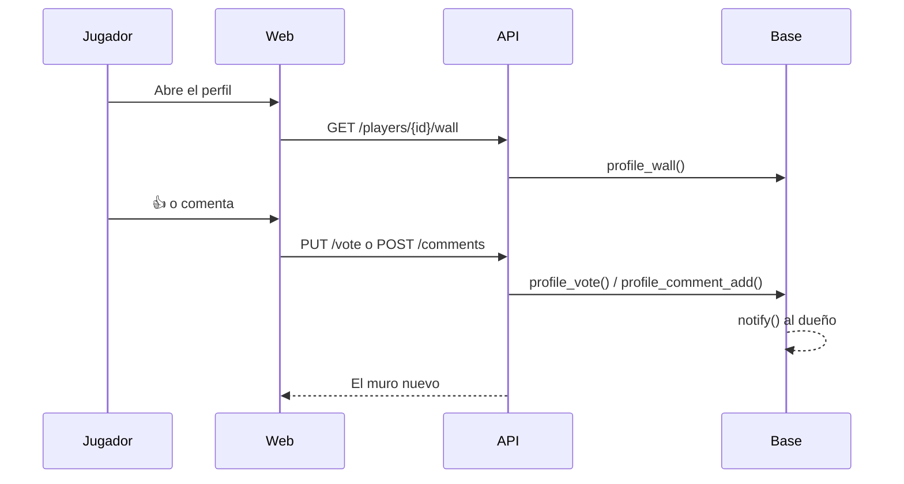

# Plan: comentarios y me gusta / no me gusta en los perfiles

> Planeación original (Kyan, 2026-11-09). Estado: **aprobada** en el mismo pedido ("que se puedan dejar comentarios y likes/dislikes en los perfiles"; "conectados a las notificaciones").

## Decisiones tomadas

| Tema | Decisión | Por qué |
|---|---|---|
| Quién vota y comenta | Con sesión y ficha de jugador. No se vota el perfil propio; sí se comenta, para responder | Igual que las visitas (replanteo 86): una cuenta sin ficha no es un jugador |
| Votos | Uno por cuenta y perfil, `+1` o `-1`; se cambia o se saca | Lo mínimo para que un número no se infle |
| Quién votó | No se publica: solo los números | Evita peleas y represalias por un "no me gusta" |
| Comentarios | Hasta 280 caracteres, sin respuestas anidadas | Un muro simple, como el Guestbook de FACEIT |
| Tope | 30 segundos entre comentarios y 30 por día por cuenta | Frena el spam sin molestar al que comenta normal |
| Borrar | El autor, el dueño del perfil y moderadores o admins. Borrado lógico (`deleted_at`, `deleted_by`) | Si hay acoso, la evidencia queda |
| Cerrar | El dueño cierra los comentarios de su perfil (`user_preferences.profile_comments`). Cerrados no se ven ni se dejan; los votos siguen | Control del dueño sobre su perfil |
| Lectura | El muro se lee sin sesión | El perfil es público |
| Avisos | `profile_comment` por cada comentario de otro; `profile_like` la primera vez que cada cuenta da me gusta; el no me gusta no avisa. En la categoría `friends` (Amigos) | Sin categoría nueva ni otro interruptor; un no me gusta avisado sirve para molestar |
| Dónde se ve | Los votos, arriba a la derecha del encabezado del perfil; los comentarios, en una pestaña nueva **Comentarios** | Como FACEIT: el número a la vista y el muro aparte |

## 1. El flujo completo

## 2. Base (replanteo 91)

- Tablas `profile_votes` y `profile_comments`, sin acceso directo.
- Funciones `profile_wall`, `profile_vote`, `profile_comment_add`, `profile_comment_delete` y `profile_comments_set`.
- `notification_category` suma los dos tipos nuevos a `friends`.
- Va después de la 90, porque el muro muestra la insignia del autor.

## 3. API

| Ruta | Qué hace |
|---|---|
| `GET /api/v1/players/{id}/wall?before=` | El muro (`optionalUser`) |
| `PUT /api/v1/players/{id}/vote` | `{ value: 1 \| -1 \| 0 }` |
| `POST /api/v1/players/{id}/comments` | `{ body }` |
| `DELETE /api/v1/profile-comments/{id}` | Borra |
| `PUT /api/v1/me/profile-comments` | `{ open }` |

## 4. Web

- `ProfileWall.tsx` con `WallVotes`, `WallComments` y sus versiones con la API.
- Los votos en `PlayerHeader` y la pestaña `comentarios`.
- Los avisos en la campana y la demo `/demo/perfil-social`.

## 5. Requisitos antes de empezar

Ninguno: se prueba en la base local con `probar_90_91.sh docker`.

## 6. Orden de implementación

1. Migración, inversa y pruebas SQL.
2. Rutas y pruebas de la API.
3. Tipos de la web, componentes, pestaña y demo.
4. Notificaciones.
5. Manual, términos y privacidad.
