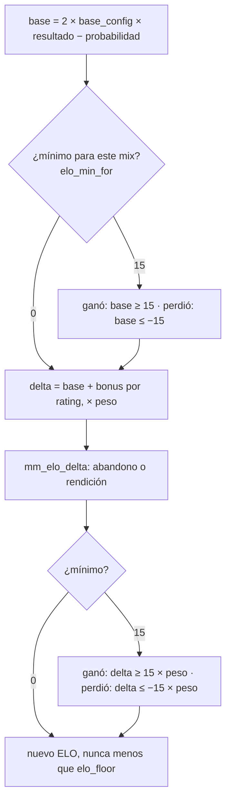

# Mínimo de 15 de ELO por partida terminada: documentación

## Qué hace

Un mix **terminado** mueve al menos **15** de ELO: el que gana suma 15 o más y el que pierde resta 15 o más. El cálculo de TrueSkill sigue igual (la probabilidad de ganar sale de `mu` y `sigma`, que no se reinician con la temporada); el mínimo se aplica a la parte base y el bonus por rating se suma encima, sin bajar nunca de 15.

Lo pidió Daniel el 2026-11-09, después de un mix del matchmaking (#2, `de_mirage_rc1`, 8-16) en el que el equipo ganador tenía un 90,7 % de probabilidad: dio entre +2 y +8 y quitó entre −4 y −8. Con la regla, ese mix da de +15 a +19 y de −15 a −19.

## Cuándo vale

`elo_min_for(p_match)` devuelve `elo_config.min_delta` (15) si se cumple todo esto, y 0 si no:

| Condición | Por qué |
|---|---|
| `kind = 'mix'` y `status = 'finished'` | Solo los mixes terminados |
| `end_reason` distinto de `'crash'` | Los mixes interrumpidos que aplica un admin (`elo_crash_apply`) siguen con las reglas de antes |
| `winner_side` 1 o 2 | Sin mínimo en los empates (tampoco para el que abandona un empate) |
| `played_at` (o `starts_at`) desde `elo_config.min_delta_from` | Desde el inicio de la Temporada 2 (2026-11-09 09:00:05 UTC). La BETA no cambia aunque se recalcule |
| `min_delta > 0` | 0 apaga la regla |

## Casos

| Caso | Resultado |
|---|---|
| Ganó jugando todo | `max(round((max(base, 15) + bonus) × 1), 15)`: 15 o más |
| Perdió jugando todo | `min(round((min(base, −15) + bonus) × 1), −15)`: −15 o menos |
| Jugó una parte (peso entre 0 y 1) | El mínimo también va por su peso: con el 50 %, 8 |
| Abandonó | Cuenta como peso 1: pierde al menos 15. Con `abandon_win_min/max` en 10 a 15 (hoy), el que abandona con el equipo ganador pierde siempre 15 |
| Rendición (`!gg`) con un abandono | `abandon_gg_pct` reduce la derrota, pero no por debajo de 15 |
| Llegó al piso de ELO (`elo_floor`, 100) | Sigue sin bajar de 100 |
| Mix interrumpido aplicado, empate, mix anterior a `min_delta_from` | Como antes: al menos 1 |

`mu` y `sigma` no cambian: el mínimo toca solo el ELO visible.

## Base de datos (replanteo `98_elo_minimo.sql`)

- `elo_config.min_delta` (`integer`, 0 a 100, 15 por defecto) y `min_delta_from` (`timestamptz`; se llena con el inicio de la Temporada 2).
- `elo_min_for(uuid)`: el mínimo de un mix (sin acceso para `anon` ni `authenticated`).
- `elo_apply_match`, `elo_recompute_player` y `mm_elo_stake` cambian con reemplazos de texto sobre su definición (`pg_get_functiondef`), marcados con `(replanteo 98)`. Si algún fragmento no está, la migración aborta.
- `mm_elo_stake` ("En juego" en la sala): `win` y `loss` nunca menos que `min_delta` (sin el bonus, como antes).
- `elo_set_config` no cambió: `min_delta` se cambia solo por SQL. La pestaña Reglas del ELO no lo muestra.
- Inversa: `docs/bitacora/2026-10-14-replanteo-modelo-datos/reversas/98_elo_minimo.sql` (y después `elo_recompute_all()`).

## Qué cambia para cada rol

| Rol | Qué cambia | Página del manual |
|---|---|---|
| Jugador | Cada mix terminado suma o resta al menos 15; "En juego" en la sala muestra al menos +15 / −15 | `jugador/elo-y-estadisticas.md` |
| Admin | La regla en Reglas del ELO (no editable desde la web) y el aviso antes de cerrar un mix sin señal | `admin/elo-y-mixes.md` |
| Capitán, organizador, moderador, streamer, dueño de un servidor externo | Nada | — |

## Términos y privacidad

Sin cambios: no hay datos nuevos, servicios, plazos, sanciones ni pagos.

## Dónde está cada cosa

| Qué | Dónde |
|---|---|
| Migración | `supabase/replanteo/98_elo_minimo.sql` |
| Inversa | `docs/bitacora/2026-10-14-replanteo-modelo-datos/reversas/98_elo_minimo.sql` |
| Pruebas (base local, con rollback) | `pruebas/probar_98.sh` y `pruebas/probar_98.sql` |
| Manual | `docs/manual/jugador/elo-y-estadisticas.md`, `docs/manual/admin/elo-y-mixes.md` |
| Changelog | `CHANGELOG_DISCORD.txt` (2.9.30) |
