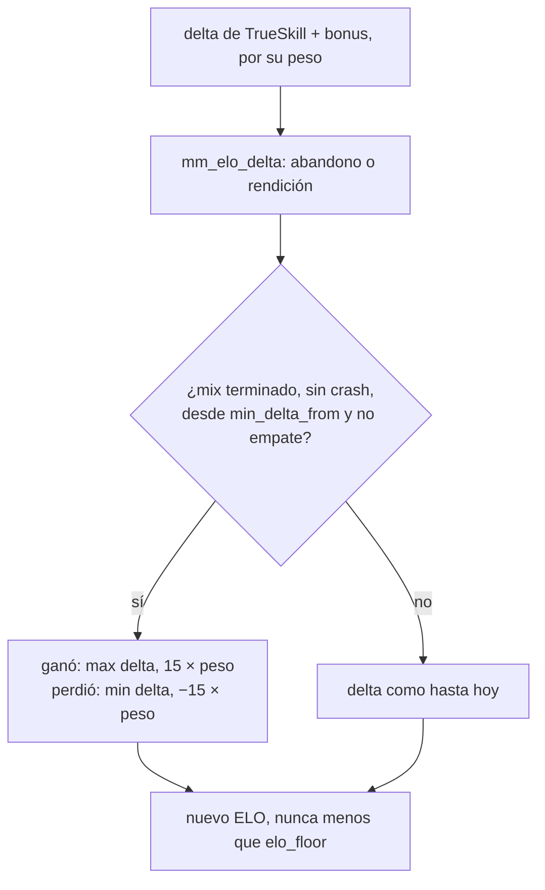

# Plan: mínimo de 15 de ELO por partida terminada

> Planeación original. Estado: **aprobada** por Daniel el 2026-11-09, con la opción (b) del bonus.

Pedido por Daniel el 2026-11-09, después de un mix del matchmaking (#2, `de_mirage_rc1`, 8-16) que dio entre +2 y +8 y quitó entre −4 y −8. El cálculo de TrueSkill queda como está: el equipo ganador tenía un 90,7 % de probabilidad, porque `mu` y `sigma` no se reinician con la temporada. Daniel decidió dejarlo así y sumar un piso.

## La regla

En un mix **terminado** (`status = 'finished'`, sin `end_reason = 'crash'`), el que gana suma al menos **15** y el que pierde resta al menos **15**. Las partidas canceladas, incluidos los mixes interrumpidos que aprueba un admin (`elo_crash_apply`, `end_reason = 'crash'`), siguen con las reglas de hoy.

## Decisiones tomadas

| Tema | Decisión | Por qué |
|---|---|---|
| Dónde | Al final del cálculo de cada jugador en `elo_apply_match`, después de `mm_elo_delta` (abandonos, rendición) | Es el único lugar por el que pasa todo ELO de un mix, en vivo y en los recálculos |
| El bonus por rating | **A decidir.** (a) Piso al total: `max(delta, 15)`, y en un partido muy desparejo todos los ganadores suman 15 y el bonus no se nota. (b) Piso a la parte base y después el bonus, sin bajar nunca de 15: el que jugó bien gana más que 15 y el que perdió jugando mal pierde más que 15 | En el mix del 2026-11-09, con (a): +15 y −15 para todos. Con (b): daniloev +19, roman +18, kyan +17, nokushima y tam +15; yupi −19, Slave −17, Lesco −16, Nmz1 y rbkkk −15 |
| Valor | `elo_config.min_delta` (15; 0 la apaga), editable como la base | Kyan ya ajusta `base` desde la web; el piso va junto |
| Desde cuándo | `elo_config.min_delta_from` = inicio de la Temporada 2 (2026-11-09 09:00:05 UTC). Los mixes anteriores no cambian aunque se recalcule | No reescribe la historia de la BETA (que además ya se reinició a 1000) y alcanza a los mixes de hoy |
| Jugó solo una parte | El piso se multiplica por su peso (`elo_weight`): con el 100 % de las rondas, 15; con el 50 %, 8 | Hoy todo el ELO de quien entra tarde o se va antes ya va en proporción a lo que jugó. El que abandona cuenta como peso 1, como hasta ahora |
| Empate | Sin piso | No hay ganador ni perdedor |
| Abandono | También tiene piso (pierde al menos 15, aunque gane su equipo) | Hoy pierde de 10 a 15 si gana su equipo: el piso lo deja en 15 |
| Piso del ELO | `elo_floor` (100) sigue mandando: nadie baja de 100 | Ya era así |
| Al aplicarla | `elo_recompute_all()` una vez (tarda unos 3 s) | Los mixes de la Temporada 2 ya jugados reciben el piso |

## 1. El cálculo

`mu` y `sigma` no cambian: el piso toca solo el ELO visible.

## 2. Cambios en la base (replanteo `98_elo_minimo.sql`)

- `elo_config.min_delta integer not null default 15` (0 a 100) y `min_delta_from timestamptz`.
- `elo_apply_match`: el piso en el bucle de jugadores.
- La función que guarda la configuración del ELO desde Administración suma los dos campos (si se quiere editarlos desde la web; si no, solo por SQL).
- `manual_valores()` con `elo.minimo`, si el manual lo nombra.
- Inversa: quita el piso y las columnas, y vuelve a recalcular.

## 3. Web y manual

- Administración › ELO: el campo "Mínimo por partida" (opcional en esta tanda).
- Manual: la página del jugador que explica el ELO suma la regla.
- Términos y privacidad: sin cambios (no hay datos nuevos ni sanciones nuevas).

## 4. Orden

1. Aprobación de Daniel de este plan.
2. Replanteo `98` y prueba en la base local (mix ganado por favorito, perdido, parcial, abandono, empate, crash y un mix anterior a `min_delta_from`).
3. Aplicar en producción, `notify pgrst`, `elo_recompute_all()`.
4. Comprobar el mix `ea84eb1a` con los valores de la opción elegida (ver "El bonus por rating").
5. Documentación, manual y commit en `main` (y copia en las dos ramas del matchmaking) cuando Daniel lo pida.
