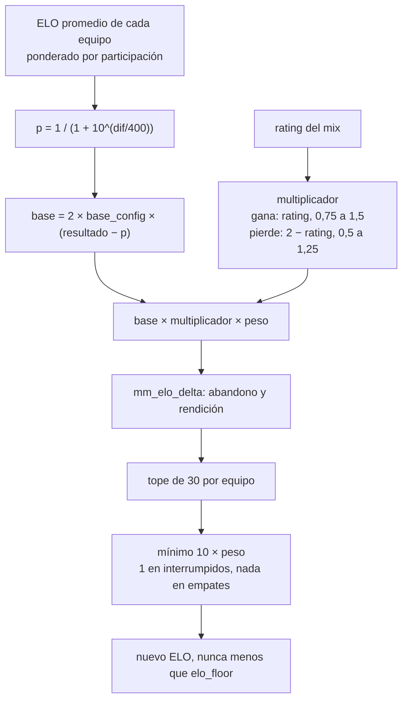

# El ELO se gana en la partida que jugaste: documentación

## Qué hace

Desde la Temporada 2, lo que un jugador gana o pierde en un mix sale de **esa partida**: qué equipo era favorito según su **ELO visible promedio** y el **rating de ese mix** de cada uno. El nivel general (ELO + rating reciente + ajuste manual) solo arma los equipos del matchmaking. TrueSkill (`mu`, `sigma`) se sigue actualizando, pero ya no decide nada.

Lo propuso Kyan (artifact "ELO por partida", 2026-11-09) y lo aprobó Daniel. Reemplaza la fórmula de [`2026-10-11-elo-jugadores`](../2026-10-11-elo-jugadores/) (TrueSkill + bonus de ±5) y baja el mínimo de [`2026-11-09-elo-minimo-15`](../2026-11-09-elo-minimo-15/) de 15 a 10.

## Qué decide cada número

| Número | Para qué |
|---|---|
| ELO + rating reciente + ajuste manual (`mm_balance_elos`) | Armar los equipos del matchmaking. Sin cambios |
| ELO visible promedio de cada equipo | La probabilidad de ganar, o sea la base |
| Rating del mix (`csstv_rating`, HLTV 1.0) | El multiplicador de cada uno |

## La cuenta

1. **Probabilidad:** `p = 1 / (1 + 10^((ELO rival − ELO propio) / 400))`, con el ELO antes del mix, promediado con el peso de la participación (`elo_weight`; el que abandona cuenta 1; sin fila en `player_elo`, `start_elo`). Se redondea a 4 decimales y se guarda en `match_player_stats.win_prob`. Con 200 de diferencia, 76 %; con 400, 91 %.
2. **Base:** `2 × base × (resultado − p)`. Con `base` 20 (K 40): ±20 con equipos parejos.
3. **Multiplicador** (`elo_mult`): al ganar, el rating entre `mult_win_min` y `mult_win_max` (0,75 y 1,5); al perder, `2 − rating` entre `mult_loss_min` y `mult_loss_max` (0,5 y 1,25); empate, 1.
4. **Delta:** `base × multiplicador × peso`, y después `mm_elo_delta` (abandono y rendición, como antes; el que abandona tiene su valor fijo).
5. **Tope** (`elo_scale`): si en un equipo alguien (sin contar al que abandona) pasa de `team_cap` (30), todo el equipo se multiplica por `30 / máximo`.
6. **Mínimo:** `min_delta × peso` (10) en un mix terminado con ganador; ±1 en los interrumpidos (`end_reason = 'crash'`); nada en los empates.
7. Nadie baja de `elo_floor`.

### Ejemplo: el mirage del 2026-11-09 (todos en 1000)

| Ganadores | Rating | Antes (`98`) | Ahora | Perdedores | Rating | Antes | Ahora |
|---|---|---|---|---|---|---|---|
| daniloev | 1.82 | +19 | **+30** | yupi | 0.17 | −19 | **−25** |
| roman | 1.63 | +18 | +30 | Slave | 0.67 | −17 | −25 |
| kyan | 1.48 | +17 | +30 | Lesco | 0.85 | −16 | −23 |
| nokushima | 0.71 | +15 | +15 | rbkkk | 0.98 | −15 | −20 |
| tam | 0.65 | +15 | +15 | Nmz1 | 1.09 | −15 | −18 |

## Base de datos (replanteo `100_elo_por_partida.sql`)

- `elo_config`: `mult_win_min`, `mult_win_max`, `mult_loss_min`, `mult_loss_max`, `team_cap`, `formula_from` (inicio de la Temporada 2); `base` en 20 y `min_delta` en 10.
- `match_player_stats.elo_mult` y `elo_scale`, que limpia el trigger `match_player_stats_elo_clear_extra` cuando un recálculo borra `elo_after` y `win_prob`.
- `elo_apply_match`, `elo_recompute_player` y `mm_elo_stake` reescritas; la fórmula anterior queda adentro para los mixes previos a `formula_from`.
- `elo_set_config` con seis parámetros opcionales (`null` deja el valor actual), así una API vieja sigue funcionando.
- Respaldo de las cuatro funciones y de `base`/`min_delta` en `replanteo100_funciones`, del que lee la inversa.

## API y web

- `GET /api/v1/elo/config` devuelve los campos nuevos y `formula_from`; `PUT /api/v1/admin/elo/config` los guarda.
- `POST /api/v1/admin/elo/preview` calcula con la fórmula nueva (`services/elo.ts`: `winProb`, `multiplier`, `delta`) y suma los ejemplos `top_rating` (1,80), `favorite` y `underdog` (±200 de ELO).
- Administración › Servidores y ELO › **Reglas del ELO**: los grupos "Por mix" (base, tope, mínimo), "Multiplicador por rating" y "Mixes anteriores a la Temporada 2" (el bonus viejo), el aviso con la fecha de la fórmula y la vista previa con los ejemplos nuevos.

## Qué cambia para cada rol

| Rol | Qué cambia | Página del manual |
|---|---|---|
| Jugador | Lo que gana o pierde depende de quién era favorito por ELO y de su rating del mix; tope de 30 y mínimo de 10 | `jugador/elo-y-estadisticas.md` |
| Admin | Los campos nuevos de Reglas del ELO y su vista previa | `admin/elo-y-mixes.md` |
| Capitán, organizador, moderador, streamer, dueño de un servidor externo | Nada | — |

## Términos y privacidad

Sin cambios: el ELO ya figura como dato calculado de las partidas, sin la fórmula, y no hay datos nuevos, servicios, plazos, sanciones ni pagos.

## Dónde está cada cosa

| Qué | Dónde |
|---|---|
| Migración | `supabase/replanteo/100_elo_por_partida.sql` |
| Inversa | `docs/bitacora/2026-10-14-replanteo-modelo-datos/reversas/100_elo_por_partida.sql` |
| Pruebas de la base | `pruebas/probar_100.sh` y `pruebas/probar_100.sql` |
| API | `web/backend/src/services/elo.ts`, `src/schemas/elo.ts`, `src/routes/elo.ts`, `src/db/types.ts`, `test/unit/elo.test.ts` |
| Web | `web/frontend/src/features/admin/servers/lib/eloRules.ts` (y su prueba), `components/EloRulesTab.tsx`, `src/api/schema.d.ts` |
| Manual | `docs/manual/jugador/elo-y-estadisticas.md`, `docs/manual/admin/elo-y-mixes.md` |
| Changelog | `CHANGELOG_DISCORD.txt` (2.9.31) |
