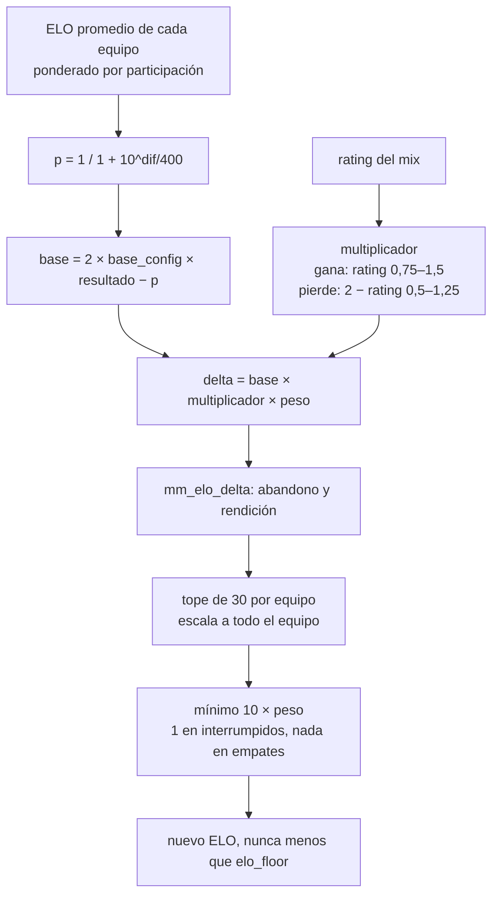

# Plan: el ELO se gana en la partida que jugaste

> Planeación original. Estado: **aprobada** por Daniel el 2026-11-09.

Pedido por Kyan y Daniel el 2026-11-09 (artifact "ELO por partida" de Kyan y esta conversación). Reemplaza la fórmula del ELO de [`2026-10-11-elo-jugadores`](../2026-10-11-elo-jugadores/) desde la Temporada 2 y cambia el mínimo de [`2026-11-09-elo-minimo-15`](../2026-11-09-elo-minimo-15/) de 15 a 10.

## El problema

En el mix de mirage del 2026-11-09 (#2, 8-16) todos tenían 1000 de ELO y el armado vio los equipos casi parejos (4649 contra 4839), pero el ELO tomó al equipo 2 como favorito al 90,7 %, porque la probabilidad sale del `mu` de TrueSkill, que nadie ve y no se reinicia con la temporada. Dio entre +2 y +8. Además, el rating de la partida casi no pesa: el bonus es de ±5 como máximo.

## La regla

| Qué | Para qué |
|---|---|
| **ELO + rating general** (`mm_balance_elos`, sin cambios) | Armar los equipos del matchmaking |
| **ELO visible promedio de cada equipo** | Quién era favorito, o sea la base de lo que se gana o pierde |
| **Rating de la partida** (HLTV 1.0, `csstv_rating`) | El multiplicador: cuánto de esa base se lleva cada uno |

El rating general y TrueSkill (`mu`, `sigma`) dejan de influir en el ELO que se gana o pierde.

## Decisiones tomadas

| Tema | Decisión | Por qué |
|---|---|---|
| Fuerza de cada equipo | Promedio del ELO visible antes del mix, ponderado por la participación (`elo_weight`); quien no tiene fila en `player_elo` cuenta como `start_elo` | Es lo que ven los jugadores y se reinicia con la temporada. Daniel, 2026-11-09 |
| Ajuste manual del armado (`mm_balance_overrides`, replanteo `96`) | Sigue solo en el ELO de armado (`mm_balance_elos`). La probabilidad usa `player_elo.elo`, sin el ajuste ni el rating general | El ajuste es para repartir equipos y no tiene que cambiar el ELO que se gana. Daniel, 2026-11-09 |
| Probabilidad | Elo clásico: `p = 1 / (1 + 10^((ELO rival − ELO propio) / 400))` | Escala conocida: 200 de diferencia ≈ 76 %, 400 ≈ 91 % |
| Base | `K × (resultado − p)`, con **K = 40** (±20 con equipos parejos). Se guarda en `elo_config.base` como 20 (la mitad de K), igual que hoy | Artifact de Kyan. `base` ya significa "± con equipos parejos" |
| Multiplicador | Gana: `rating`, entre **0,75 y 1,5**. Pierde: `2 − rating`, entre **0,5 y 1,25**. Empate: ×1 | Artifact de Kyan. Reemplaza el bonus de ±5 (`bonus_max`, `bonus_factor` quedan solo para la historia anterior) |
| Tope por equipo | Si en un equipo alguien pasa de **30**, todo el equipo se escala en la misma proporción hasta que ese quede en 30 | Artifact de Kyan: mantiene las diferencias entre compañeros |
| Mínimo | **10** (antes 15), al final: gana suma al menos `10 × peso` y pierde resta al menos `10 × peso` | Kyan, 2026-11-09. Al final, para que el multiplicador o el tope no lo rompan |
| Participación | Igual que hoy: todo se multiplica por `elo_weight` (35 % a 90 % de las rondas) | Sin cambios |
| Abandono y rendición | `mm_elo_delta` igual que hoy: el que abandona tiene su valor fijo (no pasa por el multiplicador ni por el tope, sí por el mínimo); su equipo y el rival se ajustan con `abandon_adjust_pct` y `abandon_gg_pct` | Sin cambios de reglas del matchmaking |
| Mixes interrumpidos (`end_reason = 'crash'`) | Fórmula nueva, pero con mínimo ±1 (no 10) | Daniel, 2026-11-09: los cancelados siguen sin el mínimo |
| Empates | Fórmula nueva, multiplicador ×1, sin mínimo | No hay ganador |
| Desde cuándo | Mixes desde el inicio de la Temporada 2 (`elo_config.formula_from`). Los anteriores, con la fórmula de antes. Se aplica con `elo_recompute_all()` | La BETA ya se reinició a 1000; no se reescribe su historia |
| TrueSkill | `mu` y `sigma` se siguen actualizando (no cuesta nada), pero no se usan | Por si se quiere volver |
| Configuración | `base`, los cuatro topes del multiplicador, el tope por equipo y el mínimo, editables en Administración › Reglas del ELO, con la vista previa | Artifact de Kyan |

## 1. El cálculo

### Ejemplo: mirage del 2026-11-09 (todos en 1000, p = 50 %, base ±20)

| Ganadores | Rating | Hoy | Plan | Perdedores | Rating | Hoy | Plan |
|---|---|---|---|---|---|---|---|
| daniloev | 1.82 | +19 | **+30** | yupi | 0.17 | −19 | **−25** |
| roman | 1.63 | +18 | +30 | Slave | 0.67 | −17 | −25 |
| kyan | 1.48 | +17 | +30 | Lesco | 0.85 | −16 | −23 |
| nokushima | 0.71 | +15 | +15 | rbkkk | 0.98 | −15 | −20 |
| tam | 0.65 | +15 | +15 | Nmz1 | 1.09 | −15 | −18 |

Nadie pasa de 30, así que el tope no actúa.

## 2. Base de datos (replanteo `100_elo_por_partida.sql`)

- `elo_config`: `mult_win_min` (0,75), `mult_win_max` (1,5), `mult_loss_min` (0,5), `mult_loss_max` (1,25), `team_cap` (30), `formula_from` (inicio de la Temporada 2); `base` pasa a 20 y `min_delta` a 10.
- `match_player_stats.elo_mult` (el multiplicador de ese jugador) y `elo_scale` (el factor del tope de su equipo, 1 si no actuó): para que `elo_recompute_player` reproduzca el cálculo sin el resto del equipo, y para mostrarlos en el detalle si se quiere.
- `elo_apply_match`: dos pasadas (calcular todos los deltas, aplicar el tope por equipo, después escribir), con la fórmula vieja si el mix es anterior a `formula_from`. Se reescribe entera (ya no alcanza con reemplazos de texto).
- `elo_recompute_player`: la misma cuenta con `win_prob`, `elo_mult` y `elo_scale` guardados.
- `mm_elo_stake` ("En juego" en la sala): con el ELO promedio y el multiplicador ×1, entre el mínimo y el tope.
- `elo_set_config`: los parámetros nuevos.
- `elo_min_for` de la `98`: el mínimo de interrumpidos pasa a 1.
- Inversa: la fórmula y las funciones de la `99`, y `elo_recompute_all()`.

## 3. API y web

- `web/backend/src/routes/elo.ts` y `services/elo.ts`: las columnas nuevas, `elo_set_config` y la vista previa con la fórmula nueva. Tipos regenerados.
- `web/frontend/src/features/admin/servers/lib/eloRules.ts` y la pestaña Reglas del ELO: los campos nuevos y la vista previa (partido normal, bueno y malo, antes y después), con sus pruebas.

## 4. Manual, legales y changelog

- `jugador/elo-y-estadisticas.md`: "Cuánto sube o baja" nuevo (favorito por ELO promedio, multiplicador, tope y mínimo de 10).
- `admin/elo-y-mixes.md`: los campos nuevos de Reglas del ELO.
- Términos y privacidad: revisar; en principio sin cambios (el ELO ya figura como dato calculado, sin decir cómo).
- `CHANGELOG_DISCORD.txt`.

## 5. Pruebas (base local, con rollback)

1. La fórmula exacta en mixes de la Temporada 2 (base, multiplicador, tope y mínimo).
2. El tope: un equipo con alguien por encima de 30 queda con el máximo en 30 y las proporciones iguales.
3. Interrumpidos con mínimo 1; empates sin mínimo y con ×1.
4. Abandono: el valor fijo y el ajuste del equipo, como hoy.
5. Los mixes anteriores a `formula_from` quedan igual.
6. `elo_recompute_player` da lo mismo que `elo_recompute_all`.
6b. Un jugador con ajuste manual en `mm_balance_overrides`: el ELO que gana o pierde es el mismo que sin el ajuste.
7. La inversa deja las funciones como estaban.
8. API: pruebas unitarias de la vista previa. Web: pruebas, typecheck y lint, y la pestaña en el navegador.

## 6. Orden

1. Aprobación de Daniel (y de Kyan, que propuso los valores).
2. Replanteo `100`, pruebas en la base local.
3. API y web (`main`).
4. Aplicar la `100` en producción, `notify pgrst` y `elo_recompute_all()`, sin un mix por terminar en ese momento. Desplegar la API y la web en la misma tanda (la pestaña lee las columnas nuevas).
5. Documentación, manual y commit: la base en `main`, `feat/frontend-fase-1` y `feat/mm-claim-en-sala`; la API y la web en `main`.
