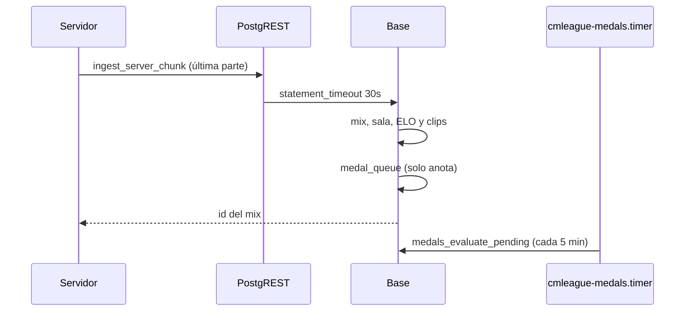

# El resultado de un mix no se corta por tiempo: documentación

## Qué hace

El servidor manda el resultado de un mix por `ingest_server_chunk`, en partes de 1400 caracteres. La última parte hace todo en una sola llamada: crea el mix y las stats, lo vincula a la sala del matchmaking (o a la partida de torneo o PCW), aplica el ELO y guarda los clips. Esa llamada entra como `anon`, que tiene `statement_timeout = 3s`.

Desde el replanteo `97`:

- `ingest_server_chunk` tiene su propio límite de **30 s**. PostgREST (v14 en el VPS) lo aplica a la transacción antes de llamarla. El resto de `anon` sigue en 3 s.
- Las medallas ya no se evalúan dentro del envío: los triggers solo anotan a los jugadores en `medal_queue` y las reparte el cron `cmleague-medals.timer` (cada 5 minutos, `medals_evaluate_pending`).

## El incidente del 2026-11-09

| Hora (UTC) | Qué pasó |
|---|---|
| 18:30:57 | La sala `cb04b97c` (#2, `de_mirage_rc1`) termina 8-16. El plugin guarda el resultado en `data/csstv/queue/` |
| 18:31 a 18:46 | Cuatro envíos fallan con `57014 canceling statement due to statement timeout` en la última parte. La web muestra la sala en vivo, 15-8 (la última foto) |
| 18:36 | El plugin manda `abort` ("El resultado de la partida no llegó a la web") y la sala se cancela |
| 18:46 | Se devuelve la sala a `live`; el plugin, que ya estaba en otro mapa, la cancela ("El servidor se reinició durante la partida") |
| 18:46 a 18:47 | Desde Administración se cierra el mix con la última foto y se aplica como interrumpido: mix 8-15 con ELO |
| 18:54 | Se aplica la `97` |
| 18:55 | Se borra el mix 8-15 (con su fila en `mix_deletions`), se devuelve la sala a `live` y `elo_recompute_all()` |
| 19:01:51 | El plugin manda el 8-16 y entra: mix `ea84eb1a`, 24 rondas, ELO aplicado. La sala se había vuelto a cancelar por lo mismo de las 18:46 |
| ~19:10 | Se vincula el mix a la sala en una sola transacción (`csstv_link_game`): sala terminada con `result` y ganador el equipo 2 |

### Por qué tardaba

- El envío más lento anterior al incidente ya tardaba 2,4 s, contra un límite de 3 s.
- `medal_evaluate_now` corría en `medal_queue_stats_ins` (al insertar las stats), en `medal_queue_stats_upd` (en cada `update` de `match_player_stats`, y `elo_apply_match` actualiza fila por fila) y en `medal_queue_match` (al terminar la partida madre): unas 20 evaluaciones por mix.
- Su `exception when others` no atrapa `query_canceled`: unas medallas lentas tumbaban el resultado entero.

No se midió cuánto tardaba cada paso: el modo automático no dejó correr la medición en producción, ni siquiera con `rollback`.

### Lo que el plugin hace mal (pendiente)

Si la web tarda en recibir el resultado, el plugin cambia de mapa y, al ver que la sala sigue en `live` y asignada a él, la cancela como si el servidor se hubiera reiniciado. Ver `docs/PENDIENTES.md`.

## Qué cambia para cada rol

| Rol | Qué cambia | Página del manual |
|---|---|---|
| Jugador | Las medallas llegan hasta 5 minutos después de la partida, en vez de al instante | — |
| Admin | Antes de cerrar un mix sin señal que estaba por terminar, mirar el servidor: si el resultado está en la cola, al cerrarlo ya no entra | `admin/elo-y-mixes.md` |
| Capitán, organizador, moderador, streamer, dueño de un servidor externo | Nada | — |

## Términos y privacidad

Sin cambios.

## Dónde está cada cosa

| Qué | Dónde |
|---|---|
| Migración | `supabase/replanteo/97_ingreso_sin_timeout.sql` |
| Inversa | `docs/bitacora/2026-10-14-replanteo-modelo-datos/reversas/97_ingreso_sin_timeout.sql` |
| Cron de medallas | `cmleague-medals.timer` en el VPS (`pnpm medals:tick`) |
