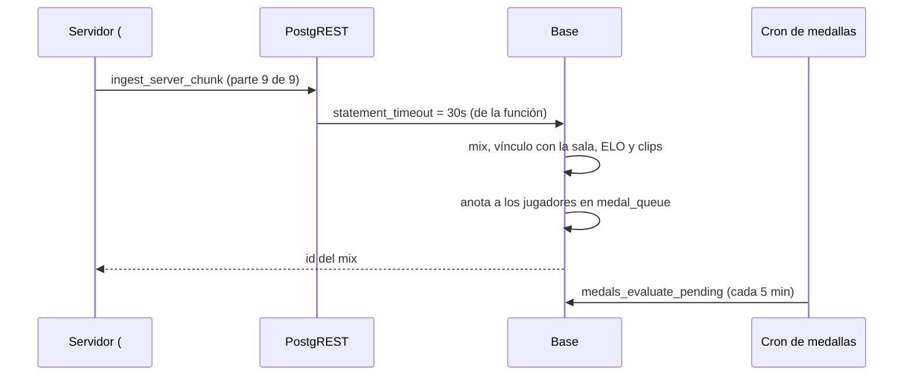

# Plan: el resultado de un mix no se corta por tiempo

> Planeación original. Estado: **aprobada** por Daniel el 2026-11-09 ("dale, haz los dos"). Se escribió con el incidente en curso, antes de aplicar el replanteo.

## El incidente

La sala del matchmaking `cb04b97c` (#2, `de_mirage_rc1`) terminó 8-16 a las 18:30:57 UTC, pero la web la siguió mostrando en vivo, 15-8, con la última foto (ronda 23). El plugin guardó el resultado en la cola y, en cada reintento, la base cortó la última parte con `57014 canceling statement due to statement timeout`.

## Decisiones tomadas

| Tema | Decisión | Por qué |
|---|---|---|
| Límite de tiempo | `ingest_server_chunk` con `statement_timeout = 30s` propio | El rol `anon` tiene 3 s y el ingreso completo (mix, sala, ELO, medallas y clips) ya rozaba ese tope (2,4 s antes del incidente). PostgREST (v12.1 o más; el VPS tiene la v14) aplica la configuración de la función. El resto de `anon` sigue en 3 s |
| Medallas | Los triggers de `medal_queue` solo anotan en la cola; las evalúa el cron `cmleague-medals.timer` (cada 5 min) | `medal_evaluate_now` corría en cada insert y en cada update de `match_player_stats` (unas 20 veces por mix, porque `elo_apply_match` actualiza fila por fila). Su `exception when others` no atrapa la cancelación por tiempo |
| Plugin | Sin cambios | El problema y la solución están en la base |
| La partida del incidente | Borrar el mix 8-15 que se creó al cerrarla desde Administración, devolver la sala a `live`, recalcular el ELO y dejar que el plugin mande el 8-16 que tiene en la cola | Daniel quiere las stats completas y no un arreglo a mano |

## 1. El flujo

## 2. Cambios en la base

Replanteo `97_ingreso_sin_timeout.sql`:

- `alter function ingest_server_chunk(...) set statement_timeout = '30s'`.
- `tg_medal_queue_stats` y `tg_medal_queue_match` sin `medal_evaluate_now`.

Inversa en `docs/bitacora/2026-10-14-replanteo-modelo-datos/reversas/97_ingreso_sin_timeout.sql`.

## 3. Requisitos

- Túnel o SSH al VPS (`sudo docker exec supabase-db psql`).
- `notify pgrst, 'reload schema'` después de aplicar, para que PostgREST lea la configuración nueva.

## 4. Orden

1. Aplicar la `97` en producción y recargar PostgREST.
2. Borrar el mix 8-15 (`c213f804`), anotarlo en `mix_deletions` y devolver la sala `cb04b97c` y su partida madre a `live`.
3. `elo_recompute_all()`.
4. Esperar el reintento del plugin del #2 y comprobar que la sala termina con el 8-16.
5. Commit en `main` (y copia en `feat/frontend-fase-1` y `feat/mm-claim-en-sala`, por ser del matchmaking) cuando Daniel lo pida.
