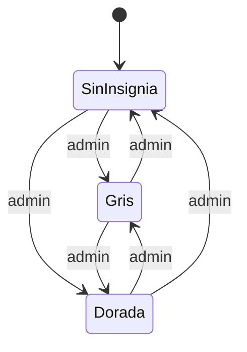

# Insignia de jugador verificado: documentación

## Qué es

Un sello con un check al lado del nick, como el de FACEIT:

| Color | Título de la ficha | Motivo por defecto |
|---|---|---|
| Gris (`gray`) | Cuenta verificada | Verificación de identidad |
| Dorada (`gold`) | Cuenta verificada destacada | Jugador destacado de la comunidad |

Al pasar el mouse (o tocarlo en el teléfono) se abre una ficha con:

- el sello y el título;
- una línea con ✓ y el motivo que escribió el admin;
- "**Saber más** sobre la verificación de cuentas", que lleva a la página del manual `jugador/cuentas-verificadas`.

Se ve en el encabezado del perfil y al lado del nick en los comentarios de los perfiles.

## Base: replanteo `90_jugadores_verificados.sql`

| Objeto | Para qué |
|---|---|
| `players.verified` | `gray`, `gold` o `null` |
| `players.verified_note` | El motivo, hasta 60 caracteres |
| `players.verified_at`, `verified_by` | Cuándo y qué admin |
| `admin_player_verify(p_player, p_kind, p_note)` | La pone, la cambia o la saca (`p_kind` null borra todo). Solo `is_admin()` |
| Trigger `players_verified_guard` | Si `anon` o `authenticated` cambian esas columnas por un `UPDATE` directo, falla. La función (security definer) sí puede |

Las políticas de `players` ya no dejan que un jugador edite su ficha directo. El trigger además obliga al admin a pasar por la función, para que queden quién y cuándo.

## API

- `GET /api/v1/players/{id}`: `verification: { kind, note } | null`.
- `PUT /api/v1/admin/players/{id}/verification` `{ kind: "gray" | "gold" | null, note? }`: solo admins. Devuelve `{ verification }`.
- En el muro de comentarios (replanteo 91), cada autor trae `verified`.

## Web

| Archivo | Qué tiene |
|---|---|
| `components/brand/VerifiedBadge.tsx` | `VerifiedSeal` (el sello solo, para listas) y `VerifiedBadge` (con la ficha, un `Popover` que se abre al pasar el mouse o al tocar) |
| `features/player/components/VerifyDialog.tsx` | El botón **Verificar** / **Insignia** del encabezado, para admins: Ninguna, Gris o Dorada, y el motivo |
| `auth/permissions.ts` | `canVerifyPlayers` (solo admin) |
| `features/player/pages/PlayerProfile.tsx` | El sello pegado al `h1` y el chip "Steam vinculado" |

## Qué cambia para cada rol

- **Jugador:** ve las insignias y la ficha. No puede pedirla desde la web. Manual: [`jugador/cuentas-verificadas.md`](../../manual/jugador/cuentas-verificadas.md), nueva y enlazada desde "Saber más".
- **Admin:** la pone, la cambia o la saca desde el perfil del jugador. Manual: [`admin/usuarios-y-fichas.md`](../../manual/admin/usuarios-y-fichas.md), sección "Insignia de verificado".
- **Moderador, organizador, streamer y dueño de un servidor externo:** como un jugador.

## Términos y privacidad

- **Términos, sección 10:** la insignia la pone un admin a su criterio, no se compra ni se pide, y se puede quitar.
- **Privacidad:**
  - Qué guardamos: el color, el motivo, quién la puso y cuándo.
  - Dónde se ve: en el perfil y en los comentarios.
