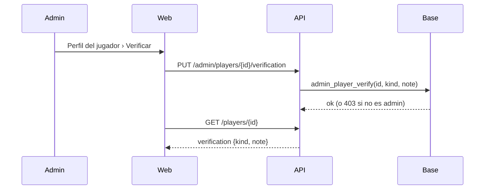

# Plan: insignia de jugador verificado

> Planeación original (Kyan, 2026-11-09). Estado: **aprobada** en el mismo pedido:
> - "una insignia para poder marcar jugadores verificados, en gris y en dorado, que un admin los tenga que asignar";
> - "que se vean así, con un tooltip";
> - "que se parezca a FACEIT".

## Decisiones tomadas

| Tema | Decisión | Por qué |
|---|---|---|
| Colores | `gray` (cuenta verificada) y `gold` (cuenta verificada destacada) | Pedido de Kyan |
| Quién la pone | Solo admins, con `admin_player_verify` | Pedido de Kyan |
| Dónde se guarda | Columnas en `players` (`verified`, `verified_note`, `verified_at`, `verified_by`) | Es un dato de la ficha y viaja con ella |
| Escritura | Solo por la función. Un trigger frena el `UPDATE` directo de esas columnas, aunque lo haga un admin por la API de fichas | Queda quién y cuándo la puso |
| Motivo | Texto libre de hasta 60 caracteres que se lee en el tooltip; vacío, uno por defecto según el color | El "✓ ID verification" de FACEIT |
| Aspecto | Sello con check pegado al nick y una ficha al pasar el mouse (o tocar): título, ✓ motivo y "Saber más" a la ayuda | Las capturas de FACEIT que pasó Kyan |
| Chip "Verificado" viejo | Pasa a decir "Steam vinculado" | Decía solo que la ficha tiene SteamID y se confundiría |
| Dónde se ve | En el encabezado del perfil y al lado del nick en los comentarios | Lo primero que se pidió; listas y ranking quedan para después |

## 1. El flujo completo

## 2. Base (replanteo 90)

- Las cuatro columnas, con sus `check`.
- El trigger `players_verified_guard`.
- La función `admin_player_verify`.

## 3. API

- `PlayerDetail.verification` (`null` si no tiene).
- `PUT /api/v1/admin/players/{id}/verification`, solo admins.

## 4. Web

- `components/brand/VerifiedBadge.tsx` (`VerifiedSeal` y `VerifiedBadge`).
- `features/player/components/VerifyDialog.tsx`, para admins (`canVerifyPlayers`).
- La insignia en el encabezado y en los comentarios.

## 5. Requisitos antes de empezar

Ninguno.

## 6. Orden de implementación

1. La migración y la inversa.
2. Las rutas.
3. La insignia, el diálogo y el encabezado.
4. Las pruebas, el manual (incluida la página "Saber más") y los términos.
