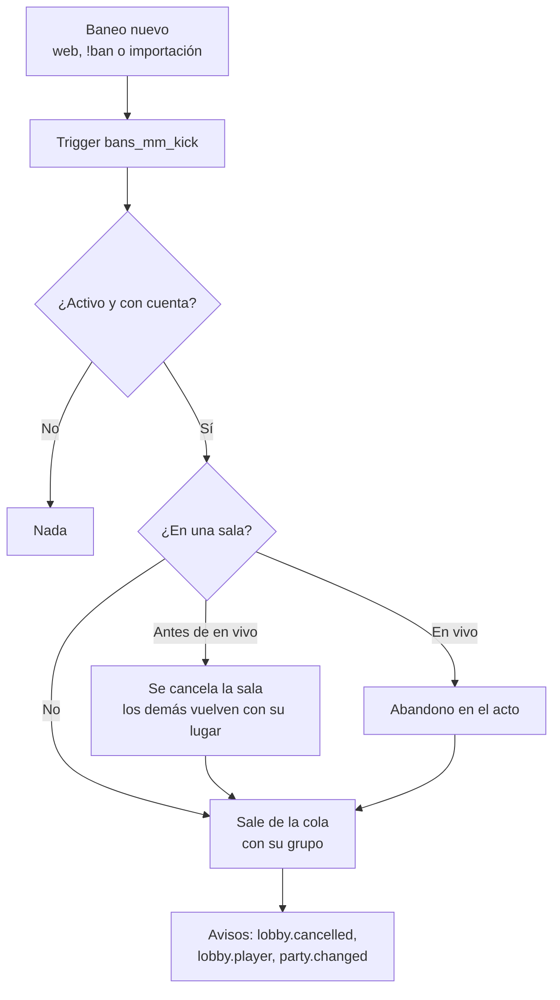

# El baneo saca al jugador del matchmaking: documentación

## Qué hace

Cuando se crea un baneo de los servidores (desde Administración › Baneos, con `!ban` en el juego o por la importación), la base revisa en el acto si el baneado está en el matchmaking y lo saca:

- **Buscando partida:** sale de la cola él y todo su grupo (el grupo no se desarma). En el historial de la cola queda como `cancelled`.
- **En una sala que todavía no empezó** (`accepting`, `veto`, `waiting_server`, `assigned` o `connecting`): la sala se cancela con el motivo "Un jugador fue baneado". Los demás vuelven a la cola con su lugar, como cuando alguien rechaza.
- **En una sala en vivo:** su abandono se marca en el acto (opción A de Daniel). Cuenta como cualquier abandono: suma para la derrota por 2 abandonos y abre el reemplazo en la próxima vuelta del tick. La partida no se corta.

No se suma una sanción de la cola: el baneo ya es la sanción. Antes, un baneado que ya estaba en la cola seguía ahí, caía en una sala y el servidor lo echaba al conectarse.

## Reglas

| Caso | Qué pasa |
|---|---|
| Baneo de una ficha | Se busca la cuenta de la ficha |
| Baneo de un SteamID | Se busca la ficha dueña del SteamID (principal o adicional) y cualquier ficha con ese SteamID principal, como `mm_block_reason` |
| SteamID sin ficha o ficha sin cuenta | Nada |
| Baneo que se guarda ya levantado | Nada |
| Baneo que reemplaza a otro | Se revisa de nuevo (es un baneo nuevo) |
| Cambiar o levantar un baneo (`ban_update`, `ban_lift`) | Nada. Al levantarlo, el jugador vuelve a la cola solo si entra él |
| Un reemplazo que tomó el link y todavía no entró a una sala en vivo | No se marca: lo saca `mm_replace_sweep` cuando vence su plazo |
| Si algo falla adentro | El baneo se guarda igual; queda un `WARNING` en el log de Postgres |

**Por qué la sala va antes que la cola:** `mm_cancel_lobby(…, true)` devuelve a la cola a todos los que aceptaron, también al baneado. Por eso primero se cancela la sala y después se lo saca de la cola con su grupo.

**La red en el armado:** `mm_try_build` no arma con una unidad (jugador o grupo) que tenga a alguien baneado, por si alguno se cuela (por ejemplo, un baneo puesto a mano con el trigger apagado).

## Funciones de Supabase (replanteo `107_mm_baneo_saca_de_cola.sql`)

| Función | Qué hace |
|---|---|
| `mm_ban_kick(p_ban uuid) returns jsonb` | Lo de arriba. Devuelve `users`, `removed` (los que salieron de la cola), `cancelled` (salas) y `abandoned` (salas en vivo) |
| `bans_mm_kick()` + trigger `bans_mm_kick` | `after insert on bans`: llama a `mm_ban_kick` y atrapa cualquier error |
| `mm_user_banned(p_user uuid)` | Si la cuenta tiene un baneo activo de los servidores |
| `mm_unit_banned(p_unit text)` | Si alguien de esa unidad de la cola está baneado |
| `mm_try_build` | Suma `and not mm_unit_banned(…)` en los 3 lugares donde mira `mm_unit_away`, con la marca `(replanteo 107)` |

Ninguna se puede llamar desde la web ni la API: solo las usa la base.

La API y la web no cambian. La web ya escucha `lobby.cancelled` (con el motivo), `lobby.player` y `party.changed`, y al intentar volver a entrar `mm_join` ya responde "Tenés un baneo activo en los servidores".

## Qué cambia para cada rol

| Rol | Qué cambia | Página del manual |
|---|---|---|
| Jugador | Si lo banean en el matchmaking, sale de la cola con su grupo, se cancela su sala o cuenta como abandono | `jugador/baneos-y-sanciones.md` |
| Moderador | Al banear no tiene que sacarlo de la cola a mano | `moderador/banear-jugador.md` |
| Admin | Lo mismo que el moderador | `moderador/banear-jugador.md` (los admins también la ven) |
| Capitán, organizador, streamer y dueño de un servidor externo | Nada | — |

## Términos y privacidad

- **Términos:** en "Moderación y baneos" se suma que un baneo en el matchmaking saca de la cola (con el grupo), cancela la sala que no empezó y cuenta como abandono si la partida está en juego. En `TermsPage.tsx` y `terms/terminos.html`. La fecha ya era 10 de noviembre de 2026.
- **Privacidad:** sin cambios. No se guarda ningún dato nuevo.

## Dónde está cada cosa

| Qué | Archivo / ubicación |
|---|---|
| Base | `supabase/replanteo/107_mm_baneo_saca_de_cola.sql` |
| Inversa | `docs/bitacora/2026-10-14-replanteo-modelo-datos/reversas/107_mm_baneo_saca_de_cola.sql` |
| Prueba | `docs/bitacora/2026-11-09-mm-baneo-saca-de-cola/pruebas/prueba_107.sql` y `prueba_107.sh` |
| Términos | `web/frontend/src/features/legal/pages/TermsPage.tsx` y `terms/terminos.html` |
| Manual | `docs/manual/moderador/banear-jugador.md` y `docs/manual/jugador/baneos-y-sanciones.md` |
