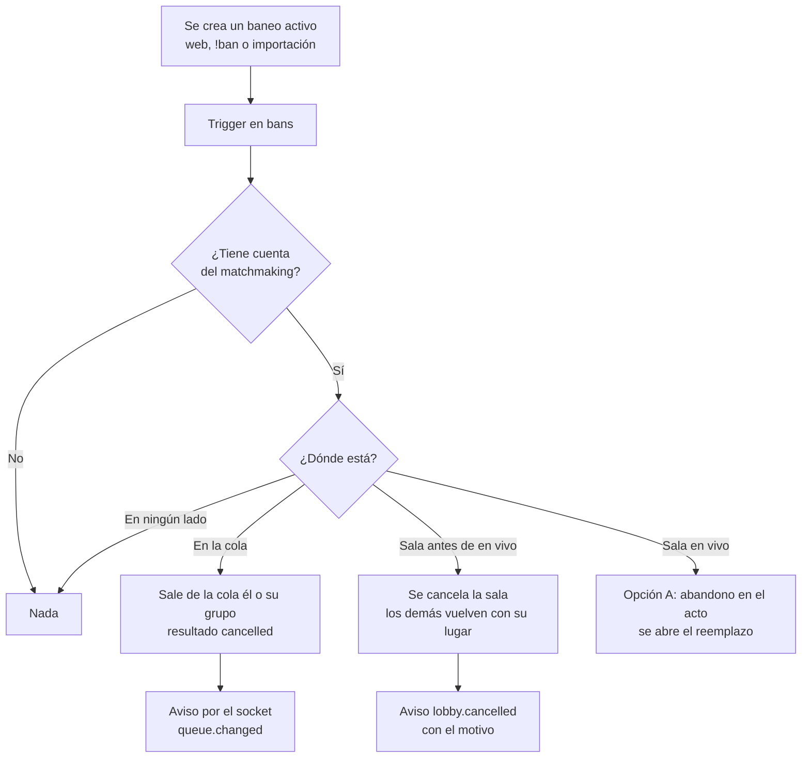

# Plan: el baneo saca al jugador del matchmaking

> Planeación original. Estado: **aprobado** por Daniel el 2026-11-10 (opción A para la sala en vivo; "implementar y desplegar"). Escrito el 2026-11-09 con el número `105`, que después tomó "grupo máximo": pasa a ser el `107`.

Pedido por Daniel el 2026-11-09, después de banear a Acc por 1 hora: Acc estaba en la cola de 5v5 desde antes del baneo y seguía ahí. Se lo sacó a mano con `mm_queue_remove(…, 'cancelled')`.

Hoy la base solo revisa los baneos de los servidores (`bans`) en `mm_block_reason`, que se llama al entrar a la cola (`mm_join`) y al tomar un reemplazo (`mm_replace_reason`). Ni `ban_insert` ni el armado de salas (`mm_try_build`) vuelven a mirar. Un baneado que ya estaba en la cola puede caer en una sala y el servidor lo echa al conectarse (sincronización de baneos cada 3 minutos), así que la sala se rompe para los otros nueve.

## Decisiones tomadas

| Tema | Decisión | Por qué |
|---|---|---|
| Dónde se engancha | Un trigger `after insert` en `bans`, más una revisión en `mm_try_build` | El trigger cubre los tres orígenes (web con `ban_create`, `!ban` del juego con `csstv_ban_add` y la importación) sin tocar cada uno. La revisión en `mm_try_build` es la red por si algo se cuela (un baneo puesto a mano en la base, por ejemplo) |
| En la cola, solo | Sale de la cola con resultado `cancelled` | Es lo mismo que se hizo a mano con Acc. `cancelled` ya existe en `mm_queue_log` y no se confunde con `left` (salió él) |
| En la cola, con grupo | Sale **todo el grupo** de la cola; el grupo no se desarma | Un grupo entra y sale junto (`mm_join` y `mm_party_clear_queue`). Si los demás quieren seguir, sacan al baneado del grupo y vuelven a entrar: `mm_join` ya no los deja entrar con él adentro |
| Sala en `accepting` | Se cancela la sala con `mm_cancel_lobby(…, 'Un jugador fue baneado', true)`: los que aceptaron vuelven a la cola con su lugar | Es lo que pasa hoy cuando alguien rechaza, pero sin sanción de matchmaking para el baneado (ya tiene el baneo) |
| Sala en `veto`, `waiting_server`, `assigned` o `connecting` | Igual: se cancela y los demás vuelven a la cola con su lugar | Si no, el baneado no puede entrar y la sala se cae igual al vencer `connect_deadline`, minutos después y **sin** devolver a nadie a la cola |
| Sala en `live` | **Opción A** (Daniel, 2026-11-10): se marca su abandono en el acto | El servidor lo echa y no puede volver. Hoy se espera `reconnect_minutes` para confirmar el abandono; marcarlo ya abre antes el reemplazo (si `replace_enabled` está prendido) |
| Sala `finished` o `cancelled` | Nada | |
| Sanción de matchmaking | Ninguna nueva por la salida de la cola o de la sala | El baneo ya es la sanción. Dos castigos por lo mismo no tienen sentido |
| Baneo que se cambia (`ban_update`) o se levanta | Nada | Cambiar el vencimiento no lo vuelve a meter. Al levantarlo, el jugador vuelve a la cola solo si entra él |
| Ramas | Solo `main` (Daniel, 2026-11-10: "ahora solo importa la rama main") | No hay cambios en la API ni en la web |

### El baneado en una sala en vivo (se eligió la A)

| Opción | Qué pasa | Contra |
|---|---|---|
| **A. Abandono en el acto** (propuesta) | `abandoned = true` apenas se pone el baneo, con el mismo efecto que un abandono de hoy: cuenta para la derrota automática por 2 abandonos y abre el reemplazo | Su equipo queda con un abandono por algo que hizo un moderador. Es lo mismo que pasa hoy, solo que antes |
| B. No tocar nada | El servidor lo echa y el abandono se confirma a los `reconnect_minutes`, como cualquier caída | El reemplazo se abre más tarde, y durante esos minutos su equipo juega con uno menos |
| C. Abandono cubierto | Como A, pero sin contar para la derrota automática ni para el ajuste de ELO del equipo | Hay que tocar `mm_tick`, `mm_elo_delta` y el poll del servidor: más cambio y más riesgo con un mix en curso |

Ninguna opción corta el mix: no se cancela una sala en vivo por un baneo.

## 1. El flujo completo

## 2. Base de datos (replanteo `107_mm_baneo_saca_de_cola.sql`)

1. **`mm_ban_kick(p_ban uuid)`** (`security definer`, sin permisos para `anon` ni `authenticated`):
   - Busca las cuentas del baneado: `players.user_id` de `bans.player_id`, o el dueño del `steam_id` (`steam_owner`) si el baneo es de un SteamID.
   - Si el baneo no está activo (`lifted_at` o `expires_at` pasado), no hace nada.
   - **Cola:** si está en `mm_queue`, saca a todos los de su `party_id` (o solo a él) con `mm_queue_remove(…, 'cancelled')` y emite `queue.changed` con `mm_queue_sizes()`.
   - **La sala va antes que la cola:** `mm_cancel_lobby(…, true)` devuelve a la cola a todos los que aceptaron, también al baneado. Por eso primero se resuelve la sala y después se lo saca de la cola (con su grupo).
   - **Sala** (`mm_active_lobby`), con la sala bloqueada (`for update`, como `mm_decline`):
     - `accepting`, `veto`, `waiting_server`, `assigned` o `connecting`: `declined_at = now()` en su fila si estaba en `accepting`, y `mm_cancel_lobby(l.id, 'Un jugador fue baneado', true)`.
     - `live`: según la decisión de Daniel (opción A: `abandoned = true, left_at = null` y `lobby.player`; el reemplazo lo abre `mm_replace_sweep` en la próxima vuelta del tick).
2. **Trigger `bans_mm_kick`** `after insert on bans for each row` que llama a `mm_ban_kick(new.id)`. Un error adentro no tiene que impedir el baneo: se atrapa con `exception when others` y se deja un `raise warning`.
3. **`mm_try_build`:** la unidad (jugador o grupo) con alguien baneado no entra en el armado. Se reutiliza la misma condición que `mm_block_reason` (`bans` activo por `player_id` o `steam_id`). Si el trigger anduvo, nunca debería encontrar a nadie; es la red.
4. Comentarios en la función y el trigger con el número del replanteo, y la fila en `supabase/replanteo/README.md`.
5. Reversa en `docs/bitacora/2026-10-14-replanteo-modelo-datos/reversas/107_mm_baneo_saca_de_cola.sql`: borra el trigger y la función, y vuelve `mm_try_build` a como estaba.

`ban_insert` no se toca: el trigger corre dentro de la misma transacción, después del `insert`, y ya ve levantados los baneos que el nuevo reemplaza.

## 3. API y web

Sin cambios. La web ya escucha `queue.changed` y `lobby.cancelled` (que trae el motivo desde el replanteo 60) y muestra la salida de la cola y la sala cancelada. Al intentar volver a entrar, `mm_join` ya devuelve "Tenés un baneo activo en los servidores".

## 4. Manual, términos y privacidad

- `docs/manual/moderador/banear-jugador.md` y `docs/manual/admin/` (la página de baneos, si la nombra): una línea que diga que el baneo también lo saca de la cola y de la sala que no empezó, y qué pasa si está jugando.
- `docs/manual/jugador/` (la página del matchmaking que habla de sanciones): lo mismo, desde el lado del jugador.
- `/terminos`: revisar la parte de sanciones del matchmaking. Si dice qué pasa con un baneado, se suma que lo saca de la cola y de la sala. No se guarda ningún dato nuevo, así que `/privacidad` queda sin cambios.

## 5. Requisitos antes de empezar

- La decisión de Daniel sobre la sala en vivo (A, B o C).
- La base local con los replanteos hasta el `106`, igual que producción.
- Túnel a producción para aplicarlo, como los anteriores.

## 6. Orden de implementación

1. Escribir el replanteo `107` y su reversa.
2. Probarlo en la base local con datos de prueba: baneado solo en la cola, en un grupo en la cola, en una sala `accepting`, en una `connecting` y en una `live`; un baneo de un SteamID sin ficha; un baneo que reemplaza a otro; y un baneo de alguien que no juega matchmaking. Los scripts van en `pruebas/`.
3. Comprobar que `ban_create`, `csstv_ban_add` y la importación siguen funcionando igual, y que un error del trigger no impide el baneo.
4. Actualizar el manual y, si hace falta, los términos.
5. Commit en `main`.
6. Aplicar en producción **sin salas en vivo** (revisar `mm_lobbies` antes, porque se reemplaza `mm_try_build`, que el tick usa para armar salas) y anotar la guía.
