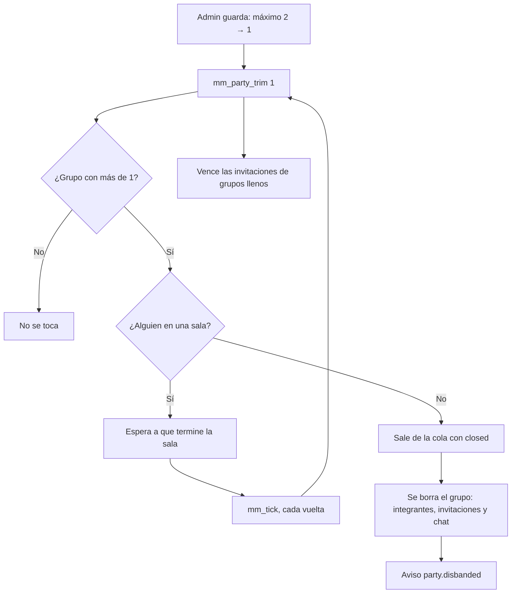

# Bajar el tamaño máximo del grupo desarma los grupos que no entran: documentación

## Qué hace

En Administración › Matchmaking › **Grupos**, el admin elige el tamaño máximo del grupo (1 = sin grupos, 2 = dúo). Antes, bajarlo solo impedía armar grupos nuevos: los que ya existían seguían, entraban a la cola y jugaban juntos.

Desde el replanteo `105`, cada grupo con más integrantes que el máximo se desarma: al guardar la configuración y en cada vuelta de `mm_tick`. Si estaba buscando, sale de la cola. Los integrantes reciben un aviso en la web. Un grupo con alguien en una sala no se toca, para no romper la partida, y se desarma en la primera vuelta de `mm_tick` después de que la sala termina. Además, la cola rechaza un grupo más grande que el máximo, por si quedara alguno en el medio.

## Reglas

| Caso | Qué pasa |
|---|---|
| Grupo más grande que el máximo, sin buscar | Se desarma |
| Grupo más grande que el máximo, en la cola | Sale de la cola (`mm_queue_log.outcome = 'closed'`, como al apagar un modo) y se desarma. Cada uno vuelve a buscar solo |
| Grupo con alguien en una sala (aceptando, veto, conectando o en vivo) | No se toca. Se desarma cuando la sala termina o se cancela |
| Invitación pendiente de un grupo que ya está lleno | Se vence (`expired`). `mm_tick` ya borraba el grupo de uno sin invitaciones pendientes |
| Grupo más grande que el máximo que intenta entrar a la cola | `mm_join` responde "Tu grupo es más grande que el máximo actual (N): salgan del grupo para buscar" |
| Subir el máximo | No desarma nada |

## Base (replanteo `105_mm_grupo_maximo.sql`)

- `mm_party_trim(p_max int) returns int`: desarma los grupos y devuelve cuántos. Solo la llaman otras funciones de la base (sin `execute` para `anon` ni `authenticated`).
- `mm_set_config`: llama a `mm_party_trim` con el máximo guardado, antes del aviso `mm.config`.
- `mm_tick`: la llama con `c.max_party_size`, después de vencer las invitaciones y borrar los grupos de uno.
- `mm_join`: el chequeo del máximo, antes del de los servidores de la región.

Los tres cambios van entre marcas `-- (replanteo 105) ini` y `-- (replanteo 105) fin`, insertadas con reemplazos de texto sobre `pg_get_functiondef`. Así conviven con el 104, que también cambia `mm_set_config` y `mm_tick`, en otros puntos. La inversa saca los bloques entre marcas y borra `mm_party_trim`.

## El aviso

`mm_emit('party.disbanded', null, <integrantes>, {"max": N, "queued": true|false})`. La API lo reenvía por el socket como a cualquier aviso, sin cambios. En la web:

- En **Jugar** (`PlayPage`) y en cualquier otra pantalla (`GlobalMatchAlerts`), un aviso: "Se desarmó tu grupo: ahora se juega sin grupos" (con 1) o "…ahora el máximo es de N por grupo", y "Saliste de la cola: vuelve a buscar solo." si estaban buscando.
- No se repite el "X salió del grupo" ni el "Ya no estás en el grupo" de siempre (`noticePartyDisbanded` en `PartyMenu.tsx`).
- El estado se vuelve a pedir como con cualquier `party.*`.

## Qué cambia para cada rol

| Rol | Qué cambia | Página del manual |
|---|---|---|
| Admin | Bajar el máximo del grupo desarma los grupos más grandes, salvo los que están en una sala, que se desarman al terminar. El texto de la sección **Grupos** lo dice | [`admin/matchmaking.md`](../../manual/admin/matchmaking.md) |
| Jugador | Si la liga baja el máximo, su grupo se puede desarmar (y salir de la cola), con un aviso | [`jugador/buscar-partida.md`](../../manual/jugador/buscar-partida.md) |
| Capitán, organizador, moderador, streamer y dueño de un servidor externo | Nada | — |

## Términos y privacidad

Sin cambios: no hablan del tamaño del grupo, y no hay datos nuevos, servicios, plazos, sanciones ni pagos.

## Dónde está cada cosa

| Qué | Archivo / ubicación |
|---|---|
| Replanteo | `supabase/replanteo/105_mm_grupo_maximo.sql` |
| Inversa | `docs/bitacora/2026-10-14-replanteo-modelo-datos/reversas/105_mm_grupo_maximo.sql` |
| Prueba de la base | `docs/bitacora/2026-11-09-mm-grupo-maximo/pruebas/probar_105.sql` |
| Aviso en la web | `web/frontend/src/features/matchmaking/PartyMenu.tsx` (`noticePartyDisbanded`), `PlayPage.tsx`, `MatchAlerts.tsx` |
| Prueba del aviso | `web/frontend/src/features/matchmaking/PartyMenu.test.ts` |
| Texto del admin | `web/frontend/src/features/matchmaking/admin/GeneralForm.tsx` |
| Manual | `docs/manual/admin/matchmaking.md`, `docs/manual/jugador/buscar-partida.md` |
