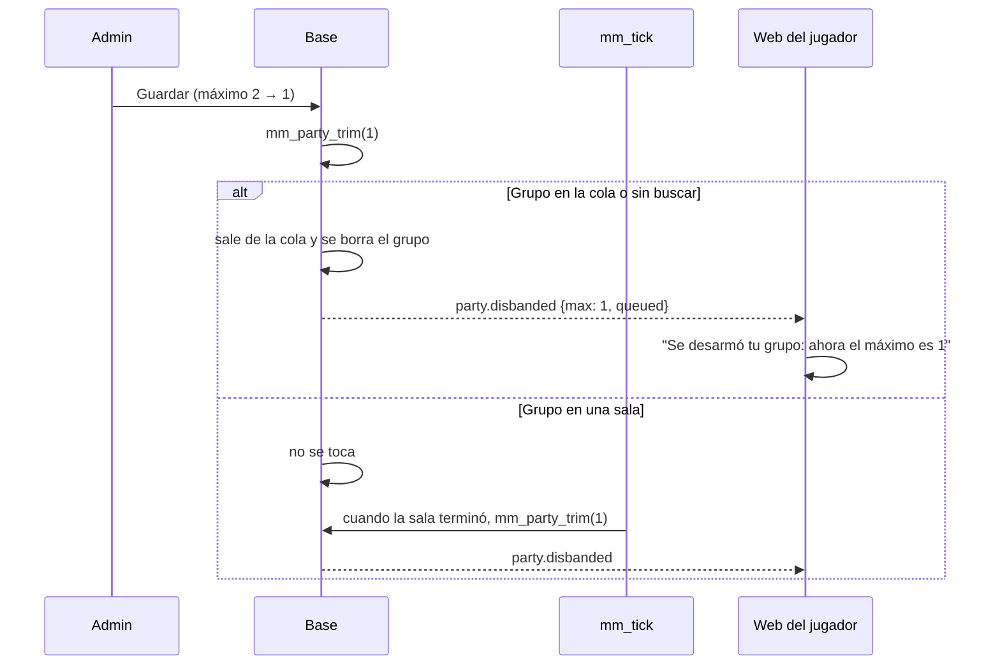

# Plan: bajar el tamaño máximo del grupo desarma los grupos que no entran

> Planeación original. Estado: **aprobada** por Daniel el 2026-11-09 ("Quiero el segundo camino").

Pregunta de Daniel (2026-11-09): si el tamaño máximo del grupo del matchmaking pasa de 2 a 1, ¿se desarman los grupos que ya existen? Hoy no. `mm_set_config` solo cambia el número. Los dúos siguen armados, entran a la cola (`mm_join` solo controla que el grupo quepa en un equipo del modo) y juegan juntos. Lo único que cambia es que no se pueden armar grupos nuevos.

## Decisiones tomadas

| Tema | Decisión | Por qué |
|---|---|---|
| Qué se desarma | Los grupos con más integrantes que el máximo nuevo | Es lo que pidió Daniel: que desde el cambio nadie juegue en un grupo más grande que el permitido |
| Grupos en la cola | Salen de la cola (`mm_queue_log` con `closed`, como los de un modo apagado) y se desarman. Cada uno vuelve a buscar solo | Si siguieran en la cola, caerían juntos en la próxima partida |
| Grupos en una sala | No se tocan: la sala sigue. Se desarman cuando la sala termina | Sacar a alguien de una sala la rompe. Nunca se toca un mix en curso |
| Cuándo | Al guardar la configuración (`mm_set_config`) y en cada vuelta de `mm_tick` | `mm_tick` corre todo el tiempo, así que agarra a los grupos que salen de una sala |
| Invitaciones pendientes que ya no se pueden aceptar | Se vencen (`expired`). Con el máximo en 1, `mm_tick` ya borra los grupos de uno sin invitaciones pendientes | Hoy quedan colgadas hasta que vencen, y al aceptarlas falla con "Ese grupo ya está completo" |
| La cola | `mm_join` rechaza un grupo más grande que el máximo, con un mensaje claro | Para el caso borde de una vuelta en la que el grupo todavía no se desarmó |
| Aviso | Un aviso nuevo del socket, `party.disbanded`, con el máximo y si estaban en la cola. La web muestra "Se desarmó tu grupo…" en Jugar y en cualquier otra pantalla, y no muestra el "salió del grupo" de siempre | Sin esto, el líder ve "X salió del grupo", que no es lo que pasó |
| Campana | No | El aviso es del momento. El que no está conectado vuelve y ve que no tiene grupo |
| Número | Replanteo `105` | Del `100` al `104` están usados en otros worktrees |

## 1. El flujo

## 2. Base (replanteo `105_mm_grupo_maximo.sql`)

1. `mm_party_trim(p_max int) returns int`, solo para la base (sin `execute` para `anon` ni `authenticated`). Por cada grupo con más de `p_max` integrantes y sin nadie en una sala: los saca de la cola con `closed`, borra el grupo (los integrantes, las invitaciones y el chat se borran en cascada) y manda `party.disbanded` a los que estaban. Después vence las invitaciones pendientes de los grupos que ya están llenos. Devuelve cuántos grupos desarmó.
2. `mm_set_config`: guarda el máximo y llama a `mm_party_trim` antes del aviso `mm.config`.
3. `mm_tick`: llama a `mm_party_trim(c.max_party_size)` después de vencer las invitaciones.
4. `mm_join`: si el grupo tiene más integrantes que el máximo, lo rechaza.

Los cambios a funciones existentes van con reemplazos de texto sobre `pg_get_functiondef`, como el 52 y el 104, para no pisar lo que agregan otros replanteos (el 104, sin aplicar todavía, también cambia `mm_set_config` y `mm_tick`, en otros puntos). Aborta si ya se aplicó. Con su inversa en `reversas/105_mm_grupo_maximo.sql`.

## 3. Web

- `PlayPage` y `GlobalMatchAlerts`: con `party.disbanded`, un aviso "Se desarmó tu grupo: ahora el máximo es N por grupo", y "Saliste de la cola: vuelve a buscar solo" si estaban buscando.
- `usePartyNotices`: no repite el "salió del grupo" en ese caso.
- Administración › Matchmaking › Grupos: el texto avisa que bajarlo desarma los grupos más grandes, salvo los que están en una sala.

## 4. Manual, términos y changelog

- `admin/matchmaking.md` (qué pasa al bajarlo) y `jugador/buscar-partida.md` (que el grupo se puede desarmar si cambia el máximo).
- Términos y privacidad: se revisa si hablan del tamaño del grupo.
- `CHANGELOG_DISCORD.txt`.

## 5. Pruebas

En la base local (copia de producción), en una transacción que se deshace: un grupo sin buscar, uno en la cola, uno en una sala y una invitación pendiente. Bajar el máximo y ver qué se desarma. Terminar la sala y ver que `mm_tick` lo desarma. Y que `mm_join` rechace un grupo grande. La web, con pruebas y lint.

## 6. Ramas

Es base del matchmaking: va en `main` y en las copias `feat/frontend-fase-1` y `feat/mm-claim-en-sala` (la web, solo en las dos primeras).

## 7. Orden

1. Replanteo, inversa y prueba en la base local.
2. Web.
3. Manual, documentación, guía, changelog, índice y pendientes.
