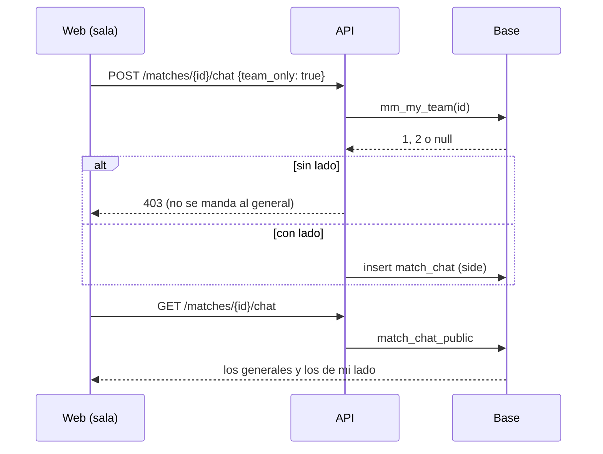

# Chat de equipo en la sala de la PCW: documentación

## Qué hace

La sala de una PCW (la misma sala del matchmaking) muestra dos chats: el **chat de equipo** debajo de los jugadores de tu lado, que solo ven los de tu lado (y los admins), y el **chat general** debajo del rival, que ven los dos. Antes la sala de la PCW mostraba el chat general dos veces y no tenía chat de equipo: la base solo separaba los mensajes por lado en el matchmaking, y la web buscaba tu lado en el roster, donde un capitán que no juega no aparece.

El reclamo que lo originó (dos chats generales en una sala del matchmaking) tenía otra causa: la ficha de la sala sin `is_me` desde la `94`. Se arregla en [`2026-11-09-sala-sin-is-me`](../2026-11-09-sala-sin-is-me/).

Si no jugás en ningún lado (por ejemplo, un admin mirando la sala), se ve un solo chat general, debajo del lado 2. Esto vale también para la sala del matchmaking.

## Mi lado en una PCW

- En la base, `mm_my_team(p_match)`: el lado de la sala del matchmaking o, en una PCW, `match_my_side` (roster de la partida, capitanes y dueños de los dos equipos, también del equipo padre de un bando "como equipo"). `null` si no juega.
- En la web, `MmLobby.my_team` (opcional). `pcwToLobby` lo llena con el `my_side` de `GET /matches/{id}/booking`. Si falta (la demo), el lado sale del jugador con `is_me`. `myTeam` y `chatScope` (`room/roomData.ts`) deciden qué chat va debajo de cada lado.

## Quién lee y quién escribe

| Mensaje | Lo leen | Lo escriben |
|---|---|---|
| General de una PCW | Los que ya lo leían | Los que ya podían (`match_chat_can_write`) |
| De equipo de una PCW | Ese lado y los admins | Solo ese lado |
| De equipo del matchmaking | Ese equipo y los admins (sin cambios) | Solo ese equipo |

- `mm_chat_can_read` filtra la lectura (la usan la política restrictiva de `match_chat` y la vista `match_chat_public`).
- La política restrictiva nueva `chat: lado propio` (insert) exige `side` nulo o igual a `mm_my_team(match_id)`. Antes, desde `/rest`, se podía escribir con el lado del rival.
- La API responde 403 a `team_only` sin lado, en vez de mandar el mensaje al general.

## Qué cambia para cada rol

| Rol | Qué cambia | Página del manual |
|---|---|---|
| Capitán | La sala de la PCW tiene chat de equipo y chat general | `capitan/jugar-pcw.md` |
| Jugador | Igual que el capitán cuando juega una PCW; en el matchmaking, sin cambios | — |
| Admin | Al mirar una sala en la que no juega, ve un solo chat general | — |

## Términos y privacidad

Sin cambios: el chat de la partida ya se guardaba; ahora un mensaje de equipo de una PCW lo lee solo ese lado.

## Dónde está cada cosa

| Qué | Archivo |
|---|---|
| Base | `supabase/replanteo/102_pcw_chat_de_equipo.sql` |
| Inversa | `docs/bitacora/2026-10-14-replanteo-modelo-datos/reversas/102_pcw_chat_de_equipo.sql` |
| Pruebas de la base | `pruebas/probar_102.sh` y `pruebas/prueba_102.sql` |
| API | `web/backend/src/routes/matches.ts` (`sendChat`), `web/backend/src/schemas/matches.ts` (`ChatBody`) |
| Lado y chats de la sala | `web/frontend/src/features/matchmaking/room/roomData.ts`, `RoomOverview.tsx`, `LobbyChat.tsx` |
| PCW | `web/frontend/src/features/pcw/lib/room.ts`, `lib/adapt.ts`, `pages/PcwLiveRoom.tsx`, `types/index.ts` |
