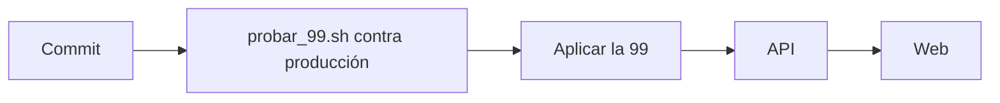

# Chat de equipo en la sala de la PCW: guía de implementación

## Estado

Implementado y probado en local el 2026-11-09 (base local con la `99` aplicada, typecheck y pruebas de la web y la API). **Sin commit y sin desplegar.**

## Archivos

| Archivo | Cambio |
|---|---|
| `supabase/replanteo/99_pcw_chat_de_equipo.sql` | `mm_my_team` y `mm_chat_can_read` con la PCW; política `chat: lado propio` |
| `docs/bitacora/2026-10-14-replanteo-modelo-datos/reversas/99_pcw_chat_de_equipo.sql` | Inversa |
| `docs/bitacora/2026-11-09-pcw-chat-de-equipo/pruebas/` | `probar_99.sh` y `prueba_99.sql` |
| `web/backend/src/routes/matches.ts` | `team_only` sin lado: 403 |
| `web/backend/src/schemas/matches.ts` | Descripción de `team_only` |
| `web/frontend/src/features/matchmaking/types.ts` | `MmLobby.my_team` |
| `web/frontend/src/features/matchmaking/room/roomData.ts` | `myTeam` y `chatScope` (con `roomData.test.ts`) |
| `web/frontend/src/features/matchmaking/room/RoomOverview.tsx` | Los chats salen de `chatScope`: nunca dos generales |
| `web/frontend/src/features/matchmaking/LobbyChat.tsx` | El filtro de equipo usa `myTeam` |
| `web/frontend/src/features/pcw/types/index.ts`, `lib/adapt.ts`, `lib/room.ts` | `my_side` de la reserva hasta `my_team` |
| `web/frontend/src/features/pcw/pages/PcwLiveRoom.tsx` | La fuente manda `team_only` a la API |
| `web/frontend/src/features/matchmaking/VetoBoard.tsx` | En una PCW, el turno de vetar sale de `can_veto` de la reserva (`MmLobby.can_veto`), no del capitán del roster |
| `docs/manual/capitan/jugar-pcw.md` | Los dos chats de la sala |

## Despliegue (pendiente)

1. **Ramas:** toca la base, la API y la web del matchmaking. La `99` y `matches.ts` van en `feat/frontend-fase-1` y en `feat/mm-claim-en-sala`; la web solo en `feat/frontend-fase-1`.
2. **Orden:** después de la `98` ([`2026-11-09-sala-sin-is-me`](../2026-11-09-sala-sin-is-me/)) y de la `95`, la `96` y la `97` de `main` (la `99` necesita la `48` y la `56`).
3. **Prueba contra producción, por el túnel:** `probar_99.sh "<conexión>"`. Corre en una transacción que se deshace; tiene que terminar con los tres `true`.
4. **Aplicar** la `99` con `PGCLIENTENCODING=UTF8` y después `notify pgrst, 'reload schema'`.
5. **API y web**, como siempre. `pnpm gen:api` solo cambia la descripción de `team_only`.

## Pruebas

### Base (`probar_99.sh docker`, 2026-11-09)

Sobre una PCW de la base local con una cuenta en cada lado: `mm_my_team` da 1, 2 y `null` (afuera); cada lado escribe el general y el suyo y no el del otro (RLS); cada lado lee el general y el suyo, afuera y sin sesión solo el general, el admin todo. Inversa igual a antes, funciones y políticas iguales a antes.

### Web y API

`pnpm typecheck` y `vitest` de `features/matchmaking` y `features/pcw` (146 pruebas de matchmaking, PCW y home, con las nuevas de `chatScope`) en verde. `tsc` de la API sin errores. No se probó en el navegador.

## En qué se apartó del plan

- **Número:** el plan dice `95`. Ese día `main` ya tenía la `95` (Pionero), la `96` (ajuste manual del armado) y la `97` (ingreso sin timeout), y la `98` fue el arreglo urgente de `is_me`. Este cambio quedó como `99`.
- **El veto de la PCW:** no estaba en el plan. Tenía el mismo problema que el chat (un capitán que no está en el roster no podía vetar) y se arregló igual, con `can_veto` de la reserva.
- **La causa del reclamo era otra:** las "dos generales" que vio Daniel fueron en una sala del matchmaking (en producción no hubo PCW) y venían de la `94`, que dejó la ficha sin `is_me`. Eso se arregla en la `98`. Este requerimiento queda para la PCW, que tenía el mismo problema por su lado, y para que una sala sin lado propio muestre un solo chat general.

## Incidentes durante las pruebas

- La primera corrida mostró que una cuenta de afuera (sin lado) leía los mensajes de equipo: en una PCW, `mm_my_team = p_side` daba `null` y el `coalesce(…, true)` de afuera lo daba por bueno. Se corrigió con `coalesce(mm_my_team(p_match) = p_side, false)` y la prueba suma el caso sin sesión.
- El límite de un mensaje cada 2 segundos (`chat_rate_limit`) frenaba los inserts de la prueba: se apaga dentro de la transacción de la prueba.

## Cómo revertir

1. La inversa `reversas/99_pcw_chat_de_equipo.sql` (los mensajes de equipo de PCW que existan pasan a leerlos todos los que leen el chat de esa partida).
2. Revert del commit de la API y la web.
