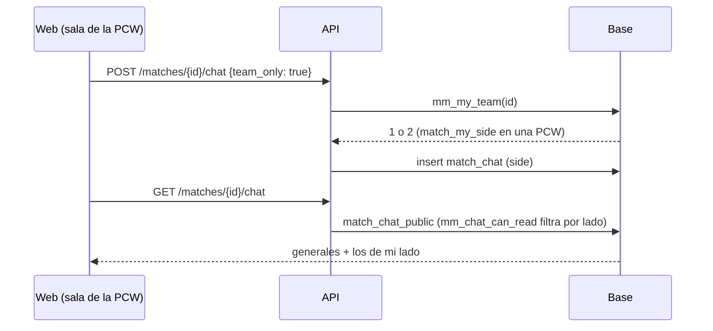

# Plan: chat de equipo en la sala de la PCW

> Planeación original. Pedido por Daniel el 2026-11-09: "en la sala de la partida hay 2 chat general y no hay uno de equipo".

## Decisiones tomadas

| Tema | Decisión |
|---|---|
| Qué se ve | Como en el matchmaking: el chat de equipo debajo de los jugadores de tu lado y el general debajo del rival. Si no jugás en ningún lado (un admin mirando), un solo chat general, debajo del lado 2. Nunca dos generales. |
| Tu lado en una PCW | El de la base: `match_my_side` (roster de la partida, capitanes y dueños de los dos equipos, también el padre de un equipo "como equipo"). La web lo toma de la reserva (`my_side` de `GET /matches/{id}/booking`), no de buscarse en el roster, porque un capitán que no juega no está en el roster. |
| Quién lee el chat de equipo de una PCW | Solo ese lado y los admins (como en el matchmaking). El general, todos los que ya podían. |
| Escribir con un lado ajeno | Hoy la tabla acepta cualquier `side` desde `/rest`. Se agrega una política restrictiva: `side` es nulo o es el tuyo (`mm_my_team`). Vale también para el matchmaking. |
| `team_only` sin lado | La API responde 403 en vez de mandar el mensaje al general (un mensaje de equipo nunca termina público). |

## 1. El flujo completo

## 2. Base: replanteo `95_pcw_chat_de_equipo.sql`

- `mm_my_team(p_match)`: si no hay sala del matchmaking y la partida es una PCW, `nullif(match_my_side(p_match), 0)`.
- `mm_chat_can_read(p_match, p_side)`: en una PCW, un mensaje con lado lo leen los admins y `mm_my_team(p_match) = p_side`.
- Política restrictiva de insert en `match_chat`: `side is null or side = mm_my_team(match_id)`.
- Inversa en `docs/bitacora/2026-10-14-replanteo-modelo-datos/reversas/` y prueba con `probar_95.sh`.

## 3. API

`POST /matches/{id}/chat` con `team_only` y sin lado: 403 `FORBIDDEN`.

## 4. Web

- `MmLobby.my_team` (opcional): el lado propio cuando no sale de `is_me`. `pcwToLobby` lo llena con `my_side`.
- `RoomOverview` y `LobbyChat` usan ese lado; sin lado, un solo chat general.
- La fuente de la sala de la PCW deja de rechazar `teamOnly`.

## 5. Manual

`capitan/jugar-pcw.md`: la sala tiene chat de equipo y general.

## 6. Orden de implementación

1. Replanteo 95, inversa y prueba en la base local.
2. API.
3. Web y pruebas.
4. Manual, documentación, guía y fila del README.
