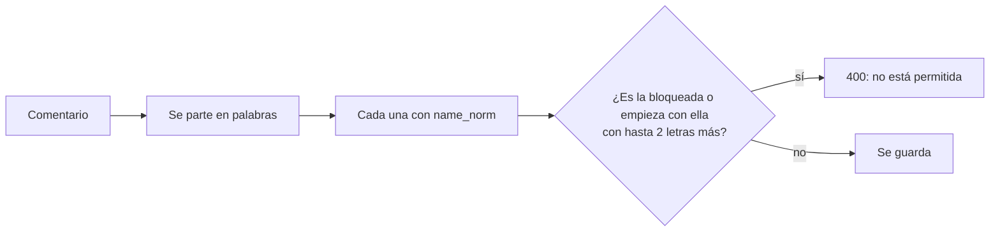
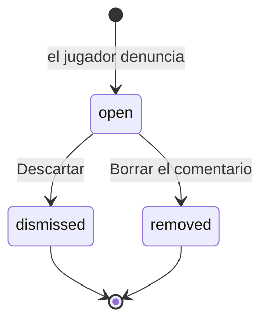

# Ajustes de los comentarios del perfil y la insignia en las listas: documentación

## Qué es

Los arreglos de backend que Kyan dejó anotados en [`2026-11-09-comentarios-perfil/PARA_DANIEL.md`](../2026-11-09-comentarios-perfil/PARA_DANIEL.md) (puntos 1 a 6), con la web que hace falta para usarlos:

| Qué | Cómo queda |
|---|---|
| Palabras bloqueadas | Un comentario con una palabra de Administración › Palabras bloqueadas no se guarda (`400` con la palabra) |
| Denunciar un comentario | Bandera en cada comentario ajeno; motivo y nota. Los moderadores las revisan en Administración › Baneos › **Comentarios** |
| Baneados | Con un baneo activo no se comenta ni se vota ningún perfil |
| Bloqueados | Si el dueño del perfil te bloqueó en Jugar, no comentas ni votas en su perfil |
| Insignia en las listas | El sello sale en el ranking, Administración › Jugadores, los amigos de Jugar, el grupo y la sala |
| Filtro "Verificados" | En Administración › Jugadores (y `verified=true\|false` en `GET /players`) |
| Tipos de la base | Regenerados con `pnpm run db:types` |

## Cómo funciona

### Las palabras bloqueadas, palabra por palabra

`name_norm` es la misma normalización de los nicks: minúsculas, sin tildes, los números a letras (`0` → `o`, `3` → `e`…) y sin signos. Para los nicks, `name_blocked` busca la palabra dentro del texto entero sin espacios. En un comentario eso daría falsos positivos ("computadora"), así que `comment_blocked_word` compara palabra por palabra:

| Texto | Palabra bloqueada `tonto` | Resultado |
|---|---|---|
| "sos un tonto" | es la palabra | Frena |
| "tontos" | la palabra con 1 letra más | Frena |
| "t0nt0" | con números | Frena |
| "tontería" | 3 letras más | Pasa |
| "abctonto" | no empieza con ella | Pasa |

Lo que no se frena: la palabra separada con espacios ("t o n t o"). Para eso está la denuncia.

### Quién no comenta ni vota

`profile_social_blocked(cuenta, perfil)` devuelve:

- `banned`: un baneo activo (`bans` sin levantar y sin vencer) por su ficha o por cualquiera de sus SteamID (`ban_active_for`, que también mira los SteamID de la misma persona);
- `blocked`: el dueño del perfil tiene a esa ficha en `mm_blocks`;
- `null`: puede.

`profile_comment_add` y `profile_vote` cortan con `403` y el motivo. `profile_wall` lo devuelve en `restriction`, y `can_vote` y `can_comment` dan `false`: la web muestra por qué en lugar de "Inicia sesión". Los comentarios que ya había dejado siguen.

### Denuncias

- **Quién:** cualquiera con sesión, sobre un comentario ajeno que no esté borrado. Una vez por comentario y 20 por día (Bogotá).
- **Motivos:** `toxic` (insultos), `harassment` (acoso), `spam` y `other`, con una nota opcional de hasta 300 caracteres.
- **Resolver:** cualquiera de las dos acciones cierra **todas** las denuncias abiertas de ese comentario. Borrar lo marca como borrado (`deleted_at`, `deleted_by`), igual que la papelera del perfil: queda guardado.
- **La lista** (`profile_comment_reports_admin`) es para moderadores y admins: filtra por estado (`open`, `resolved` o todas) y por motivo, ordena por fecha y pagina en la base. Cada fila trae el comentario, su autor, el perfil, quién denunció, la nota y cuántas denuncias tiene el comentario.
- **Sin aviso:** no se manda una notificación a los moderadores. El número de la pestaña Comentarios dice cuántas hay por revisar.

### La insignia en las listas

- `GET /players` (y la ficha) traen `verified` en `PlayerSummary`. La vista `player_overview` no tiene la columna: la API la busca en `players` para los ids de la página (`verifiedPlayers`). El filtro `verified=true` usa los ids de las fichas verificadas, que son pocas.
- `GET /ranking/players` y la comparación traen `player.verified`.
- `mm_player_card` (la sala y el grupo de Jugar) y los amigos de `mm_my_profile` traen `verified`.
- En la web, `ListSeal` (de `components/brand/VerifiedBadge.tsx`) muestra el sello al lado del nombre, con el texto para lectores de pantalla.

## Base de datos (replanteo `94`)

| Objeto | Qué es |
|---|---|
| `comment_blocked_word(text)` | La primera palabra bloqueada del texto, o null |
| `profile_social_blocked(uuid, uuid)` | `banned`, `blocked` o null |
| `profile_social_check(uuid, uuid)` | Corta con `42501` y el motivo |
| `profile_comment_reports` | Las denuncias: `comment_id`, `reporter`, `reason`, `note`, `status` (`open`, `dismissed`, `removed`), `resolved_by`, `resolved_at`. Una por cuenta y comentario. RLS sin acceso directo |
| `profile_comment_report(uuid, text, text)` | Denunciar |
| `profile_comment_reports_admin(text, text, text, int, int)` | La lista: estado, motivo, orden, límite y desplazamiento |
| `profile_comment_report_resolve(uuid, text)` | `dismiss` o `delete` |
| `profile_vote`, `profile_comment_add`, `profile_wall`, `mm_player_card`, `mm_my_profile` | Cambiadas con `pg_temp.reemplazar`; las originales, en `replanteo94_funciones` para la inversa |

## API

| Ruta | Quién | Qué hace |
|---|---|---|
| `POST /api/v1/profile-comments/{id}/report` | Con sesión | Denunciar (`204`; `400` si ya lo denunció, es suyo o pasó el tope) |
| `GET /api/v1/admin/profile-comment-reports` | Moderador y admin | `status` (`open` por defecto, `resolved`, `all`), `reason`, `page`, `per`, `order` |
| `POST /api/v1/admin/profile-comment-reports/{id}/resolve` | Moderador y admin | `{ action: "dismiss" \| "delete" }` |
| `GET /api/v1/players` | Todos | `verified` en cada jugador y el filtro `verified` |
| `GET /api/v1/players/{id}/wall` | Todos | `restriction` y `can_report` en cada comentario |

## Web

- `features/player/components/CommentReportDialog.tsx`: el diálogo de la bandera.
- `features/player/components/ProfileWall.tsx`: la bandera en los comentarios ajenos y el aviso al baneado o bloqueado.
- `features/admin/bans/components/CommentReportsPanel.tsx`: la pestaña **Comentarios** de Administración › Baneos.
- `ListSeal` en `PlayersRanking.tsx`, `FichasTab.tsx` (con el filtro **Verificados**), `FriendsPanel.tsx`, `GroupSlots.tsx` y `RoomOverview.tsx`.

## Qué cambia para cada rol

| Rol | Qué cambia | Manual |
|---|---|---|
| Jugador | Denuncia comentarios. No pasan los comentarios con palabras bloqueadas. Con un baneo activo, o bloqueado por el dueño, no comenta ni vota. Ve el sello en el ranking y en Jugar | [`jugador/comentarios-en-el-perfil.md`](../../manual/jugador/comentarios-en-el-perfil.md), [`jugador/cuentas-verificadas.md`](../../manual/jugador/cuentas-verificadas.md) |
| Moderador | Revisa las denuncias en Baneos › Comentarios | [`moderador/borrar-comentarios.md`](../../manual/moderador/borrar-comentarios.md) |
| Admin | Lo del moderador y el filtro **Verificados** en Jugadores | [`admin/usuarios-y-fichas.md`](../../manual/admin/usuarios-y-fichas.md) |

## Términos y privacidad

- **Términos:** en los comentarios, las palabras bloqueadas, que un baneado o bloqueado no comenta ni vota, y que cualquiera puede denunciar un comentario.
- **Privacidad:** guardamos las denuncias de comentarios (motivo, nota y quién la mandó) mientras existan el comentario y la cuenta; el autor no ve quién lo denunció.
- Fecha de los dos: 9 de noviembre de 2026.
