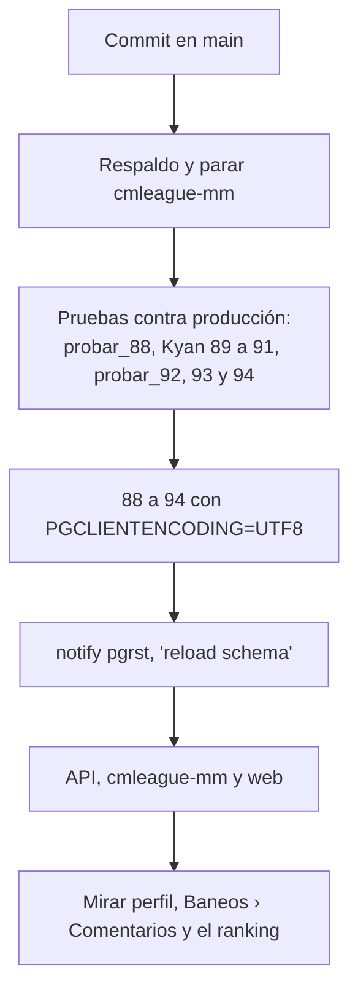

# Ajustes de los comentarios del perfil y la insignia en las listas: guía de implementación

## Estado

**Desplegado el 2026-11-09 (14:09-14:35 UTC)** desde `main` (`d06cc274`, desplegado como `e53f3e7b4a96`; copias `46524bbc` en `feat/frontend-fase-1` y `62666ff2` en `feat/mm-claim-en-sala`): sin salas, cola ni mixes en vivo; respaldo `20261109T141109Z` (también en R2); `cmleague-mm` parado; contra producción, `probar_88.sh` (con una PCW de prueba: producción no tenía ninguna), la prueba de la `89`, `probar_90_91.sh`, `probar_92.sh`, `probar_93.sh` y `probar_94.sh`, todas en verde y con la inversa igual a antes; 88 → 89 → 90 → 91 → 92 → 93 → 94 desde los archivos commiteados con `PGCLIENTENCODING=UTF8` (la `96` ya estaba); `notify pgrst, 'reload schema'`; la API (`/api/health` con `e53f3e7b4a96`), `cmleague-mm` prendido de nuevo y la web con `--sin-pruebas` (las 703 pasaron antes con `--maxWorkers=2`). La `88` no recalculó nada: no había PCW jugadas, así que el ELO de nadie cambió. Falta mirarlo con una sesión en producción y publicar el changelog.

Implementado y probado en local el 2026-11-09, en la copia de `main` (worktree `v34frag-mainwt`), **sin commit y sin desplegar**. La `94` quedó aplicada en la base local.

- **Lo del matchmaking va también en las otras dos ramas:** el cambio de `mm_player_card` y `mm_my_profile` de la `94` y `types.ts`, `FriendsPanel`, `GroupSlots` y `RoomOverview` de la web. La `94` necesita la `91` (comentarios), que no está en `feat/mm-claim-en-sala`: allá hace falta todo junto o una versión sin la parte de los comentarios. **Decidir con Daniel.**
- **No toca el plugin ni los servidores.**

## Archivos

| Archivo | Cambio |
|---|---|
| `supabase/replanteo/94_perfil_social_ajustes.sql` | Base |
| `docs/bitacora/2026-10-14-replanteo-modelo-datos/reversas/94_perfil_social_ajustes.sql` | Inversa |
| `pruebas/probar_94.sh`, `prueba_94.sql` | 7 bloques y la inversa |
| `pruebas/escenarios_api.mjs` | 10 escenarios contra la API local |
| `supabase/replanteo/README.md` | Fila de la `94` |
| `web/backend/src/routes/community.ts` | Denunciar, la lista y resolver; `restriction` y `can_report` en el muro |
| `web/backend/src/routes/players.ts`, `schemas/players.ts`, `services/players.ts`, `routes/ranking.ts` | `verified` en las listas y el filtro |
| `web/backend/src/db/types.ts` | Regenerado con la 89 a la 94 |
| `web/backend/test/unit/community.test.ts` | 7 pruebas nuevas |
| `web/frontend/src/features/player/components/` | `CommentReportDialog.tsx` (nuevo), `ProfileWall.tsx` y `ProfileWall.test.tsx` (nuevo) |
| `web/frontend/src/features/admin/bans/` | `CommentReportsPanel.tsx` (nuevo), la pestaña en `AdminBansPage.tsx` y `lib/search.ts` |
| `web/frontend/src/components/brand/VerifiedBadge.tsx` | `ListSeal` |
| `web/frontend/src/features/ranking/pages/PlayersRanking.tsx`, `features/admin/players/`, `features/matchmaking/` | El sello y el filtro |
| `web/frontend/src/routes/demo.perfil-social.tsx` | La demo con `restriction`, `can_report` y la bandera |
| `docs/manual/…` | `jugador/comentarios-en-el-perfil.md`, `jugador/cuentas-verificadas.md`, `moderador/borrar-comentarios.md`, `admin/usuarios-y-fichas.md` |
| Términos y privacidad | `TermsPage.tsx`, `PrivacyPage.tsx`, `terms/*.html` y la fecha |

## Despliegue (falta)

Va en la misma tanda que lo de Kyan y lo de PCW. El orden de las migraciones en producción es **88 → 89 → 90 → 91 → 92 → 93 → 94**.

1. **La `94` va después de la `91`.** Cambia `mm_my_profile`, que también cambia la `89` de Kyan: aplicar en orden.
2. `probar_94.sh "<conexión>"` contra producción, por el túnel: tiene que dar los 7 `ok`, `inversa igual a antes: true` y `funciones iguales a antes: true`.
3. Después de desplegar, mirar en el navegador:
   - un comentario con una palabra bloqueada;
   - denunciar con una cuenta y resolver con un moderador;
   - el sello en el ranking.
4. **Changelog:** `CHANGELOG_DISCORD.txt` de esta carpeta, en la misma tanda que los tres de Kyan (2.9.28).

## Pruebas

- **Base** (Supabase local con Docker, en una transacción que se deshace): `probar_94.sh docker`, 7 bloques:
  1. palabras bloqueadas;
  2. baneados por la ficha y por un SteamID, y levantado;
  3. bloqueado por el dueño;
  4. denunciar;
  5. la lista paginada, filtrada y ordenada, descartar y borrar;
  6. `mm_player_card`;
  7. los amigos de Jugar.

  La inversa deja la estructura y las cinco funciones iguales.
- **La `89` de Kyan, que él no pudo probar:** se probó el 2026-11-09 sobre la base local con todo hasta la `93`:
  - sin VIP no se prende y apagarlo sí se puede;
  - el VIP entra aceptado y el que no es VIP no;
  - con el VIP vencido, no acepta solo;
  - `mm_my_profile` trae `auto_accept`.

  También pasaron sus pruebas de la 90 y la 91, y las tres inversas.
- **API:** `typecheck` y las 582 pruebas unitarias en verde (7 nuevas). `escenarios_api.mjs`: 10 de 10 contra la API local.
- **Web:** `typecheck`, `lint`, `build` y las 703 pruebas en verde (4 nuevas en `ProfileWall.test.tsx`), con `vitest run --maxWorkers=2`. Con todos los procesos, dos de `PlayPage.test.tsx` se pasan de los 5 s (lo mismo que ya dice `PENDIENTES` de despliegues anteriores); solas pasan.
- **En el navegador**, 7 de 7:
  - la bandera en el comentario ajeno y el sello del autor;
  - el diálogo y el aviso de enviada;
  - la denuncia repetida;
  - el aviso al bloqueado;
  - la pestaña Comentarios del moderador;
  - borrar y verlo en Resueltas;
  - el filtro Verificados.

## En qué se apartó del plan

- El muro trae también `restriction` (`banned`, `blocked` o null): sin eso, la web le decía "Inicia sesión" a un baneado con sesión iniciada.
- La lista de amigos de Jugar no usa `mm_player_card`: la `94` también cambia `mm_my_profile`.
- El aviso de VIP de `SoundSettings` (de Kyan) usaba `vipToast` de `features/vip/upsell`, que no está en `main`: abre el `VipDialog`, como en PCW.
- La denuncia no avisa a los moderadores por la campana. Si hace falta, es una categoría más en `notification_category`.

## Pendiente

- El sello en el buscador de arriba (Ctrl K) y en otras listas que no traen `verified` (equipos, torneos, PCW).
- La palabra separada con espacios no se frena.
- El texto de Administración › Baneos todavía nombra RBK y flow, que ya no están.
