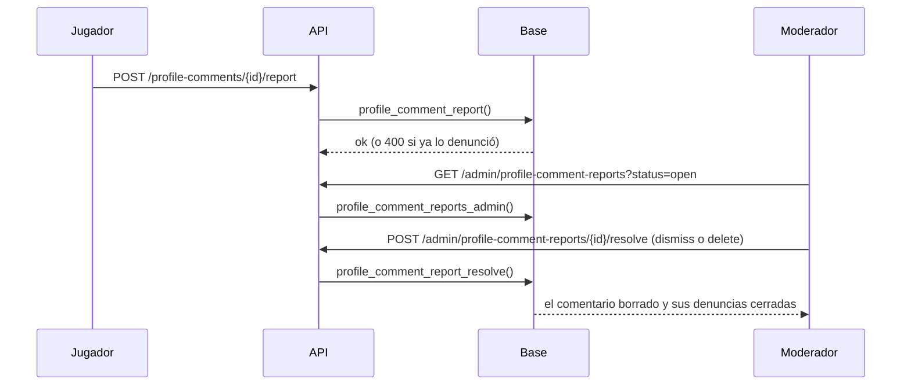

# Plan: ajustes de los comentarios y de la insignia de verificado

> Planeación original (2026-11-09). Estado: **aprobada** por Daniel ("no faltaría hacer los ajustes del backend también?"), sobre la lista de Kyan en [`2026-11-09-comentarios-perfil/PARA_DANIEL.md`](../2026-11-09-comentarios-perfil/PARA_DANIEL.md), sección "Backend", puntos 1 a 6.

## Decisiones tomadas

| Tema | Decisión | Por qué |
|---|---|---|
| Filtro de palabras | Las mismas palabras de Administración › Palabras bloqueadas (`blocked_words`), pero **palabra por palabra**: una palabra del comentario, normalizada con `name_norm`, es la bloqueada o empieza con ella y tiene a lo sumo 2 letras más (plurales). Si no pasa, `400` con la palabra | `name_blocked` busca dentro del texto entero sin espacios: sirve para un nick, pero en un comentario da falsos positivos ("computadora") |
| Denunciar un comentario | Tabla nueva `profile_comment_reports`, aparte de `mm_reports`. Motivos `toxic`, `spam`, `harassment` y `other`, con una nota opcional de hasta 300. Una por cuenta y comentario, 20 por día; no el propio | Los reportes del matchmaking tienen sala o mensaje del grupo; mezclarlos complica las dos listas |
| Quién las revisa | Moderadores y admins, en una pestaña **Comentarios** de Administración › Baneos (la sección que ya ve el moderador). Dos salidas: **Descartar** o **Borrar el comentario** (borra y cierra todas las denuncias de ese comentario) | El moderador ya borra comentarios desde el perfil; acá los encuentra sin buscarlos |
| La lista | Paginada, filtrada por estado (`open`, `resolved`, todas) y ordenada en la base, con el comentario, el perfil, el autor, quién denunció y cuántas denuncias tiene ese comentario | Regla de los GET: paginación, filtros y orden del lado del servidor |
| Baneados | Una cuenta con un baneo activo (`bans`, por su ficha o por cualquiera de sus SteamID) no comenta ni vota (`403`). Sus comentarios viejos siguen | Es lo que pidió Kyan; borrar lo viejo lo decide un moderador |
| Bloqueados | Si el dueño del perfil te bloqueó en el matchmaking (`mm_blocks`), no comentas ni votas en su perfil (`403`) | Un bloqueo que deja seguir comentando no protege a nadie |
| `profile_wall` | `can_vote` y `can_comment` ya dicen que no al baneado y al bloqueado; cada comentario suma `can_report` | La web no muestra un botón que va a fallar |
| Insignia en las listas | `verified` (`gray`, `gold` o null) en `PlayerSummary` (jugadores, buscador y Administración › Jugadores), en el jugador del ranking y en la ficha del matchmaking (`mm_player_card`: la sala y los amigos) | Kyan dejó listo `VerifiedSeal` en la web |
| Filtro "Verificados" | `verified=true|false` en `GET /players`, que es la lista de Administración › Jugadores | Sin endpoint nuevo |
| Tipos de la base | `pnpm run db:types` con la 89 a la 94 aplicadas | Kyan los había editado a mano |

## 1. El flujo de una denuncia

## 2. Base: replanteo `94_perfil_social_ajustes.sql`

- `comment_blocked_word(text)`: la primera palabra bloqueada que encuentra, o null.
- `profile_social_blocked(p_user, p_player)`: el motivo por el que esa cuenta no puede comentar ni votar en ese perfil (`banned`, `blocked`) o null.
- `profile_comment_add` y `profile_vote` (con `pg_temp.reemplazar`): el motivo de arriba y el filtro de palabras.
- `profile_wall`: `can_vote`, `can_comment` y `can_report`.
- `profile_comment_reports`, con RLS sin acceso directo; `profile_comment_report`, `profile_comment_reports_admin(p_status, p_limit, p_offset)` y `profile_comment_report_resolve(p_report, p_action)`.
- `mm_player_card`: `verified`.
- Respaldo de las funciones que cambian (`replanteo94_funciones`), inversa y pruebas SQL (`probar_94.sh`).

## 3. API

- `POST /api/v1/profile-comments/{id}/report`.
- `GET /api/v1/admin/profile-comment-reports` y `POST /api/v1/admin/profile-comment-reports/{id}/resolve`, para moderadores y admins.
- `PlayerSummary.verified`, el filtro `verified` en `GET /players` y `verified` en el jugador del ranking.
- Pruebas unitarias.

## 4. Web

- **Denunciar** en el menú de cada comentario ajeno (`ProfileWall`).
- La pestaña **Comentarios** en Administración › Baneos.
- `VerifiedSeal` en el ranking, el buscador de jugadores, Administración › Jugadores, los amigos y la sala del matchmaking.
- El filtro "Verificados" en Administración › Jugadores.

## 5. Manual, términos y privacidad

- `jugador/comentarios-en-el-perfil.md` (denunciar; quién no puede comentar), `moderador/borrar-comentarios.md` (la lista de denuncias) y `admin/usuarios-y-fichas.md` (el filtro).
- Términos: los baneados y bloqueados no comentan, las palabras bloqueadas y la denuncia. Privacidad: las denuncias de comentarios y cuánto se guardan.

## 6. Requisitos antes de empezar

- La base local con la 89, la 90 y la 91 de Kyan, y la 92 y la 93 (hecho el 2026-11-09).

## 7. Orden de implementación

1. La `94`, su inversa y sus pruebas.
2. Los tipos de la base, la API y sus pruebas.
3. La web y sus pruebas.
4. Manual, términos, privacidad, bitácora y pendientes.
