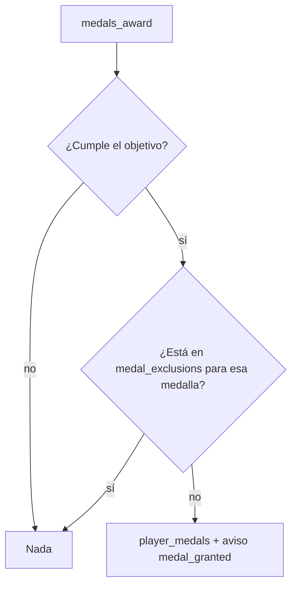

# Pionero para los del primer mix: documentación

## Qué hace

La medalla **Pionero** es para quienes jugaron el primer mix de la plataforma. Durante la BETA no se daba ninguna medalla del motor: Pionero y Fundador quedaron para la apertura de la temporada 2 (2026-11-09 09:00 UTC). Ese día se dio Fundador a 120 jugadores, pero Pionero a nadie.

La causa: la métrica `first_match` tomaba la partida terminada más vieja **de cualquier tipo**. Desde el replanteo `80` hay partidas de torneos históricos (`kind = 'official'`), y la más vieja es del 2020-07-10. Esa partida no tiene jugadores con ficha, así que la medalla no le llegaba a nadie.

El replanteo `95` hace que Pionero mire solo los mixes (`kind = 'mix'`) y suma las **exclusiones**: un jugador puede quedar sin una medalla del motor aunque la cumpla. Se usó para NOTIONSPAPU (hoy "notionszera"), que está baneado (Daniel, 2026-11-09).



## El primer mix

Es la partida terminada más vieja con `kind = 'mix'`, ordenada por `coalesce(played_at, starts_at)` y después por `id`. En producción es el mix de dust2 del 2026-10-13 a las 01:42 UTC (`609a1fd7-f1df-4ef5-abd6-618012039f87`, 16-9). Las partidas de torneo (`official`), PCW (`pcw`) y matchmaking (`mm`) no cuentan.

| SteamID | Nick en el mix | Nick hoy | Pionero |
|---|---|---|---|
| 76561200715397432 | always | always | Sí |
| 76561199710358878 | daniloev | daniloev | Sí |
| 76561199009385236 | flow | flow | Sí |
| 76561199913252416 | haalandpeek!alpeek! | odreaz | Sí |
| 76561200644339126 | kyan | kyan | Sí |
| 76561199913019676 | Lukas | Lukas | Sí |
| 76561201375527472 | NOTIONSPAPU | notionszera | **No** (excluido: baneado) |
| 76561199356091872 | shadowxr | Cypee-THOR | Sí |
| 76561200119533924 | sweedz, | sweedz | Sí |
| 76561201193682294 | vodka | vodkaa | Sí |

## Exclusiones

Tabla `medal_exclusions`:

| Columna | Qué es |
|---|---|
| `player_id` | La ficha (se borra con la ficha) |
| `definition_id` | La medalla (se borra con la definición) |
| `reason` | Por qué, de 1 a 200 caracteres |
| `created_at`, `created_by` | Cuándo y quién (`created_by` puede quedar vacío si se cargó por SQL) |

- Clave primaria `(player_id, definition_id)`.
- RLS prendida y sin políticas: no la ve nadie desde la API, solo las funciones internas.
- `medals_award` (que usan el guardado de cada mix, el cron `medals:tick` y la retroactiva al activar) no da una medalla excluida.
- `medal_progress` devuelve 0 para una medalla excluida, así Logros no la muestra como cumplida.
- No quita una medalla ya dada: para eso está la ficha del jugador.
- Por ahora se carga solo por SQL:

```sql
insert into medal_exclusions (player_id, definition_id, reason)
select '<ficha>', id, '<motivo>' from medal_definitions where key = '<clave>';
```

Exclusión cargada el 2026-11-09: `2e444310-8a50-4e45-8229-a42ef017f10b` (notionszera) y `pionero`, con el motivo "Baneado: sin Pionero (Daniel, 2026-11-09)".

## Funciones que cambian

| Función | Cambio |
|---|---|
| `medal_metric_values` | En `first_match`, `and m.kind = 'mix'` |
| `medals_award` | Salta las exclusiones |
| `medal_progress` | 0 en una exclusión |

Los cambios están marcados con `/* (replanteo 95) */` dentro de cada función.

## Qué cambia para cada rol

| Rol | Qué cambia | Página del manual |
|---|---|---|
| Jugador | Los del primer mix (menos uno) recibieron Pionero con su aviso. Para todos los demás no cambia nada | Sin cambios ([Logros](../../manual/jugador/logros.md) ya lo decía) |
| Admin | Pionero cuenta solo los mixes, y existe la exclusión de un jugador de una medalla (se la pide a Daniel; sin pantalla) | [Medallas](../../manual/admin/medallas.md) |
| Capitán, organizador, moderador, streamer y dueño de un servidor externo | Nada | — |

## Términos y privacidad

Sin cambios. La exclusión no publica nada: la tabla solo la leen las funciones internas.

## Dónde está cada cosa

| Qué | Archivo / ubicación |
|---|---|
| Replanteo | `supabase/replanteo/95_pionero_primer_mix.sql` |
| Inversa | `docs/bitacora/2026-11-09-pionero-primer-mix/pruebas/95_inversa.sql` |
| Prueba con rollback | `docs/bitacora/2026-11-09-pionero-primer-mix/pruebas/probar_95.sh` |
| Manual del admin | `docs/manual/admin/medallas.md` |
| Motor de medallas | Replanteo `79` ([`2026-11-04-medallas-configurables`](../2026-11-04-medallas-configurables/)) |
