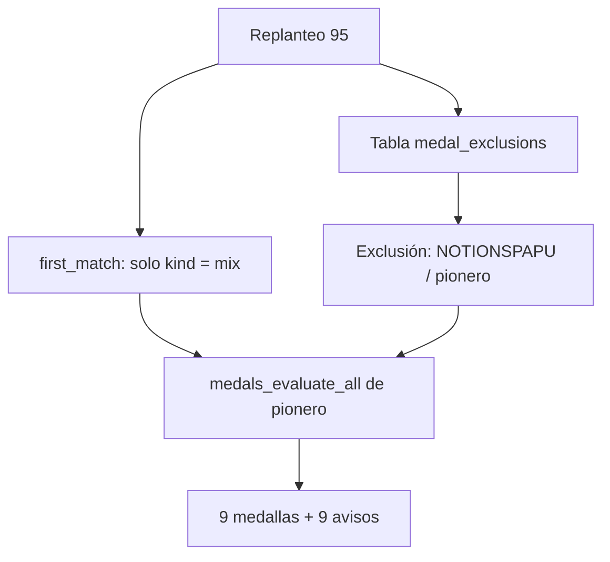

# Plan: Pionero para los del primer mix

> Planeación original. Estado: **aprobado** por Daniel el 2026-11-09 ("dale, avanza con todo, pero no se la des a NOTIONSPAPU porque ese jugador está baneado").

## Decisiones tomadas

| Tema | Decisión |
|---|---|
| Qué falló | Al abrirse la temporada 2 (2026-11-09 09:00 UTC) se dio Fundador a 120 jugadores, pero Pionero a nadie. La métrica `first_match` toma la partida terminada más vieja **de cualquier tipo**, y desde la `80` hay partidas de torneos históricos (`kind = 'official'`) con fecha de 2020, sin jugadores con ficha. |
| Qué partida es "el primer mix" | La terminada más vieja con `kind = 'mix'`. En producción es el mix de dust2 del 2026-10-13 a las 01:42 UTC (`609a1fd7-…`), con 10 jugadores con ficha. Las de torneo, PCW y matchmaking no cuentan. |
| Un jugador sin la medalla | NOTIONSPAPU (hoy "notionszera", ficha `2e444310-…`) no la recibe porque está baneado (Daniel). No tiene un baneo en `bans`, así que no alcanza con una regla por baneo: se suma una tabla de exclusiones por jugador y medalla, que el motor respeta siempre (también en la retroactiva y al guardar cada mix). |
| Quién carga una exclusión | Por ahora solo por SQL. Sin pantalla en Administración › Medallas. |
| Avisos | Los 9 reciben el aviso de medalla de siempre (`medal_granted`). |

## 1. El flujo completo

## 2. Base de datos (replanteo `95_pionero_primer_mix.sql`)

- `medal_metric_values`: en `first_match`, la subconsulta de la primera partida suma `and m.kind = 'mix'`.
- `medal_exclusions (player_id, definition_id, reason, created_at, created_by)`, con RLS y sin políticas (solo las funciones internas).
- `medals_award` no inserta una medalla excluida para ese jugador.
- `medal_progress` devuelve 0 en una medalla excluida, para que Logros no la muestre como cumplida.
- Inversa: deja las tres funciones como en la `79` y borra la tabla.

## 3. Despliegue en producción

1. Probar la `95` contra producción en una transacción con rollback (`probar_95.sh`).
2. Aplicar la `95`.
3. Cargar la exclusión de NOTIONSPAPU y correr `medals_evaluate_all` de `pionero`.
4. Comprobar: 9 Pionero, ninguna para NOTIONSPAPU, 9 avisos.

## 4. Requisitos antes de empezar

- Acceso SSH al VPS (`ubuntu`, OpenSSH de Windows).
- Sin nada que pedirle a Daniel: no toca la API, la web ni los servidores de juego.

## 5. Orden de implementación

1. Replanteo `95`, inversa y prueba (`probar_95.sh`), en la base local.
2. Prueba contra producción con rollback.
3. Aplicar y repartir (sección 3).
4. Documentación, manual, `PENDIENTES.md` y commit en `main`.
