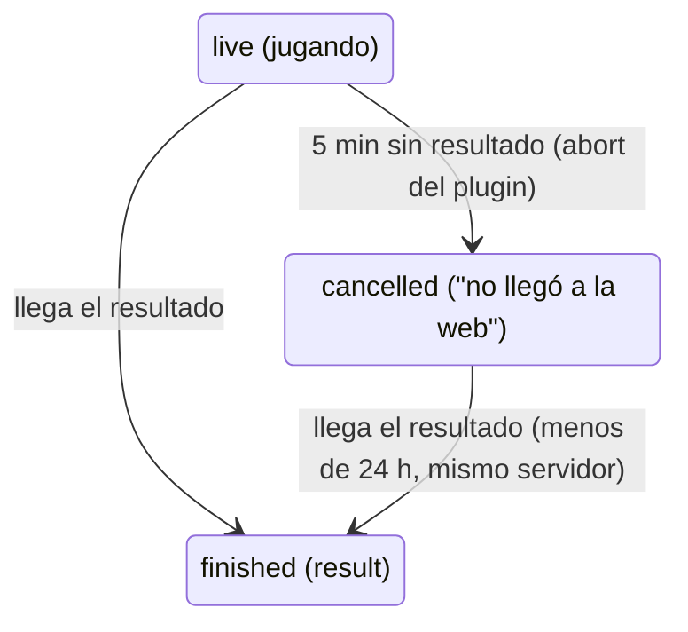

# El resultado tardío cierra la sala del matchmaking: documentación

## Qué hace

Cuando el resultado de una partida del matchmaking tarda más de 5 minutos en llegar a la web, el plugin cancela la sala con "El resultado de la partida no llegó a la web" para liberar el servidor (`MM_DONE_WAIT`, `csstv/mm.inc`), y sigue reintentando el envío desde `data/csstv/queue/`. Desde el replanteo `99`, cuando ese resultado entra, `csstv_link_game` vincula el mix a la sala cancelada y la cierra como si hubiera llegado a tiempo: partida madre terminada con el marcador, sala `finished` con `result` y ganador, y el ELO con las reglas del matchmaking.

## Cuándo se revive una sala cancelada

Solo si se cumple todo:

| Condición | Por qué |
|---|---|
| No hay partida madre `upcoming` o `live` con ese código | Una sala abierta tiene prioridad, como antes |
| Partida madre `kind = 'mm'` y `cancelled` | Solo el matchmaking |
| Sala `cancelled` con `end_reason` exactamente "El resultado de la partida no llegó a la web" | Es el `abort` del plugin. No accepted, no conectados, reinicio o admin no se reviven |
| `ended_at` hace menos de 24 horas | El plugin reintenta cada 15 minutos |
| El mix viene del servidor de la sala (`server_id`) | Un código de otro servidor no la cierra |

El resto de `csstv_link_game` no cambia: sanción a los que siguen desconectados (salvo en la última ronda), derrota automática, `lobby.finished` por el socket.

## Qué cambia para cada rol

| Rol | Qué cambia | Página del manual |
|---|---|---|
| Jugador | Una sala cancelada por resultado tardío queda terminada cuando llega el resultado | `jugador/buscar-partida.md` |
| Admin | Nada nuevo (sigue valiendo no cerrar a mano un mix que estaba por terminar) | `admin/elo-y-mixes.md` |
| Capitán, organizador, moderador, streamer, dueño de un servidor externo | Nada | — |

## Términos y privacidad

Sin cambios.

## Dónde está cada cosa

| Qué | Dónde |
|---|---|
| Migración | `supabase/replanteo/99_resultado_tardio_mm.sql` |
| Inversa | `docs/bitacora/2026-10-14-replanteo-modelo-datos/reversas/99_resultado_tardio_mm.sql` |
| Pruebas (base local, con rollback) | `pruebas/probar_99.sh` y `pruebas/probar_99.sql` |
