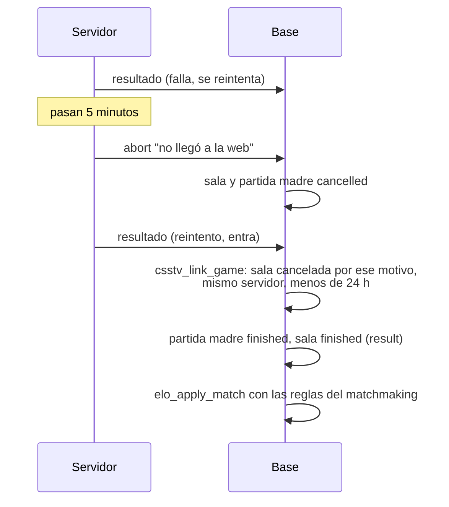

# Plan: el resultado tardío cierra la sala del matchmaking

> Planeación original. Estado: **aprobada** por Daniel el 2026-11-09 (opción 2: en la base, sin tocar los servidores).

## El problema

Al terminar una partida del matchmaking, el plugin manda el resultado y espera a que la web cierre la sala. Si en 5 minutos (`MM_DONE_WAIT`, `csstv/mm.inc`) no la cerró, manda `abort` y la sala queda cancelada con "El resultado de la partida no llegó a la web", aunque el resultado siga en `data/csstv/queue/` reintentándose. Cuando el resultado entra, `csstv_link_game` busca la partida madre solo en `upcoming` o `live`, no la encuentra y el mix queda suelto: la sala cancelada, sin ganador, sin vínculo y sin las reglas del matchmaking en el ELO (`mm_elo_delta`, abandonos). Pasó el 2026-11-09 con la sala `cb04b97c` ([`2026-11-09-ingreso-sin-timeout`](../2026-11-09-ingreso-sin-timeout/)).

## Decisiones tomadas

| Tema | Decisión | Por qué |
|---|---|---|
| Dónde | `csstv_link_game` (replanteo `99`) | Un solo cambio en la base, sin compilar ni subir el plugin a los tres servidores |
| Qué sala revive | Solo una sala cancelada con exactamente "El resultado de la partida no llegó a la web" (el `abort` de `MM_DONE_WAIT`) y con su partida madre `cancelled` | Las demás cancelaciones (no aceptaron, no se conectaron, reinicio, admin) siguen sin vincularse |
| Mismo servidor | El mix tiene que venir del servidor de la sala (`matches.server_id = mm_lobbies.server_id`) | Que un código de `!match` de otro servidor no cierre la sala |
| Plazo | Sala cancelada hace menos de 24 horas | El plugin reintenta cada 15 minutos; un día alcanza para una caída del VPS. Después no se toca una sala vieja |
| Qué hace al vincular | Lo mismo que con una sala `live`: partida madre terminada con el marcador, sanción a los que siguen desconectados (salvo la última ronda), derrota automática, sala `finished` con `result` y ganador, aviso `lobby.finished` | El resultado queda igual que si hubiera llegado a tiempo |
| Plugin | Sin cambios | El `abort` sigue liberando el servidor a los 5 minutos |

## 1. El flujo

## 2. Cambios en la base

`99_resultado_tardio_mm.sql`: en `csstv_link_game`, si no hay partida madre `upcoming`/`live` con ese código, busca una del matchmaking `cancelled` cuya sala cumpla lo de arriba (reemplazo sobre `pg_get_functiondef`, como la `98`). Inversa en `reversas/`.

## 3. Pruebas (base local, con rollback)

1. Sala cancelada por "no llegó a la web": se vincula y queda terminada con ganador.
2. Cancelada por otro motivo: no se vincula.
3. Mix de otro servidor: no se vincula.
4. Cancelada hace más de 24 horas: no se vincula.
5. Una sala `live` se vincula como antes.
6. La inversa deja la función idéntica.

## 4. Orden

1. Replanteo y pruebas en local.
2. Aplicar en producción y `notify pgrst`.
3. Documentación, manual (si cambia algo para un rol) y commit cuando Daniel lo pida (en `main`, `feat/frontend-fase-1` y `feat/mm-claim-en-sala`).
