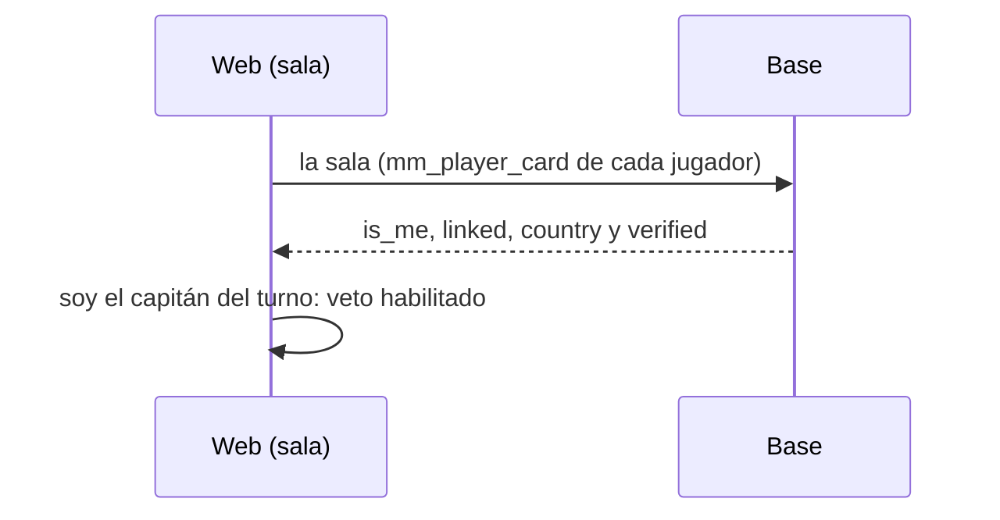

# La sala del matchmaking sin `is_me`: documentación

## Qué hace

Desde la `94` (desplegada el 2026-11-09), la ficha de cada jugador de la sala (`mm_player_card`) llegaba sin `is_me`, `linked` ni `country`. La `94` le agregó `'verified'` con un comentario `-- (replanteo 94)` en medio de la línea, y todo lo que seguía en esa línea quedó comentado.

Sin `is_me`, la web no sabe cuál de los diez jugadores es el que está mirando:

- **Veto:** el botón solo se habilita si el jugador es el capitán del turno, así que ningún capitán podía vetar. Cada turno se vencía y la base elegía un mapa al azar.
- **Chats:** el chat de equipo va debajo de tu lado y el general debajo del rival. Sin lado propio, la sala mostraba el general en los dos lados.
- **`!claim`:** sin `linked`, no aparecía el aviso para vincular el SteamID.
- **País:** sin `country`, no se veía la bandera.

El replanteo `101` saca el comentario de esa línea y la ficha vuelve a tener los tres campos.

## Qué cambia para cada rol

| Rol | Qué cambia | Página del manual |
|---|---|---|
| Jugador | La sala vuelve a funcionar como antes del 2026-11-09: el capitán veta, hay chat de equipo y aparece el aviso del `!claim` | Sin cambios (el manual ya lo describe así) |

## Términos y privacidad

Sin cambios.

## Dónde está cada cosa

| Qué | Archivo |
|---|---|
| Arreglo | `supabase/replanteo/101_mm_ficha_is_me.sql` |
| Inversa | `docs/bitacora/2026-10-14-replanteo-modelo-datos/reversas/101_mm_ficha_is_me.sql` |
| Prueba | `pruebas/probar_101.sh` |
