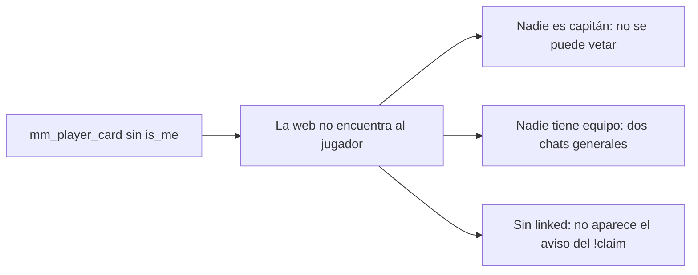

# Plan: la sala del matchmaking sin `is_me` (capitanes sin veto y dos chats generales)

> Planeación original. Reportado por Daniel el 2026-11-09: en la segunda partida del día los capitanes no podían vetar y la sala mostraba dos chats generales.

## Decisiones tomadas

| Tema | Decisión |
|---|---|
| Causa | La `94` agregó `'verified'` a `mm_player_card` con el comentario `-- (replanteo 94)` en medio de la línea. Todo lo que seguía en esa línea (`'is_me'`, `'linked'` y `'country'`) quedó comentado. |
| Arreglo | Replanteo `98`: saca el comentario de esa línea, sin tocar nada más de la función. Verifica que la línea cortada esté antes de cambiarla. |
| Número | `98`: la `95`, la `96` y la `97` ya son de `main`. |
| Web | No hace falta tocarla para el matchmaking: con `is_me` de vuelta, el veto y los chats funcionan como antes. |

## 1. El flujo completo

## 2. Base

`98_mm_ficha_is_me.sql`, su inversa y `pruebas/probar_98.sh`.

## 3. Orden de implementación

1. Replanteo, inversa y prueba en la base local.
2. Prueba y aplicación en producción, por el túnel.
