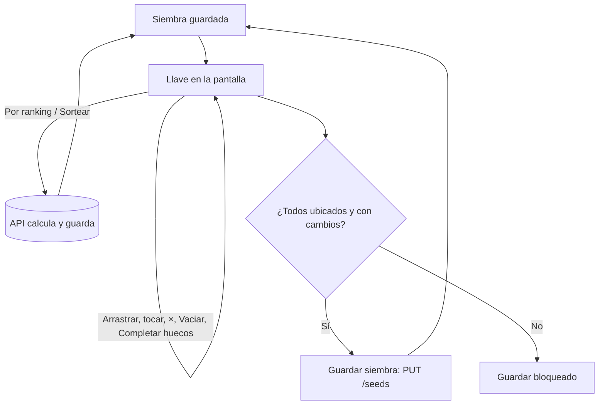

# Siembra sobre la llave: documentación

## Qué hace

La pestaña **Siembra** de un torneo (Administración › Torneos › un torneo) muestra el formato elegido con cada equipo en su lugar: la llave de eliminación directa o la superior de la doble, los grupos, o los que entran directo y la ronda 1 del suizo. El organizador arrastra cada equipo al lugar donde quiere que juegue, o lo toca y después toca el lugar.

Por debajo, la siembra sigue siendo una lista ordenada de equipos (la semilla 1 es la cabeza de serie). La llave solo dibuja qué semilla cae en cada lugar, así que no cambian ni la base ni la API: **Guardar siembra** manda la lista completa a `PUT /events/{id}/seeds`, como antes. **Por ranking** y **Sortear** siguen calculándose y guardándose en la API.

Mientras arma, el organizador puede dejar lugares vacíos: los equipos que no están en la llave quedan en la columna **Sin ubicar**. Guardar se habilita cuando están todos.

## Lugares y semillas

| Formato | Qué se dibuja | Qué se siembra |
|---|---|---|
| Eliminación directa | Todas las rondas. La primera con el orden clásico (1-8, 4-5, 2-7, 3-6) y las demás con "Ganador r.k" | La primera ronda. Si los inscritos no son potencia de 2, el lugar sin rival dice "Libre: pasa solo" |
| Doble eliminación | La llave superior, con "Final superior" y "Gran final" | La primera ronda de arriba. La inferior se llena sola y no se dibuja |
| Grupos y grupos de doble eliminación | Un grupo por columna, en serpentina (con 2 grupos, A: 1, 4, 5, 8 y B: 2, 3, 6, 7) | Cada lugar de cada grupo. Soltar un equipo en otro grupo le cambia la semilla y, con eso, el grupo |
| Suizo | "Entran directo" (si tiene varias etapas, en bloques de `size/2`, como `seedBlocks`) y la ronda 1 de la etapa 1 (mitad de arriba contra mitad de abajo) | Esos lugares. Las rondas siguientes son por récord |

La lógica está en `seedLayout(template, config, n)`, que devuelve secciones → columnas → cajas → lugares (`seed`, `bye` o `ph`).

## Reglas al soltar

- Sobre un lugar vacío: el equipo queda ahí (y deja vacío el lugar de donde venía).
- Sobre un lugar ocupado: si el equipo venía de otro lugar, intercambian; si venía de **Sin ubicar**, el que estaba vuelve a **Sin ubicar** (`placeTeam`).
- Sobre la columna **Sin ubicar**: sale de la llave. También con la **×**.
- **Completar huecos en orden** llena los vacíos con los sin ubicar en el orden de la siembra guardada; **al azar**, mezclados (`fillSlots`).
- **Vaciar** deja todos sin ubicar. **Deshacer cambios** vuelve a la guardada.
- Tocar un equipo lo elige (queda marcado y aparece un aviso); tocar un lugar lo pone ahí. Escape o volver a tocarlo lo suelta.
- Un punto naranja marca a los que no están en su semilla guardada.
- Con el fixture generado, la llave se ve igual pero sin columna, botones ni arrastre.

## Qué cambia para cada rol

| Rol | Qué cambia | Página del manual |
|---|---|---|
| Organizador (y moderador y admin, que gestionan torneos) | La siembra se arma sobre la llave del formato: arrastrar o tocar y poner, Vaciar y Completar huecos | [`organizador/inscripciones-y-fixture.md`](../../manual/organizador/inscripciones-y-fixture.md) |
| Jugador, capitán, streamer y dueño de un servidor externo | Nada | — |

## Términos y privacidad

Sin cambios: no se guarda ni se publica ningún dato nuevo, no hay servicios externos, plazos, sanciones ni pagos, y lo que puede hacer cada rol es lo mismo.

## Dónde está cada cosa

| Qué | Archivo / ubicación |
|---|---|
| Pantalla | `web/frontend/src/features/admin/events/components/SeedingTab.tsx` |
| Lógica (`seedLayout`, `placeTeam`, `fillSlots`, `koRoundName`) | `web/frontend/src/features/admin/events/lib/model.ts` |
| Pruebas de la lógica | `web/frontend/src/features/admin/events/lib/model.test.ts` |
| Demo sin API ni sesión (solo `pnpm dev`) | `web/frontend/src/routes/demo.siembra.tsx` → `/demo/siembra` |
| Diseño aprobado | [Siembra sobre el bracket](https://claude.ai/artifact/4TaRFuLUeo7RpoK2B8vZ7Y) |
| Manual | `docs/manual/organizador/inscripciones-y-fixture.md` |
