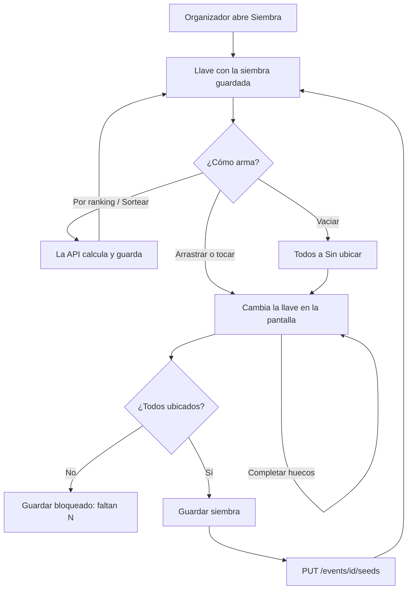

# Plan: siembra sobre la llave

> Planeación original. Estado: **aprobada** por Daniel el 2026-11-09 ("Acepto el diseño, implementa"), sobre el diseño interactivo [Siembra sobre el bracket](https://claude.ai/artifact/4TaRFuLUeo7RpoK2B8vZ7Y).

Pedido por Daniel (2026-11-09): la pestaña **Siembra** de un torneo es incómoda. Hoy es una lista del 1 al último, con una vista chica de la primera ronda al lado. Mientras ordenas, no ves cómo queda el formato. La idea es ver el formato elegido (eliminación directa, doble, grupos, suizo) y arrastrar cada equipo al lugar de la llave donde quieres que quede, sin perder la siembra automática por ranking y el sorteo.

## Decisiones tomadas

| Tema | Decisión | Por qué |
|---|---|---|
| Dónde se suelta | En la llave del formato elegido: cada lugar es una semilla (#1, #2…) | Es lo que pidió Daniel: se ve el cruce mientras se arma |
| Modelo | El mismo de hoy: una lista ordenada de equipos (`PUT /events/{id}/seeds`). La llave solo dibuja qué semilla cae en cada lugar | Sin cambios en la base ni en la API: se despliega solo la web |
| Lugares vacíos | Existen solo en la pantalla mientras armas. **Guardar siembra** pide todos ubicados | La API pide la lista completa |
| Equipos sin ubicar | Columna a la izquierda, en el orden de la siembra guardada. Soltar ahí un equipo de la llave lo saca | Se puede vaciar y armar de cero |
| Soltar sobre un lugar ocupado | Intercambia los dos equipos (si el que llega viene de la columna, el que estaba vuelve a la columna) | Es lo esperable en una llave; con "insertar y correr" se mueven equipos que no tocaste |
| Sin arrastrar | Tocar un equipo y después el lugar (sirve con el dedo y con el teclado: Enter, y Escape para soltar) | Reemplaza los botones ▲ ▼ y Alt + flechas |
| Automático | **Por ranking** y **Sortear** siguen como hoy (los calcula y guarda la API, con confirmación si hay cambios sin guardar). Nuevos: **Completar huecos en orden** y **Completar huecos al azar**, solo en la pantalla | Poner a mano los que importan y que el resto se llene solo |
| "Completar en orden" y no "por ranking" | Llena con los sin ubicar en el orden de la siembra guardada | El ranking lo calcula la API y hoy no hay forma de pedirlo sin guardarlo. Si la última siembra fue por ranking, es lo mismo |
| Puesto a mano | Un punto naranja en el equipo que no está en su semilla guardada | Reemplaza el badge "a mano" |
| Formatos | Eliminación directa (todas las rondas, con byes), doble (la llave superior completa; la inferior, un aviso de que se llena sola), grupos y grupos de doble eliminación (serpentina por grupo), suizo (los que entran directo a cada etapa y la ronda 1 de la etapa 1, con las rondas siguientes por récord) | Solo se siembra la primera ronda; lo demás sale de los resultados |
| Fixture generado | La llave se ve igual, pero sin arrastrar ni botones | Igual que hoy |

## 1. El flujo completo

## 2. Lógica (`features/admin/events/lib/model.ts`)

Funciones puras, con pruebas en `model.test.ts`:

- `seedLayout(template, config, n)`: las secciones de la llave. Cada sección tiene columnas, cada columna cajas (una partida o un grupo) y cada caja lugares: una semilla (`seed`), un bye (`bye`) o un texto (`ph`, "Ganador 1.2").
- `placeTeam(slots, id, i)`: pone un equipo en un lugar, con el intercambio.
- `fillSlots(slots, rest)`: llena los huecos en orden con los que faltan.

`koRound1`, `swissRound1`, `snakeGroups` y `seedBlocks` se reusan.

## 3. Pantalla (`features/admin/events/components/SeedingTab.tsx`)

- Arriba: **Por ranking**, **Sortear** | **Completar huecos en orden**, **Completar huecos al azar**, **Vaciar**.
- Izquierda: **Sin ubicar**, con escudo, nombre y jugadores activos.
- Derecha: la llave del formato, con scroll horizontal si no entra.
- Abajo, fija: ubicados, puestos a mano, lo que falta, **Deshacer cambios** y **Guardar siembra**.
- En el celular, la columna queda arriba de la llave.

## 4. Manual, términos y changelog

- `docs/manual/organizador/inscripciones-y-fixture.md`, sección **Siembra**.
- Términos y privacidad: sin cambios (no toca datos, servicios, plazos ni roles).
- `CHANGELOG_DISCORD.txt`.

## 5. Requisitos antes de empezar

Ninguno: no hay migración ni cambios en la API.

## 6. Orden de implementación

1. Lógica y pruebas.
2. Pantalla.
3. Pruebas, lint y typecheck de la web.
4. Manual, documentación, guía, changelog y fila del índice.
