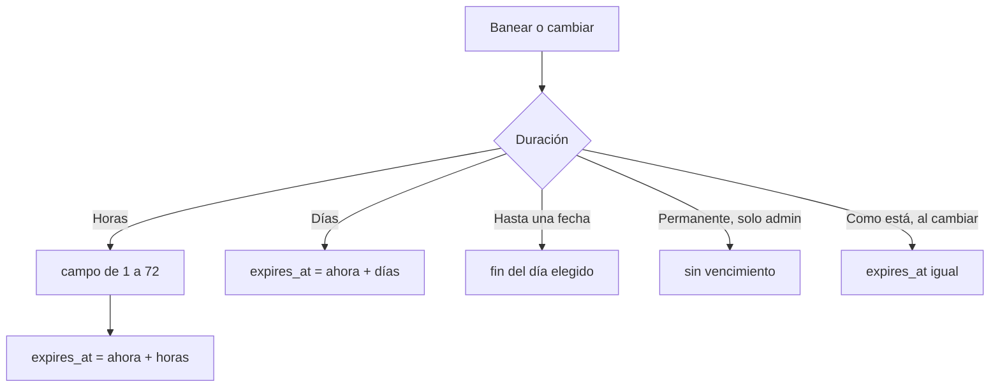

# Baneos por horas: documentación

## Qué hace

El diálogo de Banear (Administración › Baneos y el perfil del jugador) suma la duración **Horas**, con un campo para escribir cuántas, de 1 a 72. El baneo vence a esa hora exacta.

Al **cambiar** un baneo hay una opción nueva, **Como está**, que viene elegida y deja el vencimiento igual. Antes, cambiar solo el motivo pasaba el vencimiento al fin del día en que vencía, y con un baneo de horas eso lo alargaba.

La lista de baneos y el detalle muestran el vencimiento con la hora ("4 nov 2026, 21:40") y lo que falta: minutos u horas si vence en menos de un día, y días si no.

Lo pidió Daniel el 2026-11-10. Una sesión anterior había dejado, sin commit y en `feat/frontend-fase-1`, botones fijos de 1, 6 y 12 horas; se cambiaron por el campo.

## Cómo funciona

- Solo cambia la web. La base y la API ya guardaban `expires_at` con fecha y hora, y los servidores comparan contra esa hora en cada sincronización de baneos (cada 3 minutos o al cambiar de mapa, o con `!syncbans`).
- `bans/lib/bans.ts`: `Duration` suma `"hours"`; `banExpiry(d, date, now, hours)`; `validBanHours` (entero de 1 a `BAN_MAX_HOURS`, 72) y `banRemaining` (lo que falta).
- `BanDialog.tsx`: el botón **Horas** con el campo, **Como está** (solo al cambiar) y el texto "Vence el …" con la hora. Con un número inválido, el botón **Banear** queda apagado y el texto lo dice.
- `BanPanel.tsx` y `AdminBansPage.tsx`: el vencimiento con hora y lo que falta.

## Qué cambia para cada rol

| Rol | Qué cambia | Página del manual |
|---|---|---|
| Moderador | Puede banear por horas, y al cambiar un baneo puede dejar el vencimiento como está | `moderador/banear-jugador.md` |
| Admin | Lo mismo (usa la misma página de Baneos) | `moderador/banear-jugador.md` |
| Jugador, capitán, organizador, streamer, dueño de un servidor externo | Nada | — |

## Términos y privacidad

Sin cambios. Los términos no nombran las duraciones de los baneos, y no cambia qué se guarda.

## Dónde está cada cosa

| Qué | Dónde |
|---|---|
| Lógica y pruebas | `web/frontend/src/features/admin/bans/lib/bans.ts` y `bans.test.ts` |
| Diálogo | `web/frontend/src/features/admin/bans/components/BanDialog.tsx` |
| Detalle y lista | `BanPanel.tsx` y `pages/AdminBansPage.tsx` |
| Manual | `docs/manual/moderador/banear-jugador.md` |
| Changelog | `CHANGELOG_DISCORD.txt` (2.9.38) |
