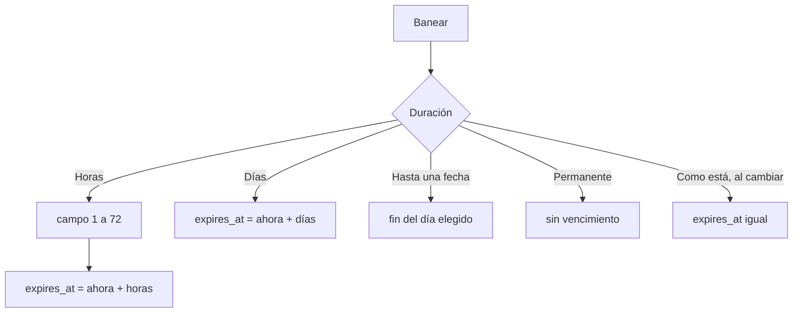

# Plan: baneos por horas

> Planeación original. Estado: **aprobado por Daniel** (2026-11-10: "despliega también lo de los baneos por horas, aunque quisiera que cuando sea por hora se pueda especificar cuántas horas y no que sea un valor definido").

## El problema

El diálogo de Banear (Administración › Baneos y el perfil) solo ofrece días: 1, 3, 7, 30, una fecha o permanente. Para una falta chica no hay forma de banear por unas horas.

Una sesión anterior dejó en el worktree de `feat/frontend-fase-1`, sin commit, las opciones fijas de 1, 6 y 12 horas. Daniel quiere poder escribir cuántas horas.

## Decisiones tomadas

| Tema | Decisión | Por qué |
|---|---|---|
| Dónde | Solo la web. La base y la API ya guardan `expires_at` con fecha y hora, y el plugin compara contra esa hora | No hace falta tocar nada más |
| Opción | Un botón **Horas** con un campo numérico al lado, de 1 a 72 | Para más de 3 días están los días y la fecha |
| Por defecto | 1 hora al elegir Horas | La falta chica típica |
| Al cambiar un baneo | Opción nueva **Como está** (por defecto), que deja `expires_at` igual | Antes, cambiar solo el motivo pasaba el vencimiento al fin del día del vencimiento; con un baneo de horas eso lo alargaba |
| Mostrar el vencimiento | Con hora ("4 nov 2026, 21:40") y lo que falta en minutos, horas o días | Con baneos de horas, solo el día no alcanza |
| Base de lo que ya estaba hecho | Se trae de `feat/frontend-fase-1` a `main` lo que sirve (`banRemaining`, `fmtDateTime`) y se cambian los botones fijos por el campo | `main` es la rama principal |

## 1. El flujo

## 2. Web

- `bans/lib/bans.ts`: `Duration` suma `"hours"` y `"keep"`; `banExpiry` recibe las horas; `banRemaining` y `clampHours`.
- `bans/components/BanDialog.tsx`: el botón **Horas** con su campo, **Como está** al cambiar, y el vencimiento con hora.
- `BanPanel.tsx` y `AdminBansPage.tsx`: el vencimiento con hora y lo que falta.
- Pruebas en `bans.test.ts`.

## 3. Manual, términos y privacidad

- `moderador/banear-jugador.md` (y la página del admin, si nombra las duraciones).
- Términos: revisar si nombran las duraciones de los baneos.

## 4. Orden de implementación

1. Web y pruebas en `main`.
2. Manual, legales si hace falta y bitácora.
3. Commit en `main`.
4. Desplegar la web, sin mixes en curso.
