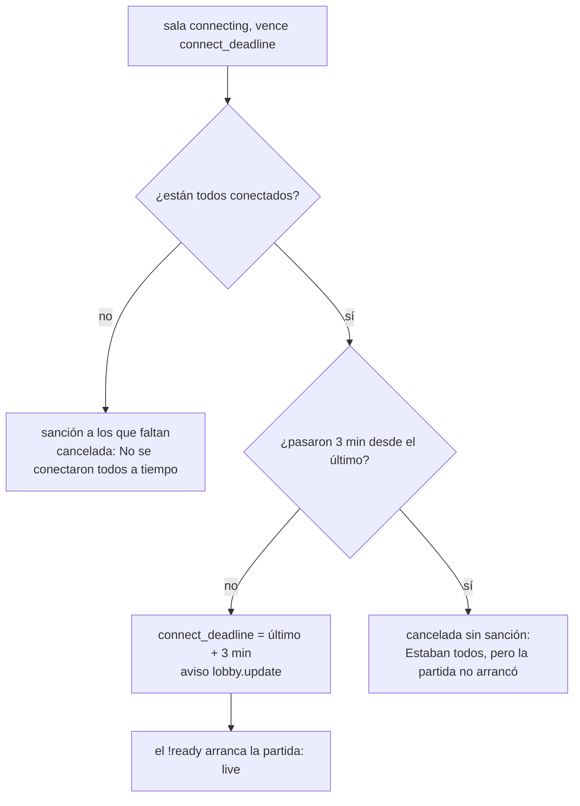

# Con todos conectados, la sala no se cancela por el plazo de conexión: documentación

## Qué hace

Una sala del matchmaking en `connecting` ya no se cancela al vencer el plazo de conexión si están todos en el servidor. Desde que entró el último, tienen **3 minutos** para escribir `!ready`. Si la partida no arranca en ese tiempo, la sala se cancela **sin sanción para nadie**.

Si al vencer el plazo falta alguien, todo sigue como antes: los que no entraron quedan sancionados y la sala se cancela con "No se conectaron todos a tiempo".

Lo pidió Daniel el 2026-11-10, después de la sala `b14ad561`: se canceló con los 10 conectados, porque el último entró 8 segundos antes del plazo.

## Cómo funciona

- En cada vuelta de `mm_tick`, para una sala `connecting` con `connect_deadline` vencido y todos los `mm_lobby_players` con `connected_at`:
  - Si todavía no pasaron 3 minutos desde el último `connected_at`, `connect_deadline` pasa a esa hora y se avisa `lobby.update`. La sala de la web muestra la cuenta nueva.
  - Si ya pasaron, la sala se cancela con "Estaban todos, pero la partida no arrancó (faltó el !ready)". No se sanciona a nadie, porque la base no sabe quién no escribió `!ready`.
- Si el último entró con más de 3 minutos de margen, al vencer el plazo de conexión se cancela directamente con ese motivo: ya tuvieron sus 3 minutos.
- El plugin no cambia. No usa `connect_seconds`, y la partida arranca con el `!ready` de siempre, que avisa `live`.
- La API no cambia: la sala trae `connect_deadline` como antes.

## Web

En la sala, mientras se conectan, la cuenta regresiva dice "Quedan m:ss para entrar" mientras falta alguien, y "Quedan m:ss para que todos escriban !ready" cuando están todos.

## Qué cambia para cada rol

| Rol | Qué cambia | Página del manual |
|---|---|---|
| Jugador | Con todos adentro, 3 minutos para el `!ready`; si no arranca, se cancela sin sanción | `jugador/buscar-partida.md` |
| Admin, capitán, organizador, moderador, streamer, dueño de un servidor externo | Nada | — |

## Términos y privacidad

Sin cambios. No cambia qué se guarda ni cuándo se sanciona. Solo se deja de cancelar en un caso y se agrega uno sin sanción.

## Dónde está cada cosa

| Qué | Dónde |
|---|---|
| Migración | `supabase/replanteo/108_mm_plazo_ready.sql` |
| Inversa | `docs/bitacora/2026-10-14-replanteo-modelo-datos/reversas/108_mm_plazo_ready.sql` |
| Pruebas de la base | `pruebas/probar_108.sh` y `pruebas/probar_108.sql` |
| Web | `web/frontend/src/features/matchmaking/room/RoomOverview.tsx` y su prueba |
| Manual | `docs/manual/jugador/buscar-partida.md` |
| Changelog | `CHANGELOG_DISCORD.txt` (2.9.36) |
