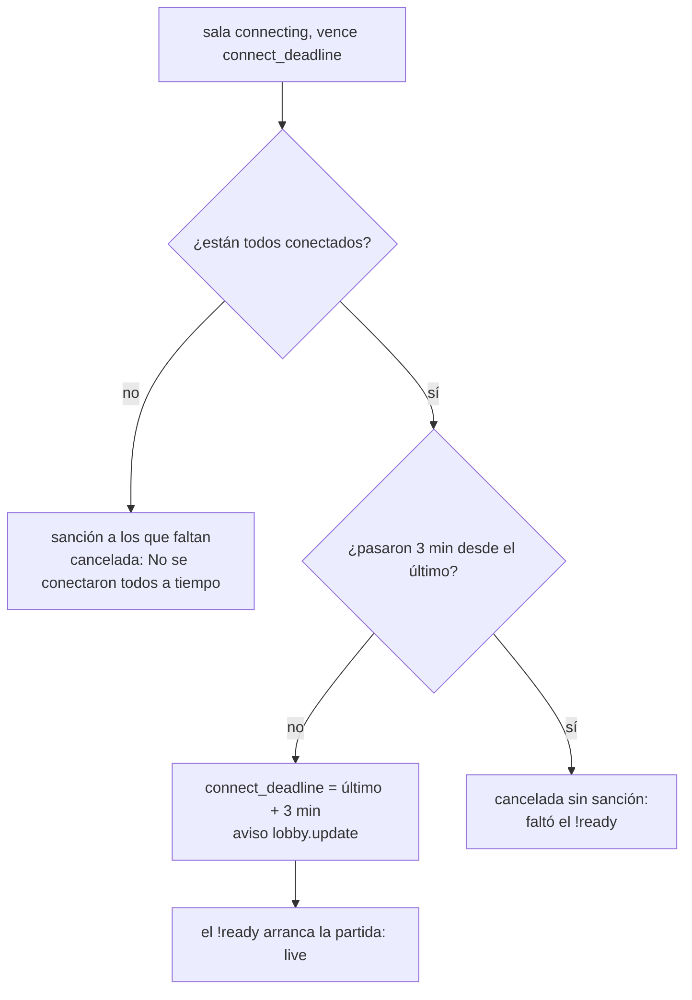

# Plan: con todos conectados, la sala no se cancela por el plazo de conexión

> Planeación original. Estado: **aprobado por Daniel** (2026-11-10: "arregla lo de la sala que se cancela con todos conectados").

## El problema

El 2026-11-10, mientras se aplicaba la `104`, la sala `b14ad561` se canceló con "No se conectaron todos a tiempo" aunque los 10 jugadores estaban en el servidor. El último había entrado 8 segundos antes del plazo.

La sala recién pasa a `live` cuando arranca la partida: el plugin avisa `live` con el `!ready` de todos. `mm_tick` cancela una sala `connecting` cuando vence `connect_deadline`, sin mirar si ya entraron todos. Nadie quedó sancionado, porque la sanción es solo para los que no se conectaron.

## Decisiones tomadas

| Tema | Decisión |
|---|---|
| Dónde | Solo en la base (`mm_tick`). El plugin no usa `connect_seconds`, y el arranque sigue siendo el `!ready` de siempre |
| Plazo para el `!ready` | 3 minutos desde que entró el último. Fijo, sin campo en Administración: si hace falta, se puede volver configurable después |
| Cómo se ve | `connect_deadline` pasa a esa hora y se avisa `lobby.update`: la sala muestra la cuenta nueva sin cambiar la API |
| Si vence sin arrancar | Se cancela con "Estaban todos, pero la partida no arrancó (faltó el !ready)", **sin sanción**: la base no sabe quién no escribió `!ready` |
| Con alguien sin conectar | Como antes: sanción a los que faltan y "No se conectaron todos a tiempo" |
| Web | Con todos adentro, la cuenta dice "para que todos escriban !ready" en vez de "para entrar" |

## 1. El flujo

## 2. Base: replanteo `108`

Reemplazo de texto en `mm_tick`, entre marcas `(replanteo 108) ini` y `fin`, al principio de la rama `connecting`, y la variable `v_ready`. Aborta si falta el fragmento. Inversa que saca el bloque.

## 3. Web

`room/RoomOverview.tsx`: el texto de la cuenta regresiva, con su prueba.

## 4. Manual, términos y privacidad

- `jugador/buscar-partida.md`, sección "Conectarte al servidor": los 3 minutos para el `!ready` y que, si no arranca, se cancela sin sanción.
- Términos y privacidad: sin cambios (no cambia qué se guarda ni las sanciones; solo se deja de cancelar en un caso).

## 5. Orden de implementación

1. Replanteo `108`, su inversa y la prueba con rollback en la base local.
2. La web y sus pruebas.
3. Manual y bitácora.
4. Commit en `main`.
5. Producción: la `108` sin salas en `connecting`, y la web.
