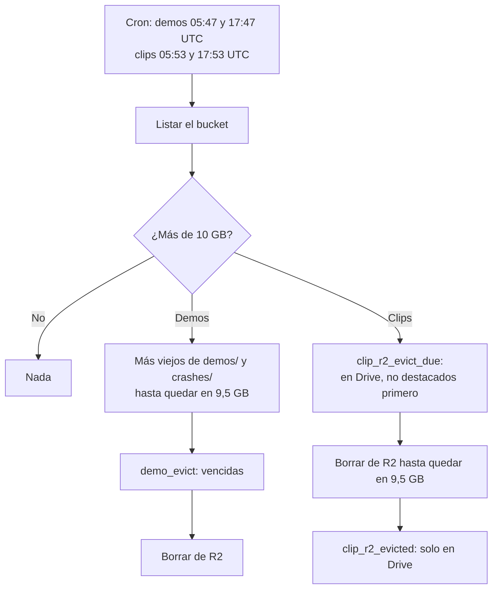

# Los dos buckets de R2 no pasan de 10 GB: documentación

## Qué hace

Dos veces por día, cada Worker de Cloudflare revisa cuánto ocupa su bucket de R2. Si pasa de **10 GB** (lo que R2 da gratis por cuenta), borra lo más viejo hasta quedar en **9,5 GB** o menos.

Los buckets están en dos cuentas distintas y un Worker solo puede usar los buckets de su cuenta, así que el recorte va en cada Worker que ya existía: `v34frag-demos` (bucket `csstv-demos`) y `cmleague-clips` (bucket `cmleague-clips`).

- **Demos:** se borran las demos (`demos/`) y los volcados de Accelerator (`crashes/`), del más viejo al más nuevo. Antes de borrar, las partidas de esas demos pasan a **vencidas** en la base: la web dice "La demo de esta partida ya venció", como a los 90 días.
- **Clips:** solo se borran de R2 los clips que ya tienen copia en Google Drive. Primero los que no se ven como destacados y, en cada grupo, del más viejo al más nuevo. Quedan marcados como "solo en Drive" y la web los sigue mostrando desde Drive. Si con esos no alcanza, el bucket queda por encima de 9,5 GB y el resultado lo dice (`note`).



## Umbrales

| Variable (`wrangler.toml`) | Valor | Qué es |
|---|---|---|
| `R2_MAX_BYTES` | `10000000000` | Por encima de esto se recorta |
| `R2_TARGET_BYTES` | `9500000000` | Hasta dónde se recorta |
| `TRIM_CRON` (solo demos) | `47 5,17 * * *` | El cron del recorte. El Worker de demos tiene otros dos crons y los distingue por este valor |

Son GB decimales: 10 GB decimales es menos que 10 GiB, así que no se pasa del gratis lo cuente R2 como lo cuente.

"Más viejo" es la fecha de subida del objeto a R2 (`uploaded`).

## Orden de las operaciones

| Bucket | Orden | Por qué |
|---|---|---|
| Demos | 1. `demo_evict` 2. borrar de R2 | La lista sale de R2. Si el borrado falla, en la próxima vuelta esos objetos siguen siendo los más viejos y se borran |
| Clips | 1. borrar de R2 2. `clip_r2_evicted` | La lista sale de la base. Si la marca falla, la próxima vuelta los vuelve a dar y el borrado no hace nada (R2 no da error si el objeto no existe) |

Lo que no está en `demos/` ni `crashes/` (en demos), o no es un clip con copia en Drive (en clips), cuenta para el total pero nunca se borra.

## Funciones de Supabase (replanteo `106_r2_tope.sql`)

| Función | Token | Qué hace |
|---|---|---|
| `demo_evict(p_token, p_keys text[])` | `demo_workers` | Pasa a `expired` las partidas `uploaded` con `demo_key` en la lista (hasta 1000). Devuelve cuántas |
| `clip_r2_evict_due(p_token, p_limit)` | `render_workers` | Clips `done`, con `video_drive_id` y sin `video_r2_deleted_at`. Orden: los que no están en `featured_clips_shown` primero, después por `video_rendered_at`. Hasta 1000 |
| `clip_r2_evicted(p_token, p_clips uuid[])` | `render_workers` | Pone `video_r2_deleted_at = now()`, con las mismas condiciones que `clip_archive_mark` |

## Correr a mano

`GET /trim?key=<ADMIN_KEY>` en cualquiera de los dos Workers corre el recorte y devuelve lo que hizo. Con `&dry=1` solo dice qué borraría (`keys`), sin tocar nada.

```json
{ "total": 10600000000, "max": 10000000000, "target": 9500000000, "objects": 290,
  "deleted": 31, "freed": 1120000000, "after": 9480000000, "dry": false, "expired": 29 }
```

## Qué cambia para cada rol

| Rol | Qué cambia | Página del manual |
|---|---|---|
| Jugador | Si se llena el espacio de las demos, las más viejas vencen antes de los 90 días | `jugador/clips-y-demos.md` |
| Admin | Una demo puede figurar **Vencida** antes de los 90 días, y los clips pueden salir de R2 antes de los 15 días si el bucket se llena | `admin/elo-y-mixes.md` y `admin/clips.md` |
| Dueño de un servidor externo | Lo mismo que el jugador, con las demos de su servidor | `servidor-externo/demos-y-clips.md` |
| Capitán, organizador, moderador y streamer | Nada | — |

## Términos y privacidad

- **Privacidad:** el plazo de las demos pasa de "90 días" a "Hasta 90 días (antes, las más viejas, si se llena el espacio)". Los clips no cambian: siguen en Drive.
- **Términos:** la sección "Demos, clips y transmisiones" dice que las demos se borran a los 90 días, o antes si se llena el espacio, las más viejas primero.
- Fecha de actualización: 10 de noviembre de 2026 (`LEGAL_UPDATED` y los dos `.html`).

## Dónde está cada cosa

| Qué | Archivo / ubicación |
|---|---|
| Funciones de la base | `supabase/replanteo/106_r2_tope.sql` |
| Inversa | `docs/bitacora/2026-10-14-replanteo-modelo-datos/reversas/106_r2_tope.sql` |
| Recorte de demos | `cloudflare/demo-worker/src/index.js` (`trimBucket` y `pickOldest`) y `wrangler.toml` |
| Recorte de clips | `cloudflare/clips-worker/src/index.js` (`trimBucket` y `pickInOrder`) y `wrangler.toml` |
| Pruebas de la elección | `docs/bitacora/2026-11-10-r2-tope-10gb/pruebas/eleccion.test.mjs` |
| Prueba de la base | `docs/bitacora/2026-11-10-r2-tope-10gb/pruebas/prueba_106.sql` |
