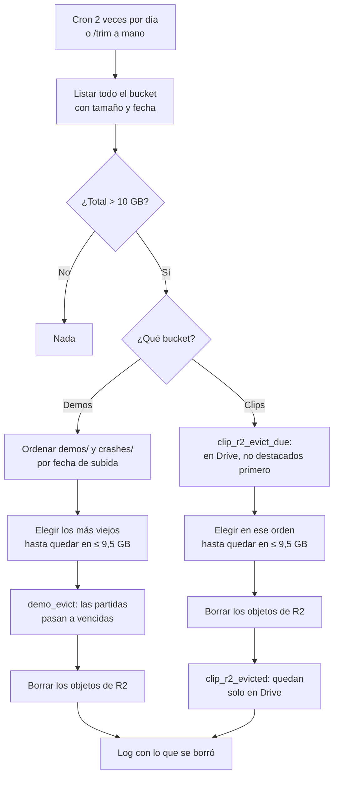

# Plan: los dos buckets de R2 no pasan de 10 GB

> Planeación original. Estado: **propuesta**, pendiente de aprobación.

Pedido por Daniel el 2026-11-10: un Worker que revise una o dos veces por día si los buckets de R2 pasan de 10 GB y, si pasan, borre los archivos más viejos hasta bajar de 9,5 GB. 10 GB es lo que R2 da gratis por cuenta.

Hoy hay dos buckets, **en dos cuentas distintas de Cloudflare**:

| Bucket | Cuenta | Worker que lo usa | Qué guarda | Cómo se vacía hoy |
|---|---|---|---|---|
| `csstv-demos` | `fedc1b83…` | `v34frag-demos` (`cloudflare/demo-worker`) | `demos/AAAA/MM/<uid>.dem` y los volcados de Accelerator (`crashes/`) | Regla de expiración del bucket a los 90 días; `demo_expire` las marca vencidas en la base |
| `cmleague-clips` | `f9aab74b…` (la de Daniel) | `cmleague-clips` (`cloudflare/clips-worker`) | `clips/<partida>/<jugada>-<sufijo>.mp4` | La máquina de render los borra a los 15 días si ya están en Drive (`clip_archive_due`), salvo los destacados |

Nada impide hoy que un mes con muchos mixes pase los 10 GB antes de esos plazos.

## Decisiones tomadas

| Tema | Decisión | Por qué |
|---|---|---|
| Un Worker o dos | **Un cron nuevo en cada Worker que ya existe**, no un Worker aparte | Un Worker solo puede tener el binding de un bucket de su propia cuenta. Un Worker único tendría que entrar a uno de los dos por la API S3, con claves y firma propias. Los dos Workers ya tienen el binding |
| Frecuencia | Dos veces por día (`47 5,17 * * *` en demos y `53 5,17 * * *` en clips, UTC) | Lo que pidió Daniel. Listar un bucket es barato (operaciones de clase A, muy lejos del millón gratis) |
| Umbrales | Se actúa por encima de `R2_MAX_BYTES` = 10 000 000 000 y se borra hasta quedar en `R2_TARGET_BYTES` = 9 500 000 000 o menos. Variables del `wrangler.toml` | En GB decimales: 10 GB decimales es menos que 10 GiB, así que alcanza para no pasarse se cuente como se cuente |
| Qué es "lo más viejo" | La fecha de subida del objeto en R2 (`uploaded`) | Es lo que da el listado, sin preguntarle a la base |
| Demos: qué se borra | **Demos y volcados** (`demos/` y `crashes/`), lo más viejo primero, sin distinguir (Daniel) | Las dos cosas ocupan lugar. Otros prefijos, si aparecen, cuentan para el total pero no se tocan |
| Demos: la base | Antes de borrar, `demo_evict(token, claves)` pasa esas partidas a `expired` (como `demo_expire`). Después se borran los objetos | Si se borrara primero y la marca fallara, la web diría "No se encontró el archivo" en vez de "La demo ya venció". Si la marca sale y el borrado falla, en la próxima vuelta el objeto sigue siendo el más viejo y se borra |
| Clips: qué se borra | **Solo los que ya están en Drive** (Daniel): `done`, con `video_drive_id` y todavía en R2. Primero los no destacados, del más viejo al más nuevo; después los destacados | Un clip con copia en Drive se sigue viendo en la web (el reproductor de Drive). Uno sin copia se perdería. Los destacados van al final porque son los que más se ven |
| Clips: si no alcanza | Se deja el bucket como quedó y se anota en el log | No se borra nada que no esté en Drive |
| Clips: la base | `clip_r2_evict_due(token, límite)` da los candidatos en ese orden; después de borrar, `clip_r2_evicted(token, ids)` les pone `video_r2_deleted_at` (lo mismo que `clip_archive_mark`, de a muchos) | El orden es al revés que en demos (borrar y después marcar) porque acá la lista sale de la base: si la marca falla, la próxima vuelta lo vuelve a dar y el borrado da 404, que no es error. Una sola llamada para marcar todos, porque el plan gratis de Workers tiene un tope de 50 subpedidos externos |
| Token del Worker de clips | Un token de render nuevo (`render_workers`, nombre `clips-worker`), secreto `RENDER_TOKEN` | Las funciones de clips piden `render_auth`. Uno propio se puede revocar sin tocar la máquina de render |
| Correr a mano | `GET /trim?key=<ADMIN_KEY>` en los dos Workers, con `&dry=1` para ver qué borraría sin borrar | Para probar y para usarlo si hace falta liberar espacio ya. El de clips no tenía `ADMIN_KEY`: se suma |
| Base | Replanteo `106_r2_tope.sql`, con su inversa | `105` es el último en `main` |
| Demos con clips sin grabar | No se protegen | Se borran las más viejas, que ya pasaron por el render hace mucho. Si una tiene un clip pendiente, ese clip falla como cualquier demo vencida |

## 1. El flujo completo

## 2. Base de datos (replanteo `106_r2_tope.sql`)

- `demo_evict(p_token text, p_keys text[]) returns integer`: con `demo_auth`. Pasa a `expired` las partidas `uploaded` cuyo `demo_key` está en la lista. Hasta 1000 claves. Devuelve cuántas marcó.
- `clip_r2_evict_due(p_token text, p_limit integer default 500) returns table(clip_id uuid, video_key text)`: con `render_auth`. Clips `done`, con `video_drive_id`, sin `video_r2_deleted_at`. Orden: los que no están en `featured_clips_shown` primero y, dentro de cada grupo, por `video_rendered_at`.
- `clip_r2_evicted(p_token text, p_clips uuid[]) returns integer`: con `render_auth`. Pone `video_r2_deleted_at = now()` con las mismas condiciones que `clip_archive_mark`.
- Permisos como las demás funciones de los Workers: `execute` para `anon`, `authenticated` y `service_role`, que se autentican con el token.
- Inversa en `docs/bitacora/2026-10-14-replanteo-modelo-datos/reversas/106_r2_tope.sql`.

## 3. Worker de demos (`cloudflare/demo-worker`)

- `wrangler.toml`: cron `47 5,17 * * *`, variables `TRIM_CRON`, `R2_MAX_BYTES` y `R2_TARGET_BYTES`.
- `scheduled`: si el cron es `TRIM_CRON`, corre `trimBucket`.
- `trimBucket(env, dry)`: lista con `env.DEMOS.list` (de a 1000, con `cursor`), suma, elige, llama a `demo_evict` con las claves de `demos/` y borra con `env.DEMOS.delete([...])` de a 1000. Devuelve `{ total, max, target, deleted, freed, after }`.
- La elección de qué borrar va en una función pura (`pickOldest`), probada aparte.
- Ruta `GET /trim?key=<ADMIN_KEY>[&dry=1]`.

## 4. Worker de clips (`cloudflare/clips-worker`)

- `wrangler.toml`: cron `53 5,17 * * *`, `SUPABASE_URL`, `SUPABASE_ANON_KEY`, `R2_MAX_BYTES` y `R2_TARGET_BYTES`. Secretos nuevos: `RENDER_TOKEN` y `ADMIN_KEY`.
- `scheduled` y `trimBucket(env, dry)`: lista y suma; si pasa, pide `clip_r2_evict_due`, recorre los candidatos con el tamaño que dio el listado (uno que ya no está en R2 se marca igual, con tamaño 0), borra y marca con `clip_r2_evicted`.
- Ruta `GET /trim?key=<ADMIN_KEY>[&dry=1]`. El resto del Worker (servir videos) no cambia.

## 5. Textos

- **Privacidad y términos:** las demos se guardan "hasta 90 días": si el espacio se llena, se borran antes las más viejas. Los clips siguen en Drive. En `PrivacyPage.tsx`, `TermsPage.tsx`, `terms/privacidad.html` y `terms/terminos.html`.
- **Manual:** `jugador/clips-y-demos.md`, `admin/elo-y-mixes.md`, `admin/clips.md` y `servidor-externo/demos-y-clips.md`, donde dicen 90 días.
- `CHANGELOG_DISCORD.txt` corto: las demos más viejas pueden borrarse antes de los 90 días.

## 6. Requisitos antes de empezar

- Token de render nuevo para el Worker de clips (lo crea un admin o se inserta en `render_workers` desde el SQL, como los demás).
- `ADMIN_KEY` nueva para el Worker de clips.
- `CLOUDFLARE_API_TOKEN` de cada cuenta para el despliegue (`CF_API_TOKEN_CLIPS` del `.env` para el de clips).

## 7. Orden de implementación

1. Replanteo `106` y su inversa; probarlos en la base local.
2. `pickOldest` y las pruebas de la elección (`pruebas/`).
3. Worker de demos: cron, `trimBucket` y `/trim`.
4. Worker de clips: lo mismo, con las funciones de clips.
5. Probar los dos con `/trim?dry=1` contra los buckets reales (no borra nada).
6. Textos: legales, manual y changelog.
7. Despliegue (con aprobación de Daniel): `106` en producción, secretos, `wrangler deploy` de los dos.
