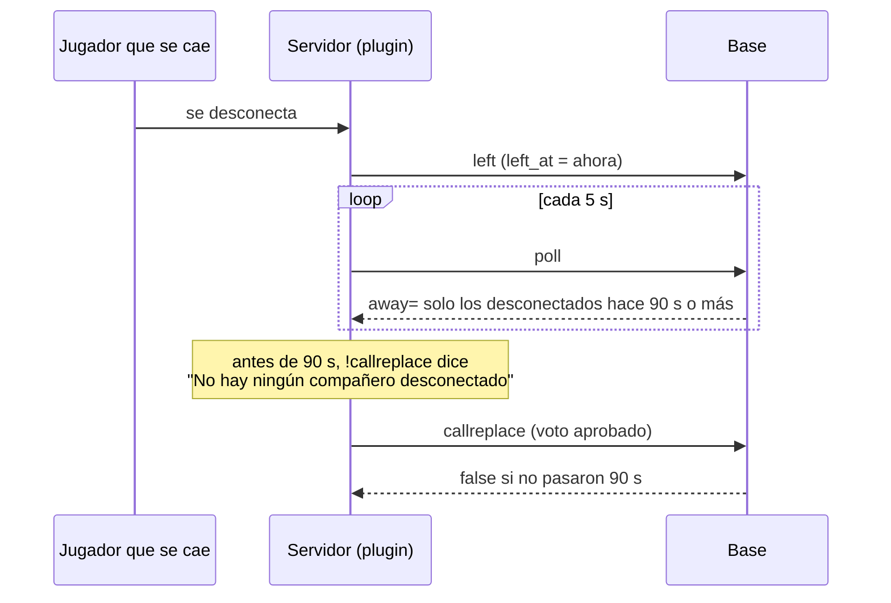

# Esperar 1 min 30 s antes de poder pedir un reemplazo: documentación

## Qué hace

En una sala del matchmaking en vivo, `!callreplace` solo deja elegir a un compañero que lleva **al menos 1 minuto y 30 segundos desconectado**, contado desde su última desconexión. Antes de ese tiempo no aparece en el menú, y si el plugin manda igual el voto aprobado, la base lo rechaza y el jugador no queda como abandono.

Antes, un jugador aparecía en el menú apenas se desconectaba, y su equipo podía darlo por abandonado aunque se le hubiera cortado el juego y estuviera volviendo. Lo pidió Daniel el 2026-11-10, después de probar varios reemplazos con los reemplazos encendidos.

## Cómo funciona

- **`mm_config.replace_min_away_s`** (90 por defecto, de 0 a 600): los segundos que un jugador tiene que llevar desconectado. Se cambia en Administración › Matchmaking › General › Reemplazos ("!callreplace con desconectados hace al menos (s)"), con `mm_set_config`. En 0 funciona como antes.
- **`csstv_mm_poll`**: `away=` solo lista a los de la sala con `left_at` de hace al menos ese tiempo. El plugin arma el menú con esa lista, así que no cambia.
- **`csstv_mm_report`**, evento `callreplace`: busca al desconectado con la misma condición. Si no la cumple, devuelve `false` y no lo da por abandonado (sin sanción ni reemplazo).
- Si el jugador vuelve y se vuelve a caer, `left_at` se pone de nuevo y la cuenta empieza otra vez.
- El reemplazo automático por abandono (el link en Discord) no cambia: se abre cuando se cumplen los minutos de reconexión, que son más de 90 s.

### Lo que ve el jugador en el servidor

Con un compañero desconectado hace menos de 90 s, `!callreplace` responde "No hay ningún compañero desconectado", que es el mensaje del plugin cuando el menú queda vacío. Para que diga cuánto falta hace falta un plugin nuevo; queda como mejora posible.

## Qué cambia para cada rol

| Rol | Qué cambia | Página del manual |
|---|---|---|
| Jugador | `!callreplace` sirve con un compañero desconectado hace al menos 1 min 30 s | `jugador/buscar-partida.md` y `jugador/comandos-en-el-servidor.md` |
| Admin | Campo nuevo en el bloque Reemplazos de Administración › Matchmaking | `admin/matchmaking.md` |
| Capitán, organizador, moderador, streamer, dueño de un servidor externo | Nada | — |

## Términos y privacidad

- **Términos (sección 7, moderación y baneos):** el voto de tu equipo para darte por abandonado se puede hacer pasado 1 minuto y 30 segundos desde que te desconectas. En `terms/terminos.html` y en `TermsPage.tsx`.
- **Privacidad:** sin cambios.

## Dónde está cada cosa

| Qué | Dónde |
|---|---|
| Migración | `supabase/replanteo/109_mm_reemplazo_espera.sql` |
| Inversa | `docs/bitacora/2026-10-14-replanteo-modelo-datos/reversas/109_mm_reemplazo_espera.sql` |
| Pruebas de la base | `pruebas/probar_109.sh` y `pruebas/probar_109.sql` |
| Web | `web/frontend/src/features/matchmaking/admin/GeneralForm.tsx`, `types.ts` y `demo.ts` |
| Manual | `docs/manual/jugador/buscar-partida.md`, `jugador/comandos-en-el-servidor.md` y `admin/matchmaking.md` |
| Términos | `terms/terminos.html` y `web/frontend/src/features/legal/pages/TermsPage.tsx` |
| Changelog | `CHANGELOG_DISCORD.txt` (2.9.37) |
