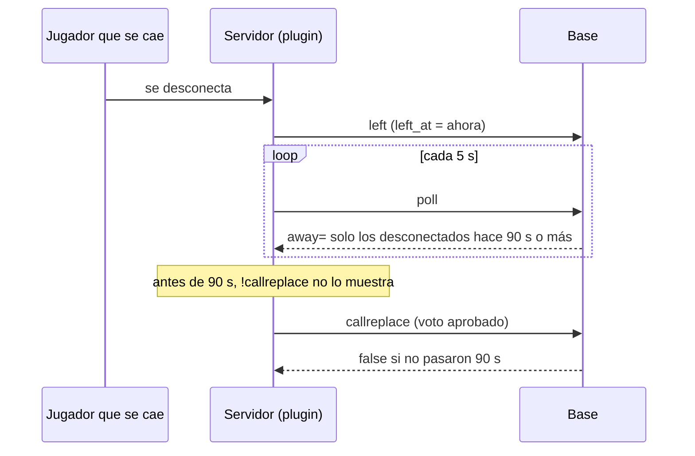

# Plan: esperar 1 min 30 s antes de poder pedir un reemplazo

> Planeación original. Estado: **aprobado por Daniel** (2026-11-10: "mínimo debemos esperar 1 min y 30 segundos antes de permitir llamar un reemplazo").

## El problema

Con los reemplazos encendidos, un jugador aparece en el menú de `!callreplace` apenas se desconecta (`away=` del poll lista a todos los que tienen `left_at`). Un compañero puede votar el reemplazo de alguien que se cayó hace 10 segundos y estaba volviendo; si pasa, ese jugador queda como abandono, con sanción y ELO de abandono.

## Decisiones tomadas

| Tema | Decisión | Por qué |
|---|---|---|
| Desde cuándo | Desde la última desconexión (`mm_lobby_players.left_at`). Si vuelve y se cae otra vez, la cuenta empieza de nuevo | Es lo que marca "desconectado" en la base |
| Cuánto | 90 s por defecto, en un campo nuevo `mm_config.replace_min_away_s` (0 a 600), editable en Administración › Matchmaking › Reemplazos | Si en la práctica 90 s es poco o mucho, se cambia sin desplegar |
| Dónde se frena | En la base: `away=` del poll solo lista a los desconectados hace al menos ese tiempo, y el evento `callreplace` de `csstv_mm_report` lo rechaza si todavía no pasó | El plugin no cambia: no hay que subirlo a los tres servidores ni esperar un cambio de mapa. Y la base manda aunque el plugin tenga una lista vieja |
| Mensaje en el juego | El de siempre: con nadie desconectado hace 90 s, `!callreplace` dice "No hay ningún compañero desconectado" | Cambiarlo pide plugin nuevo. Se anota como mejora posible |
| Reemplazo por abandono (link en Discord) | Sin cambios: se abre al confirmarse el abandono, a los minutos de reconexión, que ya son más de 90 s | |

## 1. El flujo

## 2. Base: replanteo `109`

- `mm_config.replace_min_away_s integer not null default 90 check (0..600)`.
- `mm_set_config` lo acepta (reemplazo de texto, al lado de `replace_vote_cooldown_s`).
- `csstv_mm_poll`: en `away=`, `and lp.left_at <= now() - make_interval(secs => replace_min_away_s)`.
- `csstv_mm_report`, rama `callreplace`: la misma condición al buscar al desconectado.
- Cada reemplazo de texto aborta si el fragmento no está o aparece más de una vez. Inversa que deja todo como antes.

## 3. Web

- `GeneralForm.tsx`: campo **Desconectado al menos (s)** en el bloque Reemplazos, con su validación (0 a 600).
- `types.ts` y `demo.ts`: el campo nuevo.

## 4. Manual, términos y privacidad

- `jugador/buscar-partida.md` y `jugador/comandos-en-el-servidor.md`: `!callreplace` sirve con un compañero desconectado hace al menos 1 min 30 s.
- `admin/matchmaking.md`: el campo nuevo.
- Términos (sección 7): el voto del equipo puede darte por abandonado si estás desconectado al menos 1 min 30 s. Privacidad: sin cambios.

## 5. Orden de implementación

1. Replanteo `109`, su inversa y la prueba con rollback en la base local.
2. La web y sus pruebas.
3. Manual, términos y bitácora.
4. Commit en `main` (desde el 2026-11-10 es la única rama que importa).
5. Producción: la `109` con `cmleague-mm` parado y sin votos en curso, y la web.
