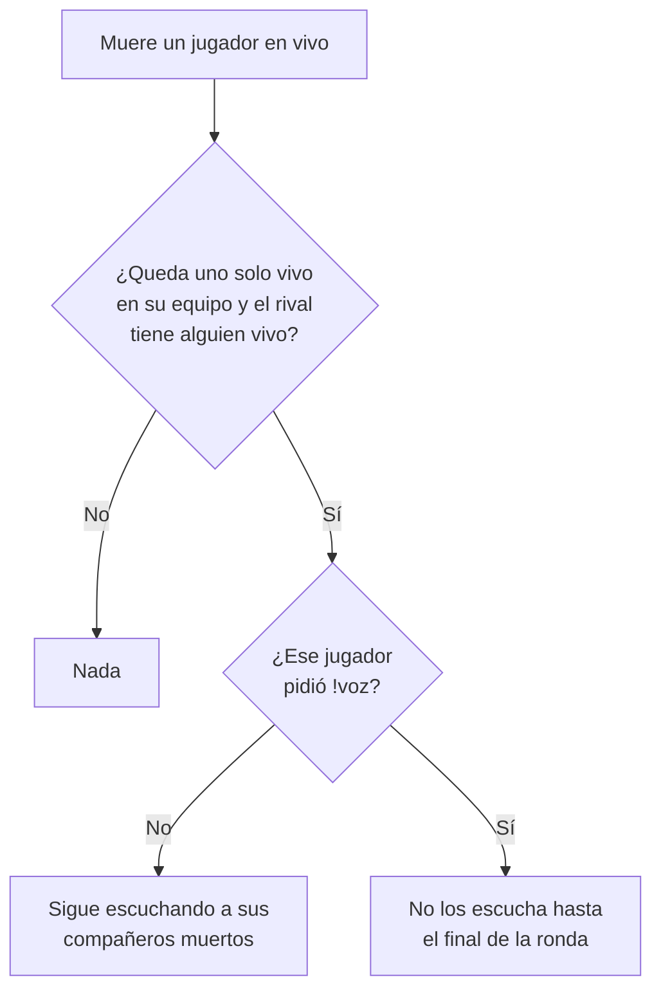

# `!voz` apagado por defecto: documentación

## Qué hace

Desde `csstv_qol` **1.4.0**, quien queda último vivo de su equipo **sigue escuchando** a sus compañeros muertos, salvo que lo haya pedido con `!voz`. Hasta la 1.3.2 era al revés: se lo silenciaba solo y `!voz` servía para seguir escuchándolos.

`!voz` es un interruptor por jugador: el primero prende el silencio del clutch y el segundo lo apaga. Dura mientras el jugador siga conectado; al reconectarse vuelve al valor por defecto (escuchar).

## Reglas

| Situación | Qué pasa |
|---|---|
| Sin `!voz` (por defecto) | Nadie deja de escuchar a nadie al quedar solo |
| `!voz` (prendido) | Cada vez que queda último vivo en vivo, no escucha a sus compañeros muertos hasta el final de la ronda. Aviso en el chat |
| `!voz` en pleno clutch | Prenderlo silencia en el momento; apagarlo devuelve la voz en el momento |
| `csstv_qol_clutch_mute "0"` | `!voz` no silencia a nadie (la opción queda deshabilitada para todos) |
| Calentamiento, cuchillo, retake, 2v2, deathmatch | No aplica: solo con la partida en vivo y sin otro modo prendido, igual que antes |

## El plugin

- `g_bClutchMute[client]` (antes `g_bVoiceOn`, con el sentido contrario), en `false` al conectarse.
- `Frame_Mute` salta a quien no lo pidió.
- `Cmd_Voz` invierte la bandera; al prenderlo con la partida en vivo corre `Frame_Mute`.
- La 1.4.0 incluye la 1.3.2 de Kyan (sin el menú de modelos, `csstv_qol_auto_class`), que corría en los servidores desde el 2026-11-04 pero solo estaba en `kyan/pruebas`. Se trajo a `main` en esta misma tanda.

## Qué cambia para cada rol

| Rol | Qué cambia | Página del manual |
|---|---|---|
| Jugador | Al quedar último vivo sigue escuchando a su equipo. `!voz` ahora es para dejar de escucharlos | `jugador/comandos-en-el-servidor.md` |
| Capitán, organizador, moderador, admin, streamer, dueño de un servidor externo | Nada | — |

## Términos y privacidad

Sin cambios: no se guarda ni se publica nada nuevo.

## Dónde está cada cosa

| Qué | Dónde |
|---|---|
| Código | `server/addons/sourcemod/scripting/csstv_qol.sp` |
| Binario | `server/addons/sourcemod/plugins/csstv_qol.smx` (1.4.0) |
| Configuración | `server/cfg/sourcemod/csstv_qol.cfg` (solo comentarios y `csstv_qol_auto_class` de la 1.3.2) |
| Manual | `docs/manual/jugador/comandos-en-el-servidor.md` |
