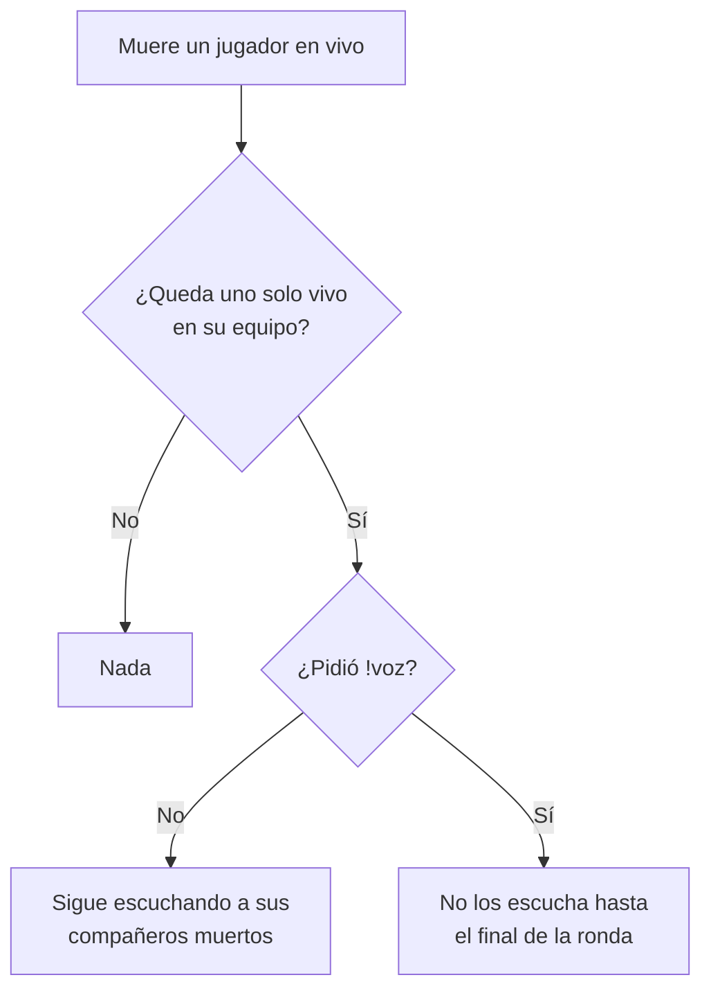

# Plan: `!voz` apagado por defecto

> Planeación original. Estado: **aprobada** (pedido de Daniel, 2026-11-10).

Pedido de Daniel (2026-11-10): "El plugin !voz debe estar desactivado por defecto en todos los servidores: por defecto sí debes escuchar a tus compañeros cuando estés solo, y solamente los dejas de escuchar si activas el comando !voz".

## Decisiones tomadas

| Tema | Decisión | Por qué |
|---|---|---|
| Comportamiento por defecto | Quien queda último vivo **sigue escuchando** a sus compañeros muertos | Es lo que pidió Daniel. Hasta la 1.3.1 era al revés: se silenciaba solo y `!voz` lo apagaba |
| `!voz` | Pasa a **prender** el silencio del clutch para uno mismo; otro `!voz` lo apaga | El comando sigue existiendo, con el sentido invertido |
| Duración | Mientras el jugador siga conectado (al desconectarse vuelve al valor por defecto) | Igual que antes: no se guarda en ningún lado |
| `!voz` en pleno clutch | Si lo prende cuando ya quedó solo, se silencia en el momento; si lo apaga, vuelve a escuchar en el momento | Que el comando tenga efecto inmediato |
| `csstv_qol_clutch_mute` | Queda en `1` y ahora solo habilita la opción. Con `0`, `!voz` no silencia a nadie | No hace falta tocar el cfg de los servidores |
| Versión | `csstv_qol` 1.3.1 → **1.4.0** | Cambia el comportamiento por defecto |

## 1. El flujo completo

## 2. El plugin (`csstv_qol.sp`)

- `g_bVoiceOn` (el que pidió no silenciar) pasa a `g_bClutchMute` (el que pidió silenciar), en `false` por defecto.
- `Frame_Mute` salta a quien no lo pidió.
- `Cmd_Voz` invierte la bandera: al apagarlo devuelve la voz (`Mute_Clear`); al prenderlo con la partida en vivo, corre `Frame_Mute` para silenciar en el momento si ya está solo.
- Textos del chat ajustados al nuevo sentido.

## 3. Manual y legales

- `docs/manual/jugador/comandos-en-el-servidor.md`: la fila de `!voz`.
- Términos y privacidad: sin cambios (no se guarda ni publica nada nuevo).

## 4. Requisitos antes de empezar

- `spcomp` 1.8 del servidor local.
- Acceso SFTP a los servidores (`SFTP_CSS_*_MVZG`; el de retake por `SFTP_CSS_*`).

## 5. Orden de implementación

1. Cambiar y compilar `csstv_qol` 1.4.0.
2. Manual, bitácora y changelog.
3. Subir el `.smx` a #1, #2 y #3 (y al de retake mientras exista), con respaldo de la 1.3.1. Sin recargar: entra en el próximo cambio de mapa.
4. Commit en `main`.
