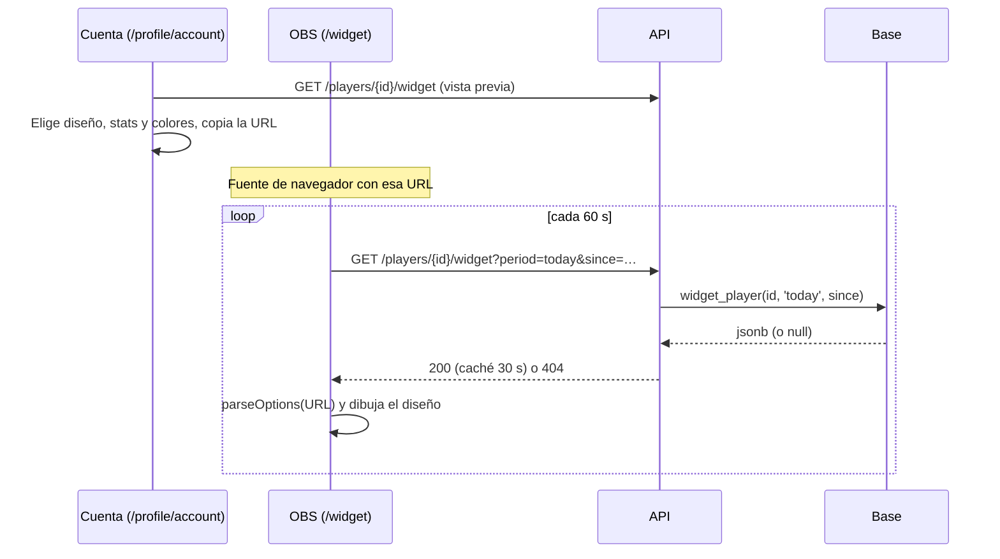
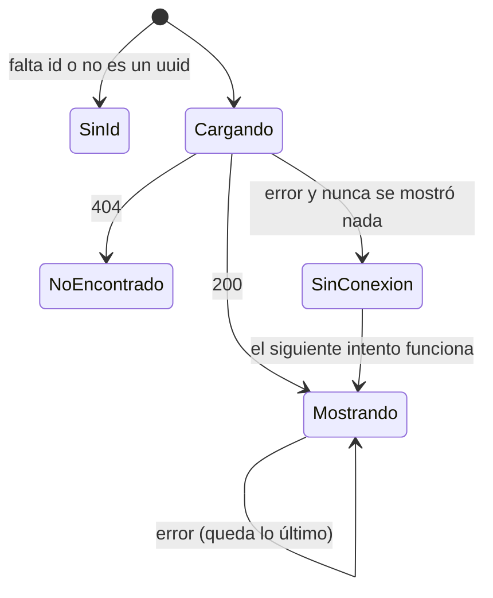

# Widget para streamers: documentación

## Qué hace

Cualquier jugador con perfil vinculado puede mostrar en OBS (o en Streamlabs) un recuadro con su nivel, su ELO, la barra al próximo nivel, las stats que elija de un período y sus últimos resultados. Es la página `/widget` de la web, sin barra ni menú y con el fondo transparente, que se agrega como **fuente de navegador** y pide los datos cada minuto.

La URL se arma en **Mi perfil › Cuenta › Widget para stream**, con un personalizador y una vista previa con los datos reales. Todo lo que se elige queda en la URL: no se guarda nada en la cuenta, y OBS no necesita sesión, porque todos los datos que muestra ya son públicos.

Es el prototipo de Kyan del 2026-11-08 (`kyan/pruebas`, commit `d9c02ee0`, bitácora `2026-11-08-widget-streamers-stats` de esa rama) con datos reales. La versión de octubre para la web vieja (`widget.html` y la migración `20261029120000_widget_streamers.sql`) no se trajo.



## La URL

`/widget?id=<players.id>&…`. Solo se escriben los valores que cambian respecto de los de fábrica (`widgetUrl` en `features/widget/options.ts`). Si un valor no es válido, se usa el de fábrica en vez de romper el widget (`parseOptions`).

| Parámetro | Qué es | De fábrica |
|---|---|---|
| `id` | El uuid de la ficha. Si el jugador se cambia el nick, la URL sigue andando | Obligatorio |
| `d` | Diseño: `mini`, `compacto`, `completo`, `stats`, `barra` o `vertical` | `compacto` |
| `v` | Período: `hoy`, `24h`, `temporada` o `historico` | `hoy` |
| `t` / `c` | Stats grandes (hasta 4) y chicas (hasta 5), separadas por comas y en orden | `adr,rating,kd,kr` / `aces,quadros,triples,sniper,knife` |
| `a` | Color de acento, hex sin `#` | `ff6900` |
| `o` | Opacidad del fondo, de 0 a 100 | `80` |
| `s` | Tamaño, de 75 a 150 % | `100` |
| `h` | Partes ocultas: `nick`, `tag`, `level`, `progress`, `last`, `flag`, `phrase` | Ninguna |
| `f` | Frase propia, hasta 40 caracteres. Vacía: la automática | Vacía |
| `n` | Últimos resultados: `5` o `10` | `5` |
| `bg` | `1` pone un fondo gris, para verlo en el navegador | Transparente |

Tamaños para OBS al 100 %: Mini 170 × 64, Compacto 360 × 150, Completo 420 × 190, Stats 420 × 200, Barra 720 × 56 y Vertical 200 × 500.

**Frase automática**, en este orden: "Primero del ranking", "Racha de N victorias" (desde 3), "Top 10 del ranking (#N)", "+N ELO hoy" (desde 50) y "Primero de su país". Si no hay nada, no se muestra.

## Estados de la página



Los textos son "Falta el jugador en la URL", "Jugador no encontrado" y "Sin conexión, reintentando…". La consulta sigue cada 60 s aunque la pestaña no esté visible (`refetchIntervalInBackground`), porque OBS no la tiene en primer plano. Mientras la página está abierta, `html` y `body` quedan sin fondo.

## Reglas de los datos

- **Qué cuenta:** mixes (`matches.kind = 'mix'`, también los mapas del matchmaking) terminados, con una fila de la ficha en `match_player_stats` (`player_id`) con `team` 1 o 2. Los torneos, las PCW y los cancelados no.
- **Resultado:** gana si `winner_side` es su `team`; con `winner_side` null es empate.
- **ELO del período:** la suma de `elo_delta`. Un mix sin ELO suma 0, pero cuenta como V, D o E.
- **Período:** `coalesce(played_at, starts_at)` desde:
  - `today`: el `since` que manda el navegador (su medianoche local); sin `since`, las últimas 24 horas.
  - `24h`: ahora menos 24 horas.
  - `season`: el `starts_at` de la temporada activa; sin temporada activa, todo.
  - `all`: todo.
- **Stats del reporter 2.7.0** (de `match_player_extra`): pistolas (`pistol_won`), clutches ganados (`clutch_1v1` a `clutch_1v5`), sniper (`weapon_kills.awp` + `weapon_kills.scout`) y cuchillo (`weapon_kills.knife`). Los mixes sin esa fila suman 0.
- **Rating del período:** `csstv_rating` con las sumas del período; null sin rondas.
- **ELO y pico:** los de `player_overview`. Sin fila en `player_elo`, `elo_config.start_elo`.
- **Puestos:** `rank` es `player_ranking.position`; `country_rank`, el puesto entre los de su país en esa misma vista. Null sin ELO o sin país.
- **País:** el de `profile_details`. Si el perfil es privado, un anónimo no lo ve (RLS), así que el widget no muestra la bandera. El resto sale igual, como en el perfil público.
- **Equipo:** la sigla del primer equipo oficial actual (`player_overview.teams`). Null si no tiene equipo o si el equipo no tiene sigla.
- **Últimos:** los 10 mixes terminados más recientes, de cualquier fecha, del más nuevo al más viejo.

## `widget_player(p_player uuid, p_period text, p_since timestamptz)`

Replanteo `110_widget_streamers.sql`. Es `stable` y `security invoker` (solo lee lo que ya es público), con `execute` para `anon`, `authenticated` y `service_role`. `p_period` inválido da `22023`. Devuelve null si la ficha no existe. Si existe, devuelve:

```json
{
  "id": "…", "nick": "romanxz", "team_tag": null, "country": "Argentina",
  "elo": 978, "peak_elo": 1115, "matches": 42, "rank": 134, "country_rank": 29,
  "period": { "v": 21, "d": 21, "e": 0, "elo": 43, "kills": 865, "deaths": 725, "rounds": 1020, "damage": 93107,
              "headshots": 428, "k3": 58, "k4": 16, "k5": 1, "sniper": 132, "knife": 0, "clutches": 9,
              "entries": 116, "pistols": 24, "rating": 1.19 },
  "ultimos": [ { "r": "V", "elo": 14 }, { "r": "D", "elo": -26 } ]
}
```

## API: `GET /api/v1/players/{id}/widget`

- `{id}`: el uuid o el nick, como las demás rutas de jugadores.
- `period`: `today` (de fábrica), `24h`, `season` o `all`.
- `since`: fecha ISO con zona, solo con `today`, entre hace 48 horas y ahora.
- Pública, con o sin sesión.
- Responde `200` con `WidgetData` y `Cache-Control: public, max-age=30`, `404` si la ficha no existe y `400` con parámetros inválidos.

## Qué cambia para cada rol

| Rol | Qué cambia | Página del manual |
|---|---|---|
| Jugador | **Widget para stream** en Mi perfil › Cuenta, para poner su widget en OBS | [`jugador/widget-para-stream.md`](../../manual/jugador/widget-para-stream.md) (nueva) |
| Streamer | Lo mismo que el jugador, al lado del HUD. Un enlace desde la página del HUD | [`streamer/hud-obs.md`](../../manual/streamer/hud-obs.md) |
| Capitán, organizador, moderador, admin, dueño de un servidor externo | Nada | — |

## Términos y privacidad

Sin cambios. Los términos ya dicen que los streamers pueden usar el widget en OBS y que el nick y las stats pueden aparecer en las transmisiones, y la privacidad ya nombra "el widget para streamers" entre lo que se publica, sin la marca "En preparación". No se guarda ningún dato nuevo: lo que se elige queda en la URL, y el widget muestra lo mismo que el perfil público. El país respeta la privacidad del perfil.

## Dónde está cada cosa

| Qué | Archivo |
|---|---|
| Función de la base | `supabase/replanteo/110_widget_streamers.sql` |
| Inversa | `docs/bitacora/2026-10-14-replanteo-modelo-datos/reversas/110_widget_streamers.sql` |
| Pruebas de la base | `pruebas/probar_110.sh` y `pruebas/probar_110.sql` |
| Ruta de la API | `web/backend/src/routes/players.ts` (`widget`) |
| Esquemas `WidgetQuery` y `WidgetData` | `web/backend/src/schemas/players.ts` |
| Pruebas de la API | `web/backend/test/integration/widget.test.ts` |
| Opciones y URL (`parseOptions`, `widgetUrl`) | `web/frontend/src/features/widget/options.ts` |
| Los seis diseños, `statValue`, `autoPhrase` y `LevelRing` | `web/frontend/src/features/widget/StreamWidget.tsx` |
| Consulta de datos (`widgetDataOptions`) | `web/frontend/src/features/widget/api.ts` |
| Página `/widget` | `web/frontend/src/features/widget/WidgetPage.tsx` y `routes/widget.tsx` |
| Personalizador (`WidgetControls`, `WidgetPreview`) | `web/frontend/src/features/widget/WidgetCustomizer.tsx` |
| Tarjeta y diálogo en Cuenta | `web/frontend/src/features/widget/WidgetCard.tsx` y `features/profile/pages/AccountSection.tsx` |
| Demo con datos de ejemplo (solo `pnpm dev`) | `web/frontend/src/routes/demo.widget.tsx` y `features/widget/demo.ts` |
