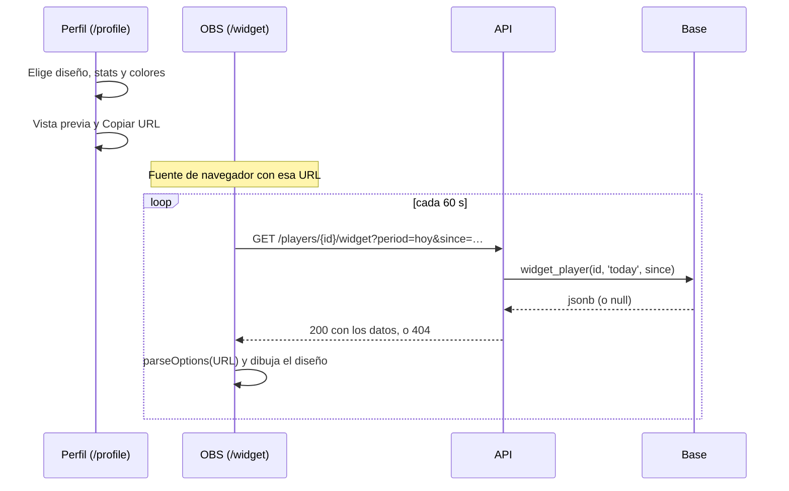

# Plan: widget para streamers en `main`

> Planeación original. Estado: **propuesta**, pendiente de aprobación.

Pedido por Daniel (2026-11-10): traer a `main` el widget para OBS que Kyan dejó en `kyan/pruebas`, sin traer lo
demás de esa rama (tienda, VIP, anticheat, retake).

Hay dos versiones en `kyan/pruebas`:

| Versión | Qué es | Qué se hace con ella |
|---|---|---|
| [`2026-10-29-widget-streamers`](../2026-10-29-widget-streamers/) | `widget.html` para la web vieja (`index.html`), la RPC `widget_player` (migración `20261029120000_widget_streamers.sql`) y el generador en el perfil viejo | **No se trae.** La web vieja ya no se usa, y la RPC lee `players.kd`, `players.rating`, `teams.members` y `matches.winner`, que el replanteo borró o cambió (`06`, `05` y `04`) |
| [`2026-11-08-widget-streamers-stats`](../2026-11-08-widget-streamers-stats/) | Prototipo en el frontend nuevo: seis diseños, 19 stats, personalización por URL y `/demo/widget` con datos de ejemplo (commit `d9c02ee0`) | **Se trae** y se termina: datos reales, la página `/widget` y el personalizador en el perfil |

## Decisiones tomadas

| Tema | Decisión | Por qué |
|---|---|---|
| Cómo se trae | Se copian los archivos del prototipo con `git checkout origin/kyan/pruebas -- <archivo>`, sin merge ni cherry-pick | El commit `d9c02ee0` también toca la bitácora de Kyan, y un merge traería la tienda y el VIP |
| Qué archivos | `features/widget/` (`options.ts`, `options.test.ts`, `StreamWidget.tsx` y `demo.ts`) y `routes/demo.widget.tsx` | Todo lo que importan ya existe en `main`: `CountryFlag`, `Segmented`, `levelOf`, `LEVEL_FLOORS`, `COUNTRIES`, `Slider` y `Switch` |
| Datos | Una función nueva en la base, `widget_player(p_player, p_period, p_since)`, en el replanteo **`110`**, que devuelve un `jsonb` | Una sola consulta cada minuto por streamer. Junta stats de cuatro lugares (`match_player_stats`, `match_player_extra`, `player_ranking` y la temporada activa) |
| API | `GET /api/v1/players/{id}/widget?period=…&since=…`, pública, sin sesión, con `Cache-Control: public, max-age=30` | La web nueva solo habla con la API. Sin sesión porque OBS no inicia sesión. El caché alcanza porque el widget pide cada 60 s |
| `{id}` | El uuid de la ficha (`players.id`), no el nick | Si el jugador se cambia el nick, la URL que quedó guardada en OBS sigue andando |
| "Hoy" | El navegador manda `since` con su medianoche local. Con `24h`, `temporada` o `histórico`, el servidor calcula el desde | Así no hay que guardar la zona horaria de nadie (igual que en la versión de octubre) |
| Temporada | Desde `starts_at` de la temporada activa. Sin temporada activa, es igual a histórico | — |
| Qué partidas cuentan | Las mismas que el historial de ELO del perfil (`player_elo_history`): terminadas y con fila del jugador, por cualquiera de sus SteamID (`steam_owner`) | Que el ±ELO y el V-D del widget coincidan con lo que muestra el perfil |
| Perfil privado | La API responde `404` y el widget muestra "Perfil privado" | Mismo criterio que el perfil público. El streamer que quiera el widget pone el perfil en público |
| Quién lo genera | Cualquier jugador con ficha vinculada, desde **su** perfil (`/profile`). No hace falta la marca de streamer del HUD (`hud_streamers`) | Los datos ya son públicos. La marca de streamer es para el HUD de SourceTV, que sí da acceso a algo privado |
| Página `/widget` | Ruta de primer nivel (`routes/widget.tsx`), fuera de `_app`: sin barra, sin menú, con el fondo transparente | OBS la muestra encima del juego |
| Errores | Si falla una consulta, queda lo último que se mostró. Si nunca se mostró nada: "Sin conexión, reintentando…" | Un corte de 1 minuto no tiene que dejar el stream con un recuadro vacío |
| Demo | `/demo/widget` queda como está (solo con `pnpm dev`) | Sirve para ver los seis diseños sin datos |

## 1. El flujo completo

La URL guarda **todo** lo que eligió el streamer (diseño, período, stats, color, opacidad, tamaño, partes, frase),
con `widgetUrl` del prototipo. No hace falta tabla nueva ni cuenta.

## 2. Base: replanteo `110_widget_streamers.sql`

`widget_player(p_player uuid, p_period text, p_since timestamptz default null) returns jsonb`

- `stable`, `security invoker`, `set search_path = public`, `grant execute` a `anon` y `authenticated`. Solo lee
  tablas y vistas con lectura pública.
- `p_period` es `today`, `24h`, `season` o `all`. Con `today` usa `p_since` (si falta, las últimas 24 horas).
- Devuelve `null` si la ficha no existe o es privada.
- Empieza verificando que exista lo que necesita (`match_player_extra`, `player_ranking`, `seasons`) y que la
  función no exista todavía, como las demás del replanteo.

Lo que devuelve es lo que pide el `WidgetData` del prototipo:

| Campo | De dónde sale |
|---|---|
| `nick`, `country`, `team_tag` | `players`, `profile_details` (país según la privacidad, como `player_ranking`) y el equipo oficial actual en `team_members` |
| `elo`, `peak_elo`, `matches` | `player_elo` por `elo_key`; sin fila, `elo_config.start_elo` y 0 |
| `rank`, `country_rank` | `player_ranking` (puesto global) y el puesto dentro de su país con la misma vista |
| `rating`, `kd`, `hs`, `adr` totales | `player_stats` |
| `period.v`, `.d`, `.e`, `.elo` | `winner_side` frente a `team` y la suma de `elo_delta` del período |
| `period.kills`, `deaths`, `rounds`, `damage`, `headshots`, `k3`, `k4`, `k5`, `entries` | `match_player_stats` (`entries` = `first_kills`) |
| `period.pistols`, `clutches`, `sniper`, `knife` | `match_player_extra`: `pistol_won`, `clutch_1v1` a `clutch_1v5`, y `weapon_kills` (`awp` + `scout`, `knife`) |
| `period.rating` | `csstv_rating` con las sumas del período |
| `streak` | Victorias seguidas, para la frase automática |
| `last` | Los últimos 10 resultados, del más nuevo al más viejo: `{ r: 'V'\|'D'\|'E', elo }` |

Los mixes viejos que no tienen fila en `match_player_extra` (antes del reporter 2.7.0) cuentan para todo lo
demás y suman 0 en pistolas, clutches, sniper y cuchillo.

Con su inversa en `docs/bitacora/2026-10-14-replanteo-modelo-datos/reversas/` y una fila en
`supabase/replanteo/README.md`.

Pruebas en `pruebas/pruebas_widget.sql`: ficha inexistente, privada, sin mixes, sin `player_elo`, cada período,
un mix sin `match_player_extra`, un SteamID adicional y un empate.

## 3. API

En `web/backend/src/routes/players.ts`, la ruta `GET /api/v1/players/{id}/widget`:

- `period`: `today`, `24h`, `season` o `all` (por defecto `today`). `since`: fecha ISO, opcional, solo con `today`;
  si viene más de 48 horas atrás o en el futuro, se rechaza con `400`.
- `{id}` tiene que ser un uuid (`400` si no).
- `200` con el esquema Zod del `jsonb`, o `404 NOT_FOUND` si la función devuelve `null`.
- Sin sesión. `Cache-Control: public, max-age=30`.
- Se regenera el cliente OpenAPI del frontend.
- Pruebas unitarias de la ruta (parámetros, `404`, caché) y de integración contra la base local.

## 4. Web

| Archivo | Cambio |
|---|---|
| `features/widget/*` y `routes/demo.widget.tsx` | Se copian de `kyan/pruebas` tal cual |
| `features/widget/api.ts` (nuevo) | `widgetOptions(id, period)`: `queryOptions` con `refetchInterval: 60_000` y `placeholderData: keepPreviousData`. Calcula `since` con la medianoche local |
| `features/widget/StreamWidget.tsx` | Se ajusta `WidgetData` a lo que devuelve la API, si hace falta |
| `routes/widget.tsx` (nuevo) | Lee la URL con `parseOptions`, pide los datos y dibuja `StreamWidget`. Estados: falta el id, perfil privado o inexistente, cargando y sin conexión. `html` y `body` transparentes solo en esta ruta |
| Perfil propio (`/profile`) | Botón **Widget para stream** que abre un diálogo con el personalizador del prototipo (lo de `demo.widget.tsx` pasado a un componente), la vista previa en un `iframe` de `/widget?…&bg=1`, **Copiar URL** y los pasos para OBS con el tamaño del diseño elegido. Si el perfil es privado, avisa que el widget no se va a ver hasta que lo ponga en público |

Pruebas: los 4 tests de `options.test.ts` y tests nuevos de la página `/widget` (cada estado) y del diálogo
(la URL cambia con las opciones).

## 5. Manual, términos y changelog

- **Manual:** página nueva `docs/manual/jugador/widget-para-stream.md` (cualquier jugador puede generarlo) y un
  enlace desde `docs/manual/streamer/hud-obs.md`.
- **Términos y privacidad:** ya dicen que se publica "el widget para streamers" y que los streamers pueden usar
  el widget en OBS, sin la marca "En preparación". No se guarda ningún dato nuevo. En principio, **sin cambios**:
  se vuelve a revisar al terminar.
- **Changelog:** `CHANGELOG_DISCORD.txt` para los jugadores.

## 6. Requisitos antes de empezar

- La base local levantada con el replanteo hasta la `109` (`pnpm db:reset` en `web/backend`).
- Revisar en `docs/PENDIENTES.md` que nadie esté usando el número `110` en otra rama.
- Nada que instalar.

## 7. Orden de implementación

1. Copiar los archivos del prototipo y comprobar que compilan, pasan lint y los 4 tests en `main`.
2. Replanteo `110`, su inversa y sus pruebas en la base local.
3. Ruta de la API, sus pruebas y el cliente OpenAPI regenerado.
4. `features/widget/api.ts` y la página `/widget` con datos reales.
5. El diálogo en el perfil.
6. Pruebas en el navegador: los seis diseños con una ficha real de la base local, un perfil privado, un id
   inexistente y la API apagada (que quede lo último).
7. Prueba en OBS de verdad (fuente de navegador con la URL local): fondo transparente y tamaño (`zoom`).
8. Manual, changelog, `DOCUMENTACION.md`, `GUIA_IMPLEMENTACION.md` y la fila de la bitácora.
9. El commit en `main`, cuando Daniel lo pida.
10. Desplegar (también cuando Daniel lo pida): primero la `110` en producción, después la API y por último la web.
    No toca los servidores de juego.
