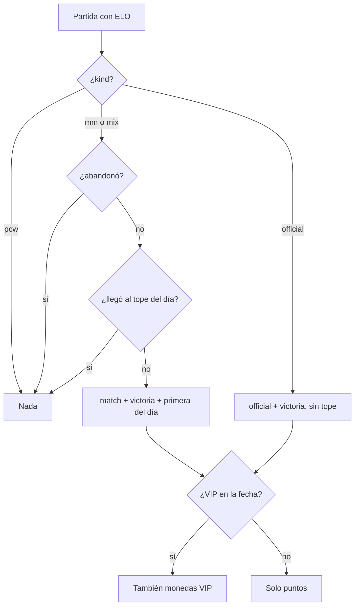

# Economía de puntos y monedas VIP: documentación

La economía se implementó junto con la tienda, en el replanteo 110. El detalle de la base, la API y la web está en [`2026-11-11-tienda/DOCUMENTACION.md`](../2026-11-11-tienda/DOCUMENTACION.md). Acá van las reglas.

## Cuánto da cada cosa (valores iniciales, configurables)

| Premio (`economy_rules.key`) | Puntos | Monedas VIP | Enganche |
|---|---|---|---|
| `match`: partida de matchmaking o mix con ELO | 10 | 10 | Trigger en `match_player_stats.elo_after` |
| `match_win`: victoria | 5 | 5 | Ídem (`matches.winner_side`) |
| `first_of_day`: primera del día | 10 | 10 | Ídem |
| `official`: partida de torneo | 15 | 10 | Ídem, sin tope |
| `tournament_1` / `tournament_2` | 500 / 250 | 250 / 125 | Pendiente: `economy_award` cuando se cierre un torneo |
| `medal_bronce` … `medal_diamante` | 50 / 100 / 200 / 400 / 800 | la mitad | Trigger en `player_medals` (metal de la definición) |
| `season_1`, `season_2`, `season_3`, `season_10`, `season_20` | 1000 / 750 / 500 / 250 / 100 | la mitad | Trigger en `player_medals` con `source = 'season'` (puesto) |
| `level_up` | 50 | 25 | Pendiente |
| `mission` / `mission_vip` | 30 / — | — / 50 | Pendiente (misiones) |
| `first_steps` | 20 | — | Pendiente |
| `clip_featured` | 50 | 25 | Pendiente |
| `referral` | 100 | 50 | Apagado: no hay referidos |
| `vip_welcome` | — | 100 | Trigger en `vip_memberships` |

## Reglas

- **Una vez por origen:** cada premio se anota una sola vez (`point_ledger_once`). Un recálculo de ELO no paga de nuevo.
- **Inicio:** antes de `economy_config.starts_at` no se da nada. Es el día que se aplica el 110, sin retroactivo.
- **Partida borrada:** sus premios vuelven con filas `reversal`.
- **Sin cuenta:** una ficha sin cuenta no cobra, ni después de reclamarla.
- **Día:** se corta en hora de Bogotá.

## Qué cambia para cada rol

Está en la [documentación de la tienda](../2026-11-11-tienda/DOCUMENTACION.md#qué-cambia-para-cada-rol).

## Términos y privacidad

Está en la [documentación de la tienda](../2026-11-11-tienda/DOCUMENTACION.md#términos-y-privacidad). En los términos se sumó el punto de las monedas VIP.
