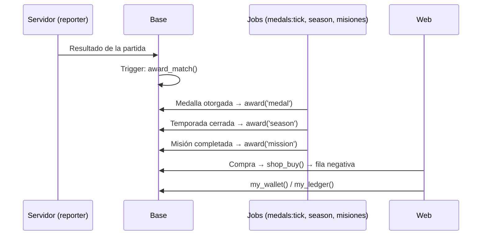

# Plan: economía de puntos y monedas VIP

> Planeación original. Estado: **propuesta**, con las decisiones de Kyan del 2026-11-11.

Es la base de la tienda en la web nueva. Define:

- cómo ganan **puntos** todas las cuentas;
- cómo ganan **monedas VIP** las cuentas VIP;
- cómo se anota cada premio para que no se pague dos veces;
- qué se configura desde Administración.

Después de este plan viene rehacer la tienda en `web/frontend`: tienda, inventario, equipar y la billetera. Para eso se reutilizan los prototipos de `/demo/tienda`, `/demo/vip` y `/demo/misiones`.

## Decisiones tomadas

| Tema | Decisión | Por qué |
|---|---|---|
| Dos monedas | **Puntos** para todos, que compran lo de todos. **Monedas VIP** solo siendo VIP, que compran lo VIP | Ya decidido en [`2026-10-29-vip-progresion`](../2026-10-29-vip-progresion/PLAN.md). |
| VIP | Gana los mismos puntos que cualquiera, **más** monedas VIP. Sin multiplicador | Ya decidido el 2026-10-29. |
| Registro | Cada premio es una fila de `point_ledger`, con un origen único: la partida, la medalla, la misión, etc. | Hay muchos orígenes. Un registro no paga dos veces, se audita y no cambia el pasado si cambia un valor. Reemplaza el saldo calculado de `20261029180000_tienda.sql`. |
| Desde cuándo | **Desde el día que se implemente.** Sin retroactivo | Kyan, 2026-11-11. |
| Valores | Todos configurables desde Administración | Kyan, 2026-11-11. |
| PCW | **No dan puntos ni monedas** | Kyan, 2026-11-11: no tienen ELO y se pueden armar entre amigos. |
| Tope diario | Hasta **10 partidas por día** dan premio, configurable. Medallas, misiones, temporada y regalos no tienen tope | Kyan, 2026-11-11. |
| Medallas | Dan premio según su metal. Las de puesto de temporada tienen su propia tabla | Una medalla nueva de Administración › Medallas trae su premio sin tocar nada más. |
| Fin de temporada | 1.º 1000, 2.º 750, 3.º 500, del 4.º al 10.º 250 y del 11.º al 20.º 100. Las monedas VIP son la mitad | Kyan pidió que el 1.º diera 1000 y bajara. Reemplaza el premio por metal de esas medallas. |
| Día | El día se corta en hora de Argentina (`America/Argentina/Buenos_Aires`) | Mismo criterio que el resto de la web. |

## 1. Cuánto da cada cosa

| Origen (`source`) | Cuándo | Puntos | Monedas VIP |
|---|---|---|---|
| `match` | Partida de matchmaking (`mm`) o mix terminada con ELO, sin abandono propio | +10 | +10 |
| `match_win` | Además, si la ganó | +5 | +5 |
| `first_of_day` | Además, si es la primera partida del día | +10 | +10 |
| `official` | Partida oficial de torneo terminada | +15 | +10 |
| `tournament` | Campeón / subcampeón del torneo, cada jugador de la plantilla | +500 / +250 | +250 / +125 |
| `medal` | Medalla desbloqueada, según el metal: bronce, plata, oro, platino y diamante | +50 / +100 / +200 / +400 / +800 | +25 / +50 / +100 / +200 / +400 |
| `season` | Puesto al cerrar la temporada | 1000 / 750 / 500 / 250 / 100 | 500 / 375 / 250 / 125 / 50 |
| `level_up` | Primera vez que llega a un nivel en la temporada | +50 | +25 |
| `mission` | Misión semanal completada | +30 | — |
| `mission_vip` | Misión VIP completada | — | +50 |
| `first_steps` | Cada paso de Primeros pasos, una sola vez | +20 | — |
| `clip_featured` | Un admin destaca un clip suyo | +50 | +25 |
| `referral` | Un amigo que invitó juega sus primeras 10 partidas | +100 | +50 |
| `vip_welcome` | Cada mes de VIP que empieza (alta o renovación) | — | +100 |
| `grant` | Regalo o corrección de un admin, con motivo | ± lo que ponga | ± lo que ponga |
| `purchase` | Compra en la tienda | − el precio | − el precio |

- **Lo que propuso Claude** (el "etc." de Kyan): `tournament`, `level_up`, `clip_featured`, `referral` y `vip_welcome`.
- **Referidos:** `referral` espera el sistema de referidos, que todavía no existe. Queda en la configuración, apagado.
- **Monedas VIP:** se dan solo si la cuenta es VIP en el momento del premio.

## 2. Reglas contra el abuso

| Regla | Detalle |
|---|---|
| Partidas sin premio | Abandonadas por el jugador, canceladas, sin ELO y PCW. |
| Tope diario | `daily_match_cap` (10): desde la partida 11 del día, `match`, `match_win` y `first_of_day` no se anotan. |
| Una vez por origen | Índice único `(user_id, currency, source, ref)`. Por ejemplo, `match` + id de la partida, `medal` + id de la medalla o `season` + id de la temporada. Reintentar no paga dos veces. |
| Sin ficha vinculada | Las partidas son de la ficha (`players`). El premio va a la cuenta dueña de la ficha. Si la ficha no tiene cuenta, no se anota nada, y tampoco cuando la reclame después. |
| Partida borrada o corregida | Si un admin borra una partida, su premio se revierte con una fila negativa (`source = 'reversal'`). |

## 3. Flujo

Todo pasa por una sola función, `points_award(user, currency, source, ref, amount, label)`:

- revisa el tope;
- revisa si la cuenta es VIP, cuando es para monedas VIP;
- inserta la fila;
- devuelve si la anotó o no.

Los premios automáticos la llaman desde triggers o desde los jobs que ya existen. Así no hace falta un proceso nuevo.

## 4. Base de datos (replanteo nuevo, número a confirmar con Daniel)

- **`points_config`:** una fila por origen, con:
  - `source`;
  - `points`;
  - `vip_coins`;
  - `enabled`;
  - `extra jsonb` para los valores por metal, por puesto y por fase.

  Más los valores generales:
  - `daily_match_cap`;
  - `starts_at`, el día de la implementación: antes de esa fecha no se anota nada.
- **`point_ledger`:**
  - `id`, `user_id`, `currency` (`points` o `vip`), `amount`, `source`, `ref`, `label`, `created_at` y `created_by` (en `grant`);
  - índice único `(user_id, currency, source, ref)`;
  - nunca se borra.
- **Funciones:**
  - `points_award` (interna);
  - `award_match` (trigger al cerrar la partida);
  - `my_wallet()`: saldos;
  - `my_ledger(p_currency, p_limit)`: historial;
  - `admin_points_grant(user, currency, amount, reason)`;
  - `admin_points_config_set(...)`;
  - `admin_wallets()`: saldo de todas las cuentas.
- **Enganches:**
  - con `player_medals`, al insertar: medalla;
  - con el cierre de temporada: puesto;
  - con `mission_progress`, al completarse: misión;
  - con `vip_memberships`: bienvenida VIP;
  - con el clip destacado: clip.
- **Tienda:**
  - se porta `20261029180000_tienda.sql`, `20261029200000_fondo_miniperfil.sql` y `20261029210000_vip_progresion.sql` al modelo del replanteo;
  - el saldo sale de `point_ledger` y la compra es una fila negativa.

## 5. API (`web/backend`)

| Ruta | Para qué |
|---|---|
| `GET /api/v1/me/wallet` | Saldo de puntos y monedas VIP, si las monedas están congeladas, y cuántas partidas con premio le quedan hoy |
| `GET /api/v1/me/ledger?currency=` | Historial |
| `GET /api/v1/admin/points/config` y `PUT` | La tabla de la sección 1 y los topes |
| `POST /api/v1/admin/points/grant` | Regalo o corrección |
| `GET /api/v1/admin/points/wallets` | Saldos de todas las cuentas |

## 6. Web (`web/frontend`)

- **Billetera en la barra de arriba:** puntos y monedas VIP. Al tocarla se abre el historial.
- **Después de cada partida:** un aviso con "+15 puntos · +15 monedas VIP".
- **Ayuda › "Cómo ganar puntos":** la tabla de la sección 1 con los valores de la configuración en vivo.
- **Administración › Puntos:** valores por origen, topes, regalos y saldos.
- **Tienda:** se rehace con estos saldos (plan aparte).

## 7. Qué cambia para cada rol

| Rol | Cambio |
|---|---|
| Jugador | Gana puntos jugando, con medallas, misiones, torneos y temporada. Ve su billetera y su historial |
| Jugador VIP | Además, monedas VIP y la bienvenida de cada mes |
| Admin | Configura los valores, da y corrige puntos y ve los saldos |

**Manual:** una página nueva, `jugador/ganar-puntos.md`, y otra, `admin/puntos.md`.

## 8. Términos y privacidad

Hay que sumar una sección sobre puntos y monedas VIP:

- no tienen valor en dinero;
- no se compran, no se venden y no se transfieren;
- un admin puede corregirlos si hubo abuso;
- se pueden perder si se cierra la cuenta.

Va en `web/frontend/src/features/legal/pages/` y en su `.html` de `terms/`, con la marca "En preparación" hasta que esté implementado.

## 9. Requisitos antes de empezar

- **Daniel:** el número del replanteo y aprobar los enganches con medallas, temporadas y misiones, que son suyos.
- **Kyan:** confirmar los valores de `tournament`, `level_up`, `clip_featured`, `referral` y `vip_welcome`.

## 10. Orden de implementación

1. Replanteo: `points_config`, `point_ledger`, `points_award` y `award_match`, con pruebas SQL en la base local.
2. Enganches de medallas, temporada, misiones, VIP y clips.
3. Rutas de la API, con sus pruebas.
4. Billetera, aviso después de la partida y Administración › Puntos en la web.
5. Manual y términos.
6. Tienda nueva sobre esta base (plan aparte).
