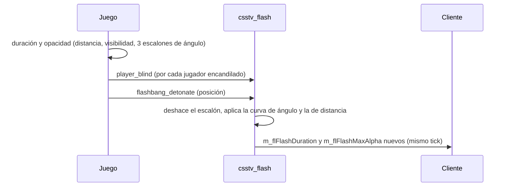
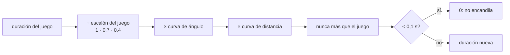

# Flash según el ángulo y la distancia: documentación

## Qué hace

En el CS:S v34, la flash tiene en cuenta hacia dónde mirás en solo tres escalones (de frente, de costado y de espaldas), y de espaldas la pantalla igual queda casi blanca (opacidad 200 de 255). Por eso se siente que da lo mismo voltearse.

El plugin `csstv_flash` recalcula cada flash con una curva parecida a la de CS:GO y CS2. De frente ciega igual que siempre, de costado ciega menos y de espaldas es un destello corto y transparente. Además, de lejos dura menos que en el juego.

No toca el cliente. El servidor manda dos valores por jugador, `m_flFlashDuration` (cuánto dura) y `m_flFlashMaxAlpha` (qué tan blanca se pone la pantalla), y el cliente dibuja la flash con esos dos valores. El plugin los pisa en el mismo tick en que el juego los calcula.

Si `flashbang_detonate` no llega (por ejemplo, porque quien la tiró se desconectó), el jugador se queda con el cálculo del juego.

## El cálculo

| Ángulo con el centro de la vista | Duración (frente a mirarla de frente) | Opacidad máxima |
|---|---|---|
| Hasta 50° | 100 % | 255 |
| 60° a 85° | 70 %, como en el juego (la curva daría más y se corta) | ≈ 245 a 210 |
| 90° (de costado) | ≈ 61 % | ≈ 202 |
| 110° | ≈ 33 % | ≈ 164 |
| 135° o más (de espaldas) | 15 % | 140 |

| Distancia a la flash | Factor extra |
|---|---|
| Hasta 400 | 100 % |
| 800 | ≈ 78 % |
| 1200 | ≈ 56 % |
| 1500 o más | 40 % |

Ejemplo, con 3 s de frente a 200 unidades: de costado queda en 1,8 s (el juego daba 2,1 s), y de espaldas en 0,45 s con la pantalla a 140 (el juego daba 1,2 s y 200).

El plugin solo baja la flash, nunca la alarga: entre 60° y 85° el juego ya aplica su escalón de costado (70 %) y la curva daría más, así que ahí queda la duración del juego (con la opacidad un poco más baja). SourceTV no se recalcula.

El juego ya tiene en cuenta si la flash se ve (paredes y obstáculos): si no la ve, no hay `player_blind` y el plugin no hace nada. El pitido del oído no cambia.

## Configuración

`cfg/sourcemod/csstv_flash.cfg`, igual en todos los servidores:

| Cvar | Por defecto | Qué es |
|---|---|---|
| `csstv_flash_enable` | `1` | `0` = la flash del juego, sin cambios |
| `csstv_flash_full_angle` | `50` | Grados hasta donde ciega completa |
| `csstv_flash_back_angle` | `135` | Grados desde donde cuenta como de espaldas |
| `csstv_flash_back_scale` | `0.15` | Parte de la duración que queda de espaldas |
| `csstv_flash_back_alpha` | `140` | Opacidad máxima de espaldas (255 = blanca) |
| `csstv_flash_dist_near` | `400` | Distancia sin baja extra |
| `csstv_flash_dist_far` | `1500` | Distancia con toda la baja extra |
| `csstv_flash_dist_scale` | `0.4` | Parte de la duración que queda desde `dist_far` |
| `csstv_flash_min` | `0.1` | Por debajo de esto (s) no encandila |
| `csstv_flash_debug` | `0` | `1` = escribe en el log de SourceMod el valor del juego y el nuevo de cada jugador |

Sin comandos para jugadores ni para admins.

## Qué cambia para cada rol

| Rol | Qué cambia | Página del manual |
|---|---|---|
| Jugador | La flash ciega menos si la mirás de costado, de espaldas o de lejos | `jugador/jugar-en-el-servidor.md` (sección "La flash") |
| Capitán, organizador, moderador, admin, streamer, dueño de un servidor externo | Nada más que lo del jugador | — |

## Términos y privacidad

Sin cambios.

## Dónde está cada cosa

| Qué | Archivo / ubicación |
|---|---|
| Código | `server/addons/sourcemod/scripting/csstv_flash.sp` |
| Compilado | `server/addons/sourcemod/plugins/csstv_flash.smx` |
| Configuración | `server/cfg/sourcemod/csstv_flash.cfg` |
| Plugin de prueba (simula flashes) | `docs/bitacora/2026-11-11-flash-por-angulo/pruebas/flash_test.sp` |
