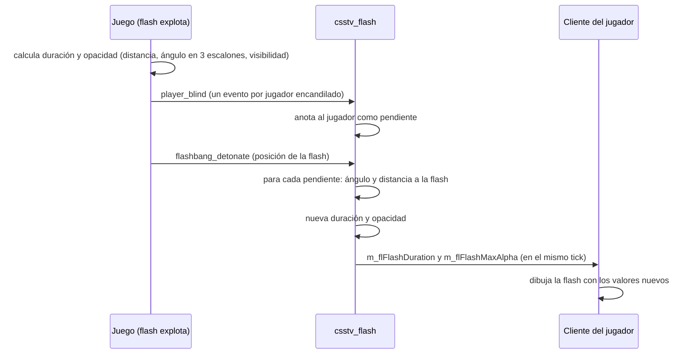

# Plan: flash según hacia dónde mirás y a qué distancia

> Planeación original. Estado: **propuesta**, pidió Kyan el 2026-11-11. Prototipo para probar en el servidor local; no se despliega sin aprobación.

## Decisiones tomadas

| Tema | Decisión | Por qué |
|---|---|---|
| Dónde se cambia | Un plugin de SourceMod nuevo, `csstv_flash` | No hace falta tocar el cliente: el cliente dibuja la flash con dos valores que manda el servidor (`m_flFlashDuration` y `m_flFlashMaxAlpha`). |
| Qué se recalcula | Lo que dura la flash y qué tan blanca se pone la pantalla | Son los dos únicos valores que el cliente usa para dibujarla. |
| Cómo se recalcula | Se parte de lo que calculó el juego, se le saca el escalón de ángulo del juego y se aplica una curva suave propia de ángulo y una caída extra por distancia | El juego ya tiene en cuenta si la flash se ve (paredes, humo parcial) y la distancia. Partir de su cálculo conserva eso; solo se cambia lo que no se parece a CS:GO. |
| Ángulo | Ciego completo hasta 50° del centro de la vista; de 50° a 135° baja suave; de 135° en adelante (de espaldas) queda el 15 % de la duración y la pantalla no pasa de 140/255 | En CS:GO y CS2, de espaldas la flash casi no ciega. Los números quedan en cvars para ajustarlos jugando. |
| Distancia | Sin cambio hasta 400 unidades; de 400 a 1500 la duración baja hasta el 40 % | El juego ya baja la duración con la distancia, pero muy poco. |
| Compañeros y propia | Misma regla para todos | No se cambia quién puede flashear a quién, solo cuánto. |
| Pitido del oído | Sin cambio | Lo pone el motor aparte y no tiene un valor que se pueda pisar desde el plugin. |
| Activación | `csstv_flash_enable 1` por defecto, con cvars para todos los números | Se puede apagar sin sacar el plugin. |

## 1. El flujo completo

El juego dispara `player_blind` durante la explosión y `flashbang_detonate` justo después, en el mismo tick. Por eso el plugin junta los jugadores en el primero y los recalcula en el segundo, cuando ya sabe dónde explotó. Si `flashbang_detonate` no llega (por ejemplo, porque quien la tiró se desconectó), el jugador se queda con el cálculo del juego.

## 2. El cálculo

1. `dot` = coseno del ángulo entre hacia dónde mira el jugador y la dirección de sus ojos a la flash (el mismo que usa el juego).
2. Escalón del juego, que se deshace: `dot ≥ 0,5` → 1; `dot ≥ -0,5` → 0,7; menos → 0,4 (proporciones de la duración del juego para cada escalón). `base = duración del juego / escalón`. Las proporciones se comprueban en las pruebas con `csstv_flash_debug 1` y se corrigen si el v34 usa otras.
3. Factor de ángulo: 1 hasta `csstv_flash_full_angle` (50°), `csstv_flash_back_scale` (0,15) desde `csstv_flash_back_angle` (135°), y una curva suave (smoothstep) entre los dos.
4. Factor de distancia: 1 hasta `csstv_flash_dist_near` (400), `csstv_flash_dist_scale` (0,40) desde `csstv_flash_dist_far` (1500), lineal entre los dos.
5. Duración nueva = `base × ángulo × distancia`. Opacidad nueva = de 255 a `csstv_flash_back_alpha` (140) con la misma curva de ángulo, y nunca más que la que puso el juego.
6. Si la duración nueva queda por debajo de `csstv_flash_min` (0,1 s), se pone en 0 (no encandila).

## 3. El plugin

- `server/addons/sourcemod/scripting/csstv_flash.sp` y su `.smx` en `server/addons/sourcemod/plugins/`.
- Cvars: las de la sección 2, `csstv_flash_enable`, `csstv_flash_debug` (escribe en la consola del servidor el valor del juego y el nuevo para cada jugador) y `csstv_flash_version`.
- La configuración va en `cfg/sourcemod/csstv_flash.cfg` (`AutoExecConfig`), igual en todos los servidores.
- Sin comandos para jugadores ni para admins.

## 4. Pruebas

- Servidor local `C:\Users\Agus\Downloads\cssds`, con bots quietos en distintas posiciones y una flash creada por un plugin de prueba (`pruebas/flash_test.sp`), con `csstv_flash_debug 1`: comprobar que se recalcula y que los números siguen la curva.
- Lo que se siente al jugar (si de espaldas se ve bien, si ClientMod respeta los valores) lo prueba una persona en el servidor local.

## 5. Requisitos antes de empezar

- `spcomp` 1.8 del servidor local (`cstrike/addons/sourcemod/scripting/spcomp.exe`).
- Aprobación de Daniel o Kyan para desplegarlo: cambia el juego en los mixes.

## 6. Orden de implementación

1. Plugin `csstv_flash.sp` y compilarlo.
2. Plugin de prueba y prueba con bots en el servidor local.
3. Prueba de una persona en el servidor local; ajustar los números.
4. Documentación, manual (página del jugador) y changelog.
5. Con aprobación: despliegue a #1, #2 y #3 en la misma tanda, sin recargar con partidas en curso.
