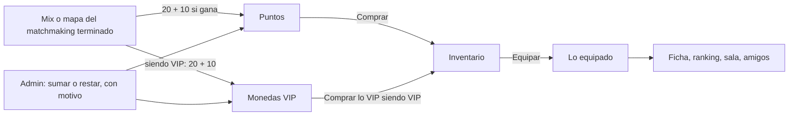

# Tienda de cosméticos con puntos y monedas VIP: documentación

## Qué hace

Cada jugador gana **puntos** con los mixes y las partidas del matchmaking, y los gasta en la **Tienda** (`/shop`) en cosméticos. El catálogo tiene 369 (Daniel elige en Administración › Tienda cuáles están a la venta):
- marcos para la foto;
- avatares, que reemplazan la foto (los de Kyan, desde el 2026-11-14);
- stickers;
- temas (los colores de toda la página del jugador);
- efectos de nombre;
- fondos de miniperfil.

Lo que se pone se ve en la ficha pública, en el ranking, en el comparador y en la sala y los amigos del matchmaking. Además, cada uno puede subir una **portada** para su perfil y, desde el 2026-11-14, su propio fondo y, siendo VIP, su avatar y su fondo animados ([`2026-11-13-avatar-y-fondo-propios`](../2026-11-13-avatar-y-fondo-propios/DOCUMENTACION.md)).

Los VIP tienen el **Marco Oro VIP** sin comprarlo y ganan **monedas VIP** en los mixes que juegan siendo VIP, con las que compran los artículos VIP. Si el VIP vence, lo VIP queda congelado.

El diseño y el catálogo son de Kyan (`kyan/pruebas` y `kyan/ejemplo-matchmaking`, 2026-10-29); acá se pasaron a la base del replanteo, la API y la web nueva.

## Reglas

- **Qué suma:** un mix o un mapa del matchmaking que terminó, que le dio ELO al jugador (35 % de las rondas o más) y en el que no abandonó. No suman los interrumpidos (`end_reason = 'crash'`), los borrados por un admin, las PCW ni los torneos (no dan ELO). Cuentan desde el primer mix. Se suman todos los SteamID de la ficha.
- **Se calculan, no se anotan.** `points_mixes_of` recorre los mixes cada vez: si un admin borra un mix o cambia `points_config`, el saldo de todos cambia solo.
- **Saldo** = ganados + regalos y correcciones del admin (`point_grants`) − gastados (`user_items.price_paid`), por moneda. Puede quedar negativo; lo comprado se conserva, pero no se compra hasta volver a positivo.
- **Monedas VIP:** solo de los mixes jugados siendo VIP en la fecha del mix (`was_vip`). Se gastan solo en lo VIP y solo siendo VIP hoy. VIP vencido: las monedas y lo VIP comprado quedan congelados (`frozen`, `usable: false`) y vuelven al renovar.
- **Marco Oro VIP** (`vip_reward`): viene con el VIP; no se compra ni se regala.
- **Sin ficha vinculada** no se suma ni se compra.
- **Valores con los que sale** (Daniel, 2026-11-14, los de su base local): 20 puntos por mix y 10 más por victoria, 20 y 10 monedas VIP, ×1 para los VIP, 6 ofertas con 25 % menos, lo propio a 550 (avatar), 650 (fondo animado) y 300 (fondo fijo), y hasta 5 avatares y 5 fondos de miniperfil guardados. El catálogo sale con 326 de los 369 artículos a la venta, con los precios y los grupos (VIP o para todos) que dejó Daniel; `catalogo.json` versión 14 los guarda (`price` y `active`) y la 119 los carga.
- **Ofertas de la semana:** 6 artículos (`weekly_count`) con 25 % menos (`weekly_discount`), elegidos con la semana ISO como semilla. Cambian solas el lunes a las 00:00 de Argentina, sin trabajo programado.
- **Precios** (Daniel, 2026-11-14): los de Kyan divididos por 2,5, redondeados a 50, y 50 más. Con puntos: stickers 100–150, efectos de nombre 200–300, temas 300–350, marcos 400–550, fondos 350–450, avatares 450. Con monedas VIP: stickers 150, efectos de nombre 250, temas 300, marcos, fondos y avatares 450. El admin los cambia uno por uno. Por qué: [`2026-11-13-avatar-y-fondo-propios`](../2026-11-13-avatar-y-fondo-propios/PLAN.md).
- **Armas de los marcos y los stickers** (Daniel, 2026-11-14): los 10 marcos y los 10 stickers `arma-*` llevan las mismas siluetas propias, dibujadas en perfil con sus detalles (cargador curvo de la AK, asa de la M4, mira de la AWP y la Scout, túnel de la MP5, cañón largo con riel de la Deagle, USP con silenciador…). Las de Kyan se veían deformes. No se usan los íconos del juego porque son arte de Valve. Generador: [`pruebas/armas_marcos.py`](pruebas/armas_marcos.py).
- **Equipado:** uno por tipo y hasta 3 stickers (en la web, el cuarto saca al más viejo).
- **Quitar un artículo** (admin) no devuelve lo pagado: deja un descuento "Compra quitada: …" en `point_grants` con el motivo, así el saldo no cambia.
- **Compras al mismo tiempo:** `shop_buy` toma un lock por cuenta antes de mirar el saldo.

## Base de datos (replanteo `113_tienda.sql`)

| Objeto | Qué es |
|---|---|
| `points_config` | Una fila: `per_mix`, `per_win`, `vip_multiplier` (1), `vip_per_mix`, `vip_per_win`, `weekly_count`, `weekly_discount` |
| `shop_items` | El catálogo de `web/frontend/public/cosmetics/catalogo.json` (mismo `id`): tipo, nombre, archivo o clase CSS, colección, `vip_only`, `vip_reward`, `price`, `vip_price`, `active`, `sort` |
| `user_items` | Inventario: comprado (con `currency`) o regalado |
| `point_grants` | Sumas y restas del admin, en puntos o monedas VIP, con motivo. No se borran |
| `user_cosmetics` | Lo equipado de cada cuenta |
| `profile_details.cover_url` | La portada |
| `points_mixes_of`, `points_totals`, `was_vip` | Internas: los mixes que suman y los totales de las dos monedas |
| `points_summary`, `points_history` | El saldo y los movimientos (el dueño o un admin) |
| `shop_weekly`, `shop_catalog` | Las ofertas y el catálogo con el precio de hoy |
| `shop_buy`, `set_my_cosmetics`, `can_use_item` | Comprar, equipar y si se puede usar |
| `player_cosmetics_public`, `cosmetic_json` | Lo equipado de cada ficha, resuelto y sin lo que ya no puede usar (pública) |
| `admin_points_grant`, `admin_item_grant`, `admin_item_revoke`, `admin_shop_item_update`, `set_points_config`, `admin_cover_clear`, `admin_points_accounts`, `user_items_of` | El admin |

Avisos nuevos en la categoría `account`: `points_granted`, `item_granted`, `item_revoked` y `cover_removed`.

## API

Contrato completo en [`docs/frontend/contrato/tienda.md`](../../frontend/contrato/tienda.md).

- **El jugador:**
  - `GET /api/v1/shop/items`, `GET /api/v1/shop/config` y `POST /api/v1/shop/items/{id}/buy`;
  - `GET /api/v1/me/points` y `/me/points/history`;
  - `GET` y `PUT /api/v1/me/cosmetics`;
  - `POST` y `DELETE /api/v1/me/cover`.
- **Cosméticos de varias fichas:** `GET /api/v1/cosmetics?players=` (hasta 100), para la sala del matchmaking y los amigos sin tocar las funciones del matchmaking.
- **En los jugadores:**
  - `cosmetics` (marco y nombre) en Jugadores, el ranking y el comparador;
  - `cosmetics` completo y `cover_url` en la ficha;
  - `details.cover_url` en `GET /me/profile`.
- **El admin:** `/api/v1/admin/shop/items`, `/admin/points/config`, `/admin/points/accounts` y `/admin/users/{id}/points`, `…/items` y `…/cover/clear`.

## Web

| Pantalla | Qué tiene |
|---|---|
| **Tienda** (`/shop`, en Comunidad) | Vista previa con "Probar", saldo de puntos y monedas VIP, cuánto se gana, el banner VIP, ofertas de la semana, catálogo con tipos, colecciones, búsqueda, filtros y orden, comprar con confirmación, equipar y sacar, historial por moneda |
| **Mi perfil** | Tarjeta **Portada y cosméticos**: subir (encuadre 4:1, 1200×300, hasta 1 MB) y quitar la portada, e ir a la Tienda |
| **Ficha del jugador** | Portada, tema (pinta toda la página, siempre en oscuro; Daniel, 2026-11-14), avatar con marco, nombre con efecto, insignia VIP y stickers |
| **Ranking** | Marco y efecto de nombre en cada fila |
| **Jugar** | En las tarjetas del grupo (la propia y la de cada integrante): fondo de miniperfil, avatar animado, marco y efecto de nombre. En la sala de la partida: el avatar quieto y el efecto de nombre, sin marco. En los amigos: el efecto de nombre |
| **Administración › Tienda** (`/admin/shop`, solo admin) | Valores de los puntos (con confirmación), cuentas con **Gestionar** (sumar o restar, regalar, inventario con quitar, quitar portada, todo con motivo) y el catálogo (precio, activo, cuántos lo tienen) |
| **Notificaciones** | Los cuatro avisos nuevos |

Los cosméticos están en `web/frontend/public/cosmetics/` y `features/shop/cosmeticos.css`.

## Qué cambia para cada rol

| Rol | Qué cambia | Página del manual |
|---|---|---|
| Jugador | Gana puntos con los mixes y los gasta en la Tienda; se pone marcos, temas, efectos de nombre, fondos y stickers; sube una portada. Si es VIP, el Marco Oro VIP y las monedas VIP | [`jugador/tienda-y-cosmeticos.md`](../../manual/jugador/tienda-y-cosmeticos.md) |
| Admin | Administración › Tienda: valores de los puntos, precios, nombre, descripción y si es solo VIP de cada artículo, vista previa, sumar o restar, regalar y quitar artículos, quitar portadas | [`admin/tienda-y-puntos.md`](../../manual/admin/tienda-y-puntos.md) |
| Capitán, organizador, moderador, streamer y dueño de un servidor externo | Nada distinto de lo del jugador | — |

## Términos y privacidad

- **Términos (sección 13, "Puntos, tienda y misiones"):**
  - la tienda sale de "En preparación"; las misiones siguen en preparación;
  - se suman las monedas VIP y que se congelan;
  - quitar un artículo no devuelve lo pagado;
  - la portada tiene que respetar las reglas y un admin la puede quitar.
- **Privacidad:**
  - la portada entre lo que se agrega al perfil;
  - las compras, los regalos, lo equipado y los ajustes del admin entre lo que se guarda (los puntos se calculan, no se guardan aparte);
  - lo equipado y la portada (salvo perfil privado) son públicos;
  - las monedas VIP, entre lo que ven solo la cuenta y el staff.
- Las dos páginas de la web y sus `.html` de `terms/`, con la fecha del 2026-11-12.
