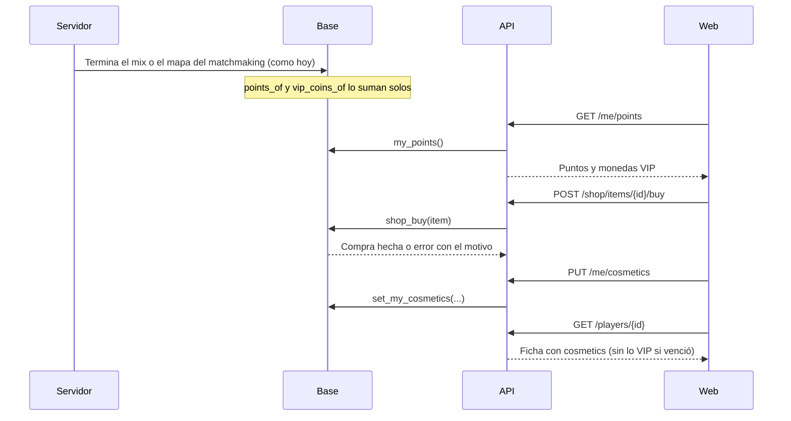
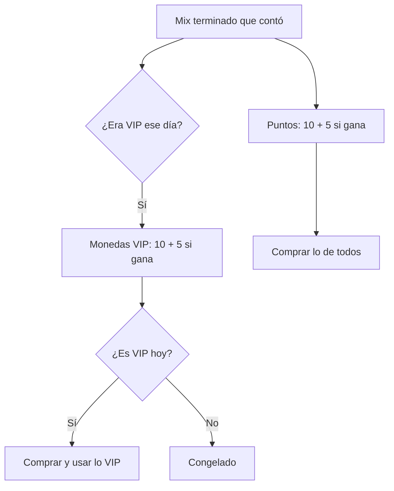

# Plan: tienda de cosméticos con puntos y monedas VIP

> Planeación original. Estado: **aprobado por Daniel el 2026-11-11** (decisiones de la tabla).

Kyan diseñó la tienda el 2026-10-29 en `kyan/pruebas` (web vieja y tres migraciones sin probar) y la prototipó en el frontend nuevo (`kyan/ejemplo-matchmaking`, `/demo/tienda`, con datos en memoria). Este requerimiento la lleva a la plataforma real: el replanteo, la API y la web nueva, en `main`.

Fuentes que se reutilizan:

| De Kyan | Dónde | Qué se toma |
|---|---|---|
| Plan del backend | `kyan/pruebas`: `docs/bitacora/2026-10-29-tienda-puntos-backend/PLAN.md` | Las tablas, las funciones y las rutas |
| Migraciones de la web vieja | `kyan/pruebas`: `supabase/migrations/20261029180000_tienda.sql`, `20261029200000_fondo_miniperfil.sql` y `20261029210000_vip_progresion.sql` | La lógica, unida en un solo replanteo y adaptada (sección 2) |
| Cosméticos | `kyan/ejemplo-matchmaking`: `web/frontend/public/cosmetics/` (308 artículos con `catalogo.json`) | Se copian tal cual |
| Pantallas | `kyan/ejemplo-matchmaking`: `web/frontend/src/features/shop/` | `ShopPage`, `AdminShop`, `ProfilePreview`, `cosmetics.tsx` y `cosmeticos.css`, pasadas a la API |

**No se usa** la tienda de `index.html` (la web vieja no se toca) ni sus migraciones directamente: nunca se corrieron en ningún Postgres y no conocen el replanteo.

## Decisiones tomadas

| Tema | Decisión | Por qué |
|---|---|---|
| Qué partidas dan puntos | **Los mixes y las partidas del matchmaking** (Daniel). Cada mapa del matchmaking ya es una fila `kind = 'mix'` con `parent_match_id`, así que entra con la misma regla. PCW y torneos no, por ahora | Es donde se juega todos los días. Sumar PCW y torneos después es cambiar una función |
| Qué mix cuenta | Terminado (`status = 'finished'`), sin `end_reason = 'crash'`, con el jugador con peso de ELO mayor a 0 (`elo_weight`, 35 % de las rondas) y **sin abandonar** (`mm_elo_abandoned`) | La misma regla que el ELO. El que abandona ya pierde ELO: no puede ganar puntos. Los interrumpidos dan ±1 de ELO pero no puntos, para no premiar un mix que no se terminó |
| Desde cuándo | **Desde el primer mix** (Daniel) | Nadie arranca en cero y los que más jugaron tienen más |
| Puntos se calculan | No se anotan: una función suma los mixes que cuentan | Si se borra un mix o cambia la configuración, el saldo se corrige solo |
| Cuánto se gana | 10 por mix, 5 más si ganó su equipo (`points_config`) | Lo de Kyan. El admin lo cambia |
| VIP | **Monedas VIP** (Daniel, la última versión de Kyan): ser VIP da solo el Marco Oro VIP; el resto de lo VIP se compra con monedas VIP, que se ganan (10 por mix, 5 más si gana) solo en los mixes jugados siendo VIP **en la fecha del mix**. Los puntos normales no llevan ×VIP (`vip_multiplier = 1`, configurable) | Lo VIP también progresa. Los términos ya lo dicen así |
| VIP vencido | El saldo de monedas y lo VIP comprado quedan congelados: no se usan ni se ganan. Vuelven al volver a ser VIP | Lo de Kyan, ya en los términos |
| Saldo | Ganados + regalos del admin − gastados. Puede quedar negativo (un mix borrado después de una compra): lo comprado se conserva, pero no se compra hasta volver a positivo | No quitarle cosas a nadie por una corrección |
| Plata real | No hay: los puntos y las monedas no se compran ni se canjean | Sin pasarela de pago |
| Precios | Los de Kyan (sticker 150 a 200, nombre 400 a 600, tema 600 a 700, marco 900 a 1200, fondo según el catálogo, y `vip_price` de cada artículo VIP). **El admin los cambia** (Daniel): precio, precio VIP, a la venta o no, activo | Ajustar sin migración |
| Ofertas de la semana | 6 artículos con 25 % menos, elegidos con la semana ISO como semilla (lunes, hora de Argentina). Cambian solos, sin trabajo programado. `weekly_count` y `weekly_discount` configurables | Lo de Kyan |
| Portada del perfil | **Sí** (Daniel): imagen 4:1 (1200 × 300) en el bucket `photos`, en `profile_details.cover_url`. El admin la puede quitar con motivo | Lo de Kyan, con el mismo manejo de imágenes que los logos y los banners |
| De quién | De la **cuenta**. Una cuenta sin ficha no suma (la tienda le pide reclamar su perfil) | Se gasta desde la web, con sesión |
| Equipados | Uno por tipo (`frame`, `background`, `theme`, `name`) y hasta 3 stickers | Lo que muestra el perfil |
| Dónde se ve | Ficha del jugador (portada, marco, fondo, nombre, tema y stickers); en listados (Jugadores, ranking, amigos y la sala del matchmaking) solo marco, nombre e insignia VIP | No cargar de más las listas |
| Misiones | **Fuera de este requerimiento**: van en uno propio, después | Necesitan cron, progreso por jugador, reglas anti-abuso y datos del plugin que no existen |
| Rama | `main` (Daniel) | Como lo último de PCW. No toca el matchmaking de la base ni el plugin: no va a `feat/mm-claim-en-sala`. La sala del matchmaking muestra los cosméticos desde `features/matchmaking/`: ese cambio de la web también va a `feat/frontend-fase-1` |

## 1. El flujo completo

## 2. Base de datos (`supabase/replanteo/113_tienda.sql`)

Une las tres migraciones de Kyan en un solo replanteo, con su inversa (`reversas/113_tienda.sql`), y les cambia esto:

| De Kyan | En el replanteo |
|---|---|
| Mix del jugador por `player_id` o `steam_id` | `elo_key(steam_id)`, como el ELO: una ficha con varios SteamID suma una vez |
| Mix con `elo_after` no nulo | La regla de la tabla de decisiones (`elo_weight > 0`, sin abandono, sin `crash`) |
| Sin avisos | `notify()` con `points_granted`, `item_granted` e `item_revoked`, en la categoría `account` de `notification_category` |
| `profile_details.cover_url` con el bucket `avatars` | La misma columna, pero la imagen va al bucket `photos` por la API (`users/<uid>/cover-…`) |
| Tres migraciones re-ejecutables | Un replanteo que aborta si ya se aplicó, como los demás |

### Tablas

| Tabla | Para qué |
|---|---|
| `points_config` | Una fila: `per_mix`, `per_win`, `vip_multiplier`, `vip_per_mix`, `vip_per_win`, `weekly_count`, `weekly_discount` |
| `shop_items` | El catálogo de `catalogo.json` (mismo `id`): `kind`, `name`, `description`, `file` o `css_class`, `collection`, `vip_only`, `vip_reward`, `animated`, `price`, `vip_price`, `active`, `sort`. `price null` no se vende |
| `user_items` | Inventario: `source` (`purchase` o `grant`), `currency` (`points` o `vip`), `price_paid`, `granted_by`, `note` |
| `point_grants` | Regalos y correcciones del admin, con `currency` y motivo obligatorio. No se borran |
| `user_cosmetics` | Lo equipado: `frame`, `background`, `theme`, `name` y `stickers` (hasta 3) |

Todas con RLS. Se escriben solo con las funciones.

### Funciones y vistas

- **Cálculo:** `was_vip(cuenta, fecha)`, `points_mixes_of`, `points_of`, `vip_coins_of`, `can_use_item`.
- **La cuenta:** `my_points()` (puntos y monedas), `my_points_history`, `my_vip_coins_history`, `shop_buy(item)` (con lock por cuenta), `set_my_cosmetics(datos)`.
- **Catálogo:** `shop_weekly()` y la vista `shop_catalog` (precio de hoy y si está en oferta).
- **Público:** la vista `player_cosmetics_public`, sin lo que la cuenta ya no puede usar (VIP vencido, artículo quitado o inactivo).
- **Admin:** `admin_points_grant`, `admin_vip_coins_grant`, `admin_item_grant`, `admin_item_revoke`, `admin_shop_item_update` (precio, precio VIP, activo y orden), `set_points_config`, `admin_cover_clear` y `admin_points_overview`.

### Carga inicial

El mismo archivo inserta los 308 artículos con los precios de Kyan, generado desde `catalogo.json` con el script de Kyan (`generar_catalogo_sql.py`), que va en `pruebas/`.

### Pruebas (`pruebas/prueba_113.sql`)

- Puntos por mix, por victoria y monedas VIP solo en mixes jugados siendo VIP.
- Cuenta un mapa del matchmaking; no cuentan el abandono, el interrumpido, el de peso 0 ni el borrado.
- Una ficha con dos SteamID suma una vez.
- Comprar sin saldo, repetido, inactivo, sin precio y VIP sin VIP; dos compras al mismo tiempo.
- Equipar algo ajeno, del tipo equivocado, 4 stickers o VIP vencido.
- `player_cosmetics_public` deja de mostrar lo VIP al vencer y lo vuelve a mostrar al renovar.
- La inversa deja la estructura idéntica.

## 3. API (`web/backend`)

Archivos nuevos `routes/shop.ts`, `schemas/shop.ts` y `services/shop.ts`. Cambios en `me.ts`, `players.ts`, `ranking.ts` y `mm.ts` (el campo `cosmetics`).

| Método y ruta | Quién | Qué hace |
|---|---|---|
| `GET /api/v1/shop/items` | Todos | Catálogo activo con el precio de hoy, paginado, con filtros (`kind`, `collection`, `vip`, `q`, `weekly`) y orden. Con sesión suma `owned`, `equipped` y `can_buy` |
| `POST /api/v1/shop/items/{id}/buy` | Cuenta | Compra. Errores `BUSINESS_RULE` con el motivo |
| `GET /api/v1/me/points` | Cuenta | Puntos y monedas VIP: `earned`, `granted`, `spent`, `balance` y si están congeladas |
| `GET /api/v1/me/points/history` | Cuenta | Paginado: mixes, regalos y compras, con `currency` |
| `GET /api/v1/me/items` | Cuenta | Inventario |
| `GET` y `PUT /api/v1/me/cosmetics` | Cuenta | Lo equipado |
| `POST` y `DELETE /api/v1/me/cover` | Cuenta | Subir o quitar la portada (JPEG, PNG o WebP, 4:1, hasta 1 MB) |
| `GET /api/v1/admin/shop/items` y `PATCH /api/v1/admin/shop/items/{id}` | Admin | Todo el catálogo y la edición de precios |
| `GET /api/v1/admin/points/accounts` | Admin | Cuentas con saldos, paginado, con filtros y orden |
| `GET /api/v1/admin/users/{id}/points` | Admin | Saldo, historial e inventario de una cuenta |
| `POST /api/v1/admin/users/{id}/points` | Admin | Sumar o restar puntos o monedas VIP (`currency`, `amount`, `reason`) |
| `POST /api/v1/admin/users/{id}/items` y `DELETE …/items/{item}` | Admin | Regalar o quitar un artículo |
| `DELETE /api/v1/admin/users/{id}/cover` | Admin | Quitar la portada, con motivo |
| `GET` y `PUT /api/v1/admin/points/config` | Admin | La configuración de `points_config` |

La ficha (`PlayerDetail`) suma `cover_url` y `cosmetics` completo; los listados, solo `frame` y `name`. Campos nuevos: no rompen a nadie. El contrato del frontend suma la sección "Tienda".

Pruebas unitarias de las rutas y de integración contra la base local (`test/integration/shop.test.ts`).

## 4. Web (`web/frontend`)

- **Cosméticos:** `public/cosmetics/` y `features/shop/cosmeticos.css`, de Kyan.
- **`/shop` (Tienda):** el prototipo de Kyan con la API: vista previa con "Probar", saldo de puntos y monedas VIP, historial, ofertas de la semana, catálogo con pestañas, colecciones, búsqueda, filtros y orden, y Comprar con confirmación, Equipar y Sacar. Sin sesión se ve todo y para comprar pide ingresar.
- **Mi perfil:** subir y quitar la portada (recortada a 4:1) y un acceso a la Tienda.
- **Ficha del jugador:** portada, marco, fondo, efecto de nombre, tema y stickers.
- **Listados:** marco y nombre en Jugadores, ranking, amigos y la sala del matchmaking.
- **Administración › Tienda:** configuración de puntos (avisando que cambia el saldo de todos), cuentas (sumar o restar, regalar o quitar artículos, quitar la portada) y catálogo (precio, precio VIP, activo).
- **Menú:** "Tienda" en la barra y en el menú del usuario.

## 5. Manual, términos y privacidad

- **Manual:** `jugador/tienda-y-cosmeticos.md` (puntos, monedas VIP, comprar, equipar y portada) y `admin/tienda-y-puntos.md`. Se revisan `jugador/elo-y-estadisticas.md` y la página del VIP si nombran la tienda.
- **Términos:** la sección "Puntos, tienda y misiones" sale de "En preparación" salvo las misiones; lo de los cosméticos y las monedas VIP del VIP también.
- **Privacidad:** la portada y lo equipado son datos que se publican; los puntos y el inventario se guardan mientras exista la cuenta. Se cambian la página y su `.html` de `terms/` juntos.
- **Changelog:** `CHANGELOG_DISCORD.txt` en esta carpeta.

## 6. Requisitos antes de empezar

- Ninguna credencial nueva. La base local de `main` con todo hasta la `112`.
- Los archivos de Kyan están en las ramas locales `kyan/pruebas` y `kyan/ejemplo-matchmaking`.

## 7. Orden de implementación

1. `113_tienda.sql`, su inversa y `prueba_113.sql` en la base local. Tipos regenerados.
2. API: rutas de la cuenta, `cosmetics` en la ficha y los listados, portada y rutas del admin, con sus pruebas.
3. Web: cosméticos, Tienda, perfil, ficha, listados y Administración › Tienda, con pruebas, lint y build.
4. Recorrerlo en el navegador con dos cuentas (una VIP).
5. Manual, términos, privacidad, `DOCUMENTACION.md`, `GUIA_IMPLEMENTACION.md`, la fila en el índice y `docs/PENDIENTES.md`.
6. Commit en `main` (la parte de `features/matchmaking/` también en `feat/frontend-fase-1`) cuando Daniel lo pida.
7. Despliegue con la guía: la `113` en producción, la API y la web. No toca los servidores de juego.
