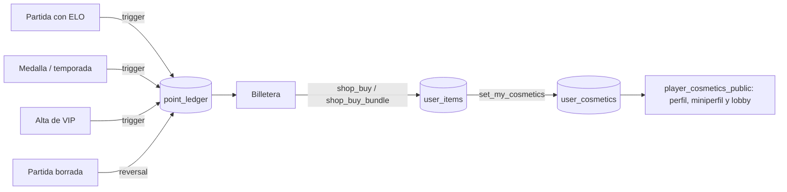

# Tienda, inventario y economía: documentación

## Qué es

Con la tienda, los jugadores cambian **puntos** por cosméticos para su perfil y los VIP cambian **monedas VIP** por lo VIP. Hay 333 artículos: marcos, fondos de miniperfil, temas, efectos de nombre y stickers.

Cada cuenta tiene:

- **Billetera:** las dos monedas.
- **Inventario:** lo que tiene y lo que tiene puesto.
- **Lista de deseos.**
- **Historial:** cada movimiento.

Las reglas de la economía (cuánto da cada cosa, el tope y las monedas VIP) están en [`2026-11-11-economia-puntos`](../2026-11-11-economia-puntos/PLAN.md).

## La web (`web/frontend/src/features/shop`)

| Pestaña | Qué tiene |
|---|---|
| **Tienda** | <ul><li>**Portada:** rota sola (los fondos nuevos, el pack de la semana y el Marco Oro VIP), salvo con movimiento reducido.</li><li>**Ofertas de la semana:** con cuenta regresiva.</li><li>**Packs:** −20 % sobre lo que falta.</li><li>**Lista de deseos.**</li><li>**Catálogo:** con tipo, colección, búsqueda, "Me alcanza", "Lo que tengo", "Lista de deseos", VIP, y orden por rareza o precio.</li></ul> |
| **Inventario** | <ul><li>Lo que tenés puesto, en perfil, miniperfil o lobby.</li><li>Ranuras: marco, fondo, tema, nombre y 3 stickers.</li><li>Lo que tenés de cada tipo.</li><li>Datos: artículos, colecciones completas, valor y VIP congelados.</li><li>Colecciones a medio camino.</li></ul> |
| **Cómo ganar** | <ul><li>Partidas con premio hoy, sobre el tope.</li><li>Lo ganado en la semana.</li><li>La tabla de premios con los valores de la configuración.</li><li>Medallas por metal y temporada por puesto.</li></ul> |
| **Historial** | Cada movimiento, por día, filtrado por moneda y por ganado o gastado. |

- **Ficha del artículo** (`ItemSheet`):
  - vista previa grande;
  - "Cómo te queda" en perfil, miniperfil y lobby;
  - la colección con su progreso y el pack;
  - comprar con confirmación, equipar y la lista de deseos.
- **Rareza:** sale del precio. Común, Rara (desde 400), Épica (desde 800), Legendaria (1000 o más y animado) y VIP (el premio VIP). Se ve en una franja de color.
- **Hoy funciona como demo:** está en `/demo/tienda`, con datos en memoria (`demo.ts`) y las mismas reglas que la base. La barra del demo simula:
  - partidas, oficiales y torneos;
  - medallas, temporada y nivel;
  - misiones y Primeros pasos;
  - clip destacado y regalos;
  - pasar al día siguiente y ser VIP.

## La base (replanteo 110)

| Objeto | Para qué |
|---|---|
| `economy_config`, `economy_rules` | Topes, ofertas, packs y cuánto da cada premio (`key`: match, medal_oro, season_10…) |
| `point_ledger` | Cada movimiento. Único por (cuenta, moneda, origen, ref): no paga dos veces |
| `points_award`, `economy_award` | Anotar. `economy_award` también la pueden llamar los sistemas que vengan (`service_role`) |
| Triggers | <ul><li>**ELO de la partida:** partida, victoria y primera del día, con el tope; la oficial, sin tope.</li><li>**Medallas:** por metal; las de temporada, por puesto.</li><li>**VIP:** bienvenida.</li><li>**Partida borrada:** reversión.</li></ul> |
| `shop_items`, `shop_catalog` | Catálogo y precio de hoy (`shop_weekly`) |
| `user_items`, `user_cosmetics`, `user_wishlist` | Inventario, lo puesto y la lista de deseos |
| `shop_buy`, `shop_buy_bundle`, `set_my_cosmetics`, `wishlist_toggle` | Lo que hace la cuenta |
| `my_wallet`, `my_ledger`, `my_inventory`, `player_cosmetics_public` | Lo que se lee |
| `admin_*` | Regalos y correcciones, economía, precios, regalar y quitar artículos, saldos |

Reglas que valida la base:

- **Quién puede comprar qué:**
  - lo VIP se compra con monedas VIP y siendo VIP;
  - el premio VIP no se compra ni se regala.
- **Lo VIP sin VIP:** queda congelado (`can_use_item`).
- **Lo puesto:** solo lo que se puede usar, y hasta 3 stickers.
- **PCW:** no dan nada.
- **Abandono:** quien abandona una partida del matchmaking no cobra (`mm_elo_abandoned`).
- **Inicio:** antes de `starts_at`, el día que se aplica, no se da nada.

## La API (`web/backend/src/routes/shop.ts`)

| Ruta | Quién |
|---|---|
| `GET /api/v1/shop/catalog`, `GET /api/v1/shop/economy`, `GET /api/v1/players/{id}/cosmetics` | Todos |
| `GET /api/v1/me/wallet`, `GET /api/v1/me/ledger`, `GET /api/v1/me/inventory`, `PUT /api/v1/me/cosmetics`, `POST /api/v1/me/wishlist/{item}`, `POST /api/v1/shop/buy`, `POST /api/v1/shop/buy-bundle` | Con sesión |
| `GET /api/v1/admin/shop/wallets`, `POST /api/v1/admin/shop/grant`, `PUT /api/v1/admin/shop/economy`, `PUT /api/v1/admin/shop/economy/rules/{key}`, `PATCH /api/v1/admin/shop/items/{id}`, `POST /api/v1/admin/users/{id}/items`, `DELETE /api/v1/admin/users/{id}/items/{item}` | Admin |

Errores:

| Caso | Código |
|---|---|
| Sin saldo | `BUSINESS_RULE` (400) |
| Ya lo tiene | `CONFLICT` (409) |
| VIP sin ser VIP | `FORBIDDEN` (403) |
| No existe | `NOT_FOUND` (404) |

## Qué cambia para cada rol

| Rol | Cambio |
|---|---|
| Jugador | <ul><li>Gana puntos jugando, con medallas, temporada, torneos, misiones y Primeros pasos.</li><li>Compra artículos y packs.</li><li>Usa la lista de deseos.</li><li>Arma lo que tiene puesto desde su inventario.</li><li>Ve su historial.</li></ul> |
| Jugador VIP | <ul><li>Además, el Marco Oro VIP y monedas VIP para lo VIP.</li><li>Si vence, queda congelado.</li></ul> |
| Admin | <ul><li>Configura premios, topes, ofertas y packs.</li><li>Cambia precios.</li><li>Da o corrige puntos con motivo.</li><li>Regala o quita artículos.</li><li>El VIP lo sigue dando en Administración › Usuarios.</li></ul> |

**Manual:** [`jugador/tienda-y-puntos.md`](../../manual/jugador/tienda-y-puntos.md) y [`admin/tienda.md`](../../manual/admin/tienda.md), ocultas hasta que la tienda salga.

## Términos y privacidad

- **Términos:** la sección 13, "Puntos, tienda y misiones", ya existía. Se le sumó el punto de las monedas VIP (congeladas si vence el VIP, sin premio por PCW y con tope diario), con la marca "En preparación".
- **Privacidad:** ya nombraba los puntos, las compras y los cosméticos. No cambió.
