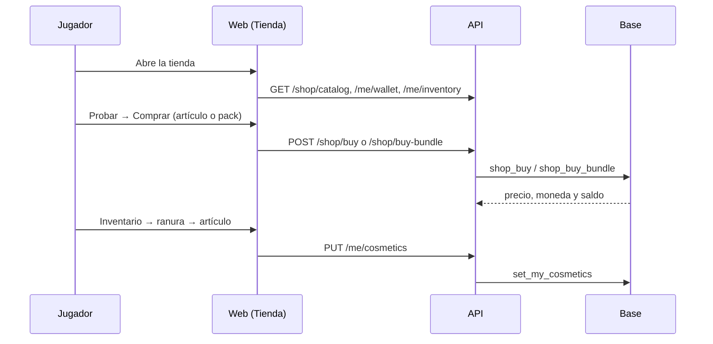

# Plan: tienda, inventario y economía en el frontend nuevo

> Planeación original, con lo que pidió Kyan el 2026-11-11. Estado: **en curso**.
>
> Se escribió a la par de la implementación: las decisiones de la economía ya estaban en
> [`2026-11-11-economia-puntos`](../2026-11-11-economia-puntos/PLAN.md), y Kyan pidió "la mejor tienda posible", con total
> libertad y siguiendo el diseño de la web.

Este plan rehace la tienda sobre el frontend nuevo (`web/frontend`), con:

- **Inventario:** uno propio para cada jugador.
- **Base y API:** lo que hace falta para sostenerla, sobre la economía del plan anterior.
- **Reutilización:** lo que ya existe (el VIP se sigue dando en Administración › Usuarios; `vip_at`; el manual; los términos).

## Decisiones tomadas

| Tema | Decisión | Por qué |
|---|---|---|
| Referencias | FACEIT y GamersClub: portada que rota, ofertas con cuenta regresiva, packs, rareza, lista de deseos, inventario con ranuras y "cómo ganar" | Lo pidió Kyan. |
| Estilo | El de Ranking. Se usan `Card`, `Badge`, `Segmented`, `FilterChips`, `StatTile`, `EmptyState`, `Carousel`, `Tabs`, `Sheet` y `ConfirmDialog` | Que no desentone con la web (`web/frontend/CLAUDE.md`). |
| Pestañas | **Tienda**, **Inventario**, **Cómo ganar** e **Historial** | Lo que tienen FACEIT y GamersClub, más el inventario que pidió Kyan. |
| Rareza | Común, Rara, Épica, Legendaria y VIP. Sale del precio y no se guarda | Da sensación de colección sin cargar un dato más. |
| Packs | Todos los artículos de un tema (`pais-ar`, `serie-ninja`…), al menos 3. Se paga solo lo que falta, con descuento (20 %) | 61 packs salen solos del catálogo. |
| Inventario | Ranuras: marco, fondo, tema, nombre y 3 stickers. Lo que tenés de cada tipo, VIP congelado y colecciones a medio camino | Pedido de Kyan. |
| Lista de deseos | `user_wishlist`, hasta 100 | Aparece en la tienda y como filtro. |
| VIP | No se da ni se quita acá: Administración › Usuarios (`admin_vip_grant`). Las monedas VIP usan `vip_at` | Kyan: "el VIP lo damos en otro apartado"; reutilizar lo que hay. |
| Base | Replanteo **110** (número a confirmar con Daniel): economía, registro, tienda e inventario. Reemplaza las migraciones viejas de la tienda, que nunca se aplicaron | Producción usa el replanteo. |
| API | Rutas nuevas en `routes/shop.ts`. Las funciones que todavía no están en `db/types.ts` se llaman con `as never`, como en `bookings.ts` | No se regeneran los tipos en este cambio. |
| Web | Por ahora, la ruta de demo `/demo/tienda` con datos en memoria y las mismas reglas que la base | La ruta real (`/tienda` con la API) va cuando la base y la API estén en producción. |

## 1. Flujo

## 2. Base (replanteo 110)

Lo de la economía (sección 4 del plan anterior), más:

- **Tablas:** `shop_items` con `vip_price` y `vip_reward`, `user_items`, `user_cosmetics` con `background` y `user_wishlist`.
- **Funciones de la cuenta:**
  - `shop_buy`, `shop_buy_bundle`, `set_my_cosmetics` y `wishlist_toggle`;
  - `my_wallet`, `my_ledger` y `my_inventory`.
- **Vistas:** `shop_catalog` y `player_cosmetics_public`.
- **Admin:** `admin_points_grant`, `admin_economy_set`, `admin_economy_rule_set`, `admin_shop_item_update`, `admin_item_grant`, `admin_item_revoke` y `admin_wallets`.
- **Reversión:** si se borra una partida, lo que dio se devuelve con filas negativas, porque los términos lo prometen.

## 3. API

Todas las rutas van en `routes/shop.ts`:

- **Públicas:** catálogo y economía (`/shop/*`), y lo que tiene puesto un jugador (`/players/{id}/cosmetics`).
- **De la cuenta:** `/me/wallet`, `/me/ledger`, `/me/inventory`, `/me/cosmetics` y `/me/wishlist/{item}`.
- **De admin:** las rutas `/admin/shop/*` y `/admin/users/{id}/items`.

## 4. Web

En `features/shop/`:

- **Pantallas:**
  - `ShopPage`: billetera y pestañas;
  - `StoreTab`: portada, ofertas, packs, lista de deseos y catálogo;
  - `ItemSheet`: ficha con vista previa en el perfil, el miniperfil y el lobby, y la colección;
  - `InventoryTab`;
  - `EarnTab` y `LedgerTab`.
- **Piezas:** `ItemCard`, `BundleCard`, `parts.tsx` y `economy.ts`.
- **Admin:** `AdminShop`, con la economía nueva y sin dar VIP.

## 5. Manual y términos

- **Manual:** `jugador/tienda-y-puntos.md` y `admin/tienda.md`, ocultas hasta que la tienda esté en producción.
- **Términos:** a la sección 13, que ya existía, se le suma el punto de las monedas VIP, con la marca "En preparación".

## 6. Orden

1. Web (demo).
2. Replanteo 110 con sus pruebas SQL.
3. Rutas de la API con sus pruebas de integración.
4. Manual, términos y bitácora.
5. Más adelante:
   - la ruta real `/tienda` sobre la API;
   - los cosméticos en el matchmaking (`MmCosmetics`) desde `player_cosmetics_public`.
