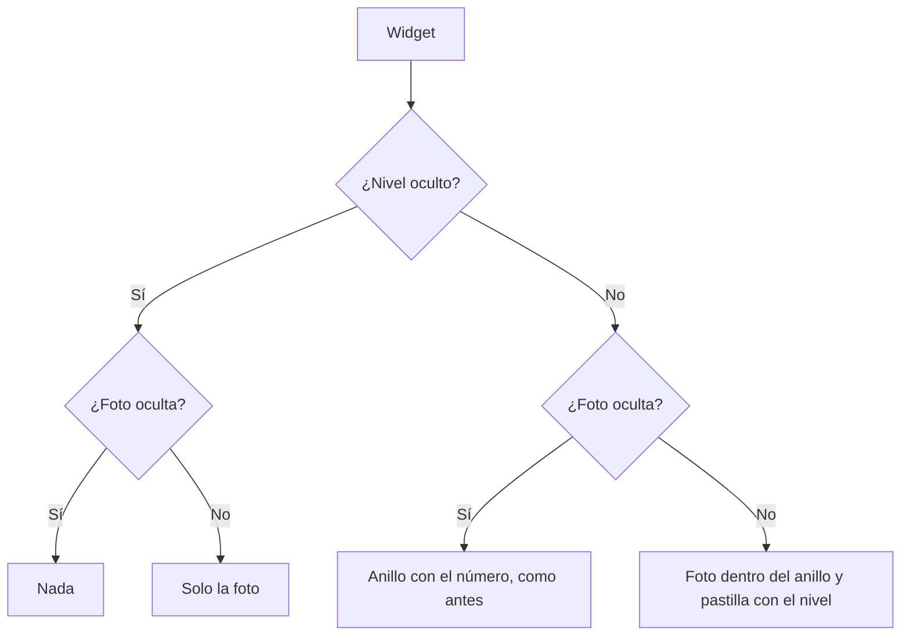

# Foto de perfil en el widget para streamers: documentación

## Qué hace

El widget para OBS ([`2026-11-10-widget-streamers-en-main`](../2026-11-10-widget-streamers-en-main/)) muestra la foto del perfil del jugador en sus seis diseños. La foto va dentro del anillo de nivel, y el número del nivel pasa a una pastilla abajo del anillo, del color del nivel. Ocupa el mismo lugar que el anillo de antes, así que no cambia el tamaño de ningún diseño ni las medidas para OBS.

La foto se puede apagar desde el personalizador (**Foto de perfil**, en las partes que se muestran). Apagada, el nivel se ve como antes: el anillo con el número adentro.

## La foto

- Sale de `widget_player` (replanteo `111`), que devuelve `photo_url` de `player_overview`: `coalesce(players.photo_url, profile_details.avatar_url)` (replanteo 69). Es la misma foto que se ve en el perfil público y en las salas.
- Si el jugador no tiene foto, o si la foto no carga, va la inicial del nick en el mismo círculo (como `PlayerAvatar` en el resto de la web).
- Se refresca con el resto de los datos, cada minuto.

## En la URL

La foto es una parte más de `h` (las partes ocultas): `h=photo` la apaga. Se combina con las demás (`h=photo,tag`).

| `h` incluye | Se ve |
|---|---|
| Ni `photo` ni `level` | La foto dentro del anillo y la pastilla con el nivel |
| `photo` | El anillo con el número adentro, como antes del 2026-11-11 |
| `level` | Solo la foto, del mismo tamaño |
| `photo` y `level` | Nada en ese lugar |

Las URLs que ya estaban en OBS no tienen `photo` en `h`, así que muestran la foto desde el próximo refresco. Quien no la quiera la apaga y vuelve a copiar la URL.

## Datos

| Dónde | Qué |
|---|---|
| `widget_player(p_player, p_period, p_since)` | Clave nueva `photo_url` (texto o null). Misma firma que en el 110 |
| `GET /api/v1/players/{id}/widget` | `WidgetData.photo_url: string \| null` |
| `features/widget/options.ts` | `photo` en `Part` y "Foto de perfil" en `PART_LABEL` |
| `features/widget/StreamWidget.tsx` | `Identity`: la foto, el anillo y la pastilla según las partes ocultas. `LevelRing` acepta `number={false}` para dibujar el anillo sin el número |

## Qué cambia para cada rol

| Rol | Qué cambia | Página del manual |
|---|---|---|
| Jugador | El widget muestra su foto de perfil dentro del anillo de nivel, y la puede apagar | [`jugador/widget-para-stream.md`](../../manual/jugador/widget-para-stream.md) |
| Capitán, organizador, moderador, admin, streamer y dueño de un servidor externo | Nada | — |

## Términos y privacidad

Sin cambios. La foto ya es pública en el perfil y en las salas, y `/privacidad` ya nombra el widget para streamers entre lo que se publica. El widget solo muestra la foto que el jugador puso en su perfil.

## Dónde está cada cosa

| Archivo | Qué es |
|---|---|
| `supabase/replanteo/111_widget_foto.sql` | `widget_player` con `photo_url` |
| `docs/bitacora/2026-10-14-replanteo-modelo-datos/reversas/111_widget_foto.sql` | La inversa: vuelve al cuerpo del 110 |
| `web/backend/src/schemas/players.ts` | `photo_url` en `WidgetData` |
| `web/frontend/src/features/widget/StreamWidget.tsx` | `Photo`, `Identity` y `LevelRing` |
| `web/frontend/src/features/widget/options.ts` | La parte `photo` |
| `docs/manual/jugador/widget-para-stream.md` | La sección "Tu foto" |
